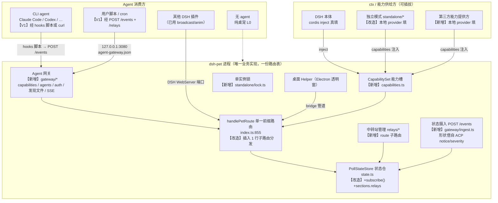
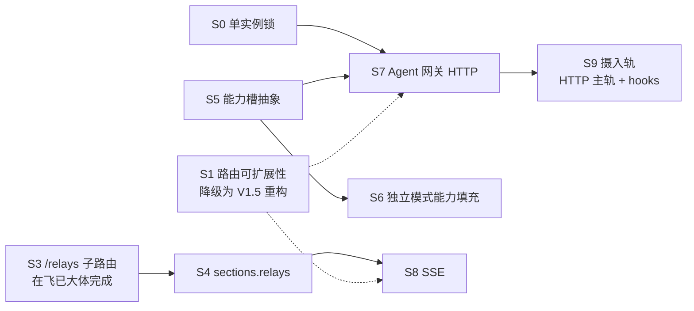

# 宿主无关架构设计：让桌宠适用于所有 agent

> 文档版本：v2.2 ｜ 日期：2026-10-17 ｜ 作者：高见远（Architect）
> 上游基线：`github.com/PC2005-cloud/dsh-pet` v0.3.7（MIT 代码 / **素材禁商用** / **二创须署名 `https://github.com/PC2005-cloud/dsh-pet`**）
> 输入：`docs/PLAN-v1.md`（team-lead 维护）、`docs/06-research-optimization.md`（PM 调研）、`src/host/relays/*`（55 单测已落地）、`src/host/index.ts`、`src/standalone/*`
> **v2.1 变更（ACP 技术裁决）**：新增 §3.8，裁决为**「部分借用」**——借 ACP 的**语义**（`notice`/`severity`/coalesce）与 **Registry 当集成目录**，**不实现 ACP 线上协议**。据此重写 §0 Q1、§2 架构图、§3 Q1、§4.2、§5 S9、§6 R10/U8、§7.2 第 3 条。
> **v2.2 变更（team-lead 对两处分歧的裁决 + 三个端点定级 + S0 层级确认）**：
> ① 新增 **§4.6「`/relays` 子域契约决策：数据直返」**，含边界表与 `API.md`/`openapi.yaml`/`README.md` 的**具体修订文案**；
> ② §3 Q3 补「三个新端点的定级」表（detect=L2 / models 拆 GET=L1+POST=L2 / focus=L2，含争议裁决）；
> ③ §3 Q2 2a 补 **DSH 宿主模式单实例机制的代码级确认（结论：没有）**，发现机制由单文件改为**目录**；§5 S0 相应改写；
> ④ §5 新增**技术债 TD-1**（`handleRelayRoute` 内联，含实测数字与三条触发条件）；
> ⑤ §6 R2/R3 同步更新。
> 纪律：**本轮只做设计与文档，不改任何代码**，不动 `docs/PLAN-v1.md`。

---

## 0. TL;DR

| # | 设计问题 | 结论 |
|---|---|---|
| Q1 | 「agent」是什么 | 四类：**DSH 本体 / CLI agent / 用户脚本 / 无 agent**。接入**三轨**：**HTTP 摄入（`POST /events`）为通用主轨**、**per-agent hooks 为高保真轨**、JSONL tail 为 P2 兜底。**ACP 只借语义与 Registry，不实现其协议**（裁决见 §3.8） |
| Q2 | 发现与握手 | **固定端口 3080（已实现顺延）+ 落 `agent-gateway.json` 发现文件 + 25 端口扫描兜底**；**前置条件：单实例锁**（当前没有，是真缺口）；握手 = `POST /agents/hello` 带 60s TTL 心跳 |
| Q3 | 多 agent 仲裁 | **不搞租约锁，搞「优先级 + TTL」**；优先级直接映射 ACP 的 `notice.severity`；`exclusiveMs` 可短期独占 |
| Q4 | 能力分级 | **L0 在场 / L1 只读 / L2 驱动 / L3 改配置与凭证** 四档 |
| Q5 | 鉴权 | **分域可选 token，默认全关**（现状不变）；只收紧「凭证写入 / 配置写入 / relay CRUD / shutdown」 |
| Q6 | DSH 专属能力隔离 | 收敛成 **`CapabilitySet` 四个可选接口**（`llm` / `credentials` / `account` / `sessionEvents`）；DSH 从 `inject` 填、独立模式从本地 provider 填、**HTTP 摄入轨也可填 `sessionEvents`** |
| Q7 | 状态推送 | **轮询契约不动**，另加 **`GET /state/stream`（SSE）作 opt-in**；**不做 WebSocket** |
| Q8 | 中转站归属 | **桌宠是唯一事实源**，agent 经 API 管；**没有任何端点返回凭证明文**（硬边界） |

**五条最重要的结论**：
1. **PLAN-v1 的 R1–R5 里没有一步把「独立模式变成一等公民」**——目标①在计划中缺任务。本文档补上（§5 的 S0–S9）。
2. **PLAN R3 第一句「把 N 个站点的余额聚合成 `sections.balance`」会破坏既有客户端契约**——必须改为新增 `sections.relays` 叶子（**工程师在飞工作树已按正确做法实现，见 §8**）。
3. **ACP 技术裁决：部分借用（v2.1 修订，详见 §3.8）**。桌宠是**第三方观察者**，而 ACP 的会话由创建它的 client **拥有**——用户在自己终端里跑 Claude Code 时那个终端才是 client，**桌宠无法 attach 一个自己不拥有的会话**；且 ACP client 必须提供 `fs/*`/`terminal/*`/权限审批，桌宠一样都没有。故「ACP 覆盖 40+ agent 零适配」这个好处**对观察者形态不成立**，接 ACP 的动机本身不存在。裁决：**借 ACP 的语义（`notice`/`severity`/coalesce）与 Registry 当集成目录，不实现 ACP 线上协议，桌宠既不做 ACP client 也不做 ACP agent**。
4. **当前没有单实例锁**（`server.ts` 端口顺延会让第二个实例静默绑 3081）——这是我的发现文件设计的**前提缺口**，必须最先补（S0）。
5. **在飞实现已与本文档在三个关键点上一致**（`relayDir` 落点、`sections.relays` 与 `balance` 并存、响应体脱敏自检），分歧点见 §8.2，需 team-lead 拍板 2 处。

---

## 1. 现状盘点（读代码得出，附 文件:行号）

### 1.1 宿主形态：一份路由表，两个「ctx 供给方」

- `src/host/index.ts:126` — `inject = ['webServer','agentDefaultModel','credentials','llm','commands','connection']` —— **桌宠对宿主的全部依赖面**，也是宿主无关改造的天然缝隙。
- `src/host/index.ts:260` — `export function apply(ctx: any): void`
- `src/host/index.ts:855` — `handlePetRoute(rawUrl, method, body?)` —— **单一 if 链分发器**（`:857` 按 `rest` 匹配）
- `src/host/index.ts:238-241` — `type RouteResult`（**文件私有，未 export**）
- `src/host/index.ts:1344-1362` — 唯一注册点 `ctx.webServer.register({kind:'prefix', path: ROUTE_PREFIX, handler})`
- `src/host/index.ts:734-749` — 桌面 Helper 的 `bridgeHandler` **复用同一份 `handlePetRoute`**（业务逻辑只有一份，这是上游最值得继承的设计）

**既有路由（11 个 `rest` 分支）**：`config`(:860)、`pet-display`(:942)、`reload`(:1009)、`config/meta`(:1016)、`models`(:1044，依赖 `ctx.llm`)、`state`(:1086)、`balance`(:1102，依赖 `agentDefaultModel`+`credentials`)、`whisper`(:1112，`ctx.llm`)、`broadcast`(:1136)、`anim`(:1182)、`chat`(:1218，`ctx.llm`)，以及 `thumb/` `font/` `pic/` 素材三分支。

**第二个 ctx 供给方 = 独立模式**（`src/standalone/`）：
- `context.ts:83` `createStandaloneContext()`；`:93-105` `webServer`（收集路由数组）；`:107-181` 其余替身
- `server.ts:21` `DEFAULT_STANDALONE_PORT = 3080`；`:23` `PORT_SCAN_LIMIT = 25`；`:59-62` 前缀匹配；`:110-119` `/`、`/health`、`/shutdown`；`:43-48` **CORS `*`**；`:139-166` **端口顺延（无单实例锁）**
- `shims/{dsh-credentials,dsh-home-paths,dsh-llm}.ts` —— `tsdown.config.mjs` 用 alias 替换三个 `@deepseek-ai/*`

### 1.2 状态仓：单一轮询源 + counter

- `src/host/state.ts:33` — `SectionName = 'balance'|'workStatus'|'notify'`（**在飞工作树已加 `'relays'`**）
- `:37` `PetLeafName = 'say'|'anim'`；`:73` `writeSection`；`:78` `writePet`；`:92` `read`
- `:64-67` counter = `Math.max(Date.now(), last+1)`，**严格单调、重启不回退**（地基；SSE 与 ACP notice 去重都复用它）
- `index.ts:1086-1096` `GET /state` 只读、纯内存、**零副作用**（`:1085` 明确「绝不在这里触发外部调用/模型生成」）

### 1.3 余额链路：单服务商口径

- `balance/index.ts:22` — `BALANCE_PROVIDERS = [opencodeGo, commandCode, deepseekOfficial, deepseekAccount]`
- `balance/index.ts:50-74` — `queryBalance(provider, resolveKey, resolveAccount)`
- `index.ts:610-641` — `refreshBalance()`：单服务商 → `state.writeSection('balance', result)`
- `index.ts:1520-1546` — 余额周期定时器（读 `eventsRefreshSec.balance`，仅当有宠物 `balanceEnabled`）
- `balance/types.ts:104` — `MoneyBalance`（**relays 复用它 → 客户端零改动**，PLAN 判断正确的关键）

### 1.4 独立模式的「明确降级」点（未封装的硬编码）

| 能力 | 降级位置 | 实际表现 |
|---|---|---|
| 余额 | `context.ts:138-140` → `{provider:'standalone',model:''}` → `balance/index.ts:56` 落空 | `sections.balance.data = {ok:false, reason:'unsupported'}` |
| 凭证 | `context.ts:141` `resolve` 恒 `undefined` | `credential-missing` |
| 碎碎念/对话 | `model-selection.ts:36-42` 因 `model===''` 返 `undefined` | `{ok:false, reason:'generate-error'}` |
| 模型清单 | `context.ts:143` `listProviders()` → `[]` | `{providers: []}` |
| 工作状态 | `context.ts:125-128` `on()` 恒 no-op | `sections.workStatus` 保持空闲 |
| 系统通知 | 同上（`:1368`、`:1462` 两个 effect 订阅不到） | `sections.notify` 空 |

> **架构含义**：这些降级不是 bug，而是**未封装的硬编码**——全部长在 `context.ts` 一个文件里，没有任何接口边界。`context.ts:145-169` 自己记录了 0.3.4 因 `stream` 形状错误（返回 Promise 而非 AsyncIterable）导致 unhandled rejection **直接终止进程**的事故。接口化是把「形状对不对」变成可编译期检查的唯一办法。

### 1.5 中转站模块（已落地，55 单测全过）

`types.ts`（契约）、`money.ts`（quota↔金额唯一权威，500000=1USD）、`providers/newapi.ts`（适配器，**未对真实站点实测**，文件末 4 条待实测）、`store.ts`（分文件 + 原子写 + 损坏留存）、`redact.ts`（唯一脱敏出口）、`index.ts`（注册表 + 降级链 + 并发 4 + `selectLowSites` + `aggregateBalances`）。

### 1.6 四个基础设施缺口（本设计要补的）

| # | 缺口 | 位置 | 后果 |
|---|---|---|---|
| G1 | **无单实例锁** | `server.ts:139-166` 端口顺延 | 第二个实例静默绑 3081 → **两个桌宠**；发现文件互相覆盖（§3 Q2 的前提） |
| G2 | **无发现机制** | 无 | agent 只能猜端口；`3080..3104` 扫描会连错进程 |
| G3 | **无能力自描述** | 无 | agent 无法知道「碎碎念能不能用」，只能试错 |
| G4 | **relays `dir` 无调用方** | `store.ts` / `index.ts` 全是注入参数 | PLAN R2 声称「JSON 落盘」实际未接线（**在飞工作树已补：`index.ts:301` `relayDir = join(userRoot,'relays')`**） |

---

## 2. 目标形态



**图例**：【改造】= 动上游代码（§5 全部标出影响面）；【新增】= 全新文件，上游零改动。

**四条关键不变式**：
1. **一份路由表**：`handlePetRoute` 仍是唯一业务实现；桌面 Helper bridge 管道与 HTTP 两端天然一致（继承 `index.ts:8-13` 硬契约）。
2. **数据只有一个出口**：`GET /state`（`API.md` 约定一）。SSE 只是同一出口的推送形态。
3. **动作端点不返回数据**（`API.md` 约定二）——**但见 §8.2 分歧 1，在飞实现已在 `/relays/{id}/refresh` 上破了例，需拍板**。
4. **绝不伪造数据**：查不到余额就 `ok:false`，不返回 0（`relays/index.ts:6-9` 铁律，新端点必须延续）。

---

## 3. 七个设计问题：逐条设计与取舍

### Q1 「agent」到底指什么？各自的接入方式（v2.1 修订）

**推荐方案：四分法 + 三轨摄入（HTTP 主轨 / per-agent hooks 高保真轨 / JSONL tail 兜底）；ACP 只借语义，不接协议。**

| 类别 | 例子 | 接入方式 | 轨 |
|---|---|---|---|
| **A. DSH 本体** | DeepSeek Harness 宿主 | cordis `inject`（`index.ts:126`），不经 HTTP | — |
| **B. CLI agent** | Claude Code / Codex / Cursor / Gemini CLI… | **hooks**：装一个 hook 脚本，事件来时 `curl` 我们的 `POST /events` | **hooks 轨（V1）** |
| **C. 用户脚本 / Registry 之外的 agent / 其他插件** | cron、巡检脚本、自研 agent | **HTTP**：`POST /events` 摄入状态 + `/relays` 管资产 + `/broadcast` 驱动气泡 | **HTTP 主轨（V1）** |
| **D. 无 agent** | 就养只鱼 | 不调 API，独立模式 L0 | — |

**为什么不接 ACP 的线上协议**：见 §3.8 完整裁决。一句话——**桌宠是第三方观察者，ACP 会话归 client 所有，桌宠既无法也不应该拥有会话**；「40+ agent 零适配」的好处只对「client 且由它 spawn agent」的形态成立，对观察者不成立。

**为什么不自建 JSONL 总线作为主轨**：JSONL tail 是「没有更好办法时的办法」——它依赖读别人的文件格式，格式一变就废，且要处理字节偏移、半行缓冲、不回放历史一堆坑（PM C3 列了规格）。它只配做 P2 兜底。

**备选（否决）**：
- **ACP 优先（实现 ACP client/agent）**：否决——§3.8.1 逐条论证。形态不匹配 + 产品漂移（桌宠变编排器，违反 Non-Goal）+ 依赖与常驻子进程成本。
- **给每类 agent 做专用 SDK / 专用端口**：否决——违反「一份路由表」纪律，立刻出现第二套实现；且 `ECOSYSTEM.md` 里已有项目（`dsh-whale-pet`、`dsh-pet-component`）就是裸 HTTP 消费方，加 SDK 对它们是纯负担。
- **只做 hooks 不做 HTTP**：否决——hooks 要逐个 agent 装，覆盖不了「任意脚本」这个最基本场景。

---

### Q2 发现与握手；多 agent 同时在场怎么办

#### 2a. 发现（三层，逐层降级；**前置：单实例锁**）

**🔴 前置缺口 G1：当前没有单实例锁。** `server.ts:139-166` 端口被占就顺延——第二个实例会**静默绑 3081**，于是桌面上出现两只桌宠，且两个实例会互相覆盖 `agent-gateway.json`。**发现文件设计在这一格不补的情况下不成立。**

**DSH 宿主模式下有没有单实例机制？—— 读代码确认：没有（本仓库可见范围内）。** 证据五条：
1. `cordis.patch.yml` 只声明插件挂载（`insert` 一行 entry），**无任何实例约束**；
2. `package.json` 的 `peerDependencies` 里**没有** single-instance 相关包；
3. `apply(ctx)` 在**每个加载它的 DSH 进程**里各跑一份。`index.ts:147` 的注释明确 DSH 有两种宿主形态（DSH Desktop 以 `ELECTRON_RUN_AS_NODE=1` 跑宿主、`dsh web` 是纯 Node），**两者是不同进程、各自持有不同的 `ctx.webServer.port`** → **端口不冲突，但会是两个桌宠实例**（各自的 `PollStateStore`、各自的定时器、**各自 spawn 自己的 Electron Helper**）；
4. 仓库里唯一的单实例锁属于 **DSH 桌面应用自己**——`open-target.test.ts:13-14` 提到 `claimDesktopSingleInstance(app, () => focusPrimaryWindow())`，**那是 DSH 自有代码、不在本仓库**，且只被 `dsh://open` 协议间接触达。**本仓库的 Electron Helper 自己没有 `requestSingleInstanceLock`**（grep `runtime/electron-helper/main.js` 仅命中 `:799` 的注释）；
5. `standalone/server.ts:139-166` 明确无锁、端口顺延。

**结论：锁加两层，形态不同，且都不与 DSH 打架：**

| 层 | 手段 | 为什么是这个形态 |
|---|---|---|
| **独立模式** | **硬锁**：`O_EXCL` 锁文件 + pid 存活校验 | 我们完全控制 `cli.ts` 的启动；用户把 CLI 跑第二次**无歧义是错的**，必须拒绝而不是静默起第二只 |
| **DSH 模式** | **不加硬锁**，改为「按实例分文件的发现目录 + 读方 pid 活性校验」的**软仲裁** | DSH 下「两个宿主进程」**可能是用户合法选择**（同时跑 `dsh web` 与 Desktop，或 Desktop + standalone）；硬锁会误杀。且我们无法验证 DSH 自己何时会起多个宿主，误判代价高 |

**因此发现机制从「单文件」改为「目录」**：`$DSH_HOME/dsh-pet/gateways/<pid>.json`（每个实例一个小文件）。收益：① 天然支持多实例，**无写覆盖竞争**；② 停机自清（删前校验 `pid === process.pid`）；③ 残留文件可由读方按 pid 活性识别；④ agent 可同时看到 DSH 模式与独立模式的两个桌宠并自选连哪个。

**备选（否决）**：
- **mDNS/Bonjour**：否决——Windows 不保证有 Bonjour；会向局域网广播「这台机器有个桌宠」，与「请勿转发到公网」姿态相反；引入常驻依赖。列 P2。
- **Windows 注册表 / 命名管道**：否决——注册表要权限，命名管道 Windows-only，与跨平台预留冲突。
- **只靠固定 3080**：否决——`server.ts` 明确会顺延，端口不固定，agent 会连错进程。

#### 2b. 握手与在场（TTL 心跳，不做锁）

```http
POST /dsh-pet-7340/agents/hello
{ "agentId": "claude-code@devbox", "kind": "cli-agent", "wants": ["pet:drive","relays:read"] }
→ 200 { "ok": true, "leaseId": "...", "ttlSec": 60, "granted": ["pet:drive","relays:read"] }
```
- **TTL 60s，心跳 = 重复调同一端点**。服务端只维护内存 Map，**不落盘、不鉴权（L0）**。
- `GET /dsh-pet-7340/agents` → 在场列表（L1）。**这同时回答了「多 agent 在场怎么办」的前半：先让它们能互相看见。**

#### 2c. 仲裁：优先级 + TTL，不搞租约

**推荐方案：给 `/broadcast`、`/anim` 加可选字段，语义是「抢占」而非「独占」；优先级直接映射 ACP 的 `notice.severity`。**

| 端点 | 新增可选字段 | 语义 |
|---|---|---|
| `POST /broadcast` | `priority?: number`（默认 0）、`ttlMs?: number`（默认 3000）、`agentId?: string`、`coalesceKey?: string` | 保留 **priority 最高且未过期**的气泡；同 `coalesceKey` 的 notice **合并**（不重复弹——这正是 ACP Session Notices RFD 对 client 的建议） |
| `POST /anim` | `priority?: number`、`exclusiveMs?: number`（默认 0） | `exclusiveMs > 0` 时该窗口内忽略更低优先级点播 |

**severity → priority 映射（形状借自 ACP Session Notices RFD；HTTP 摄入轨从 V1 就用这张表，不搞两套）**：

| ACP `notice.severity` | priority | 桌宠表现 |
|---|---|---|
| `info` | 0 | 普通气泡，3s 淡出 |
| `warning` | 10 | 忧虑表情 + 气泡 |
| `error` | 20 | 慌张表情 + 托盘变红 + 气泡 |

**为什么不用租约锁**：
- **兼容性**：现有生态（`ECOSYSTEM.md` 一批项目）是 fire-and-forget 调 `/broadcast`；强制 lease 会让它们全部 4xx。加可选字段对旧调用方**零影响**。
- **必要性**：气泡本来就只有一条槽（`state.ts:37` `PetLeafName='say'` 单槽）。两个 agent 同时说话，业务上合理的解是「谁优先级高谁说话」。
- **复杂度**：锁要处理死锁、续租、崩溃恢复；TTL 抢占全都不需要。

**备选（否决）**：全局单写者锁（`POST /agents/lease`，拿不到 409）。否决理由即上述三条；且会制造「A agent 卡住 → 桌宠永久哑巴」的故障模式。

---

### Q3 能力分级

**推荐方案：四档，按「能不能造成不可逆损害」切，不按读写切。**

| 档 | 名称 | 开放端点 | 默认鉴权 |
|---|---|---|---|
| **L0** | 在场 | `GET /capabilities`、`POST /agents/hello`、`GET /health` | 无 |
| **L1** | 只读 | `GET /state`、`GET /state/stream`、`GET /relays`、`GET /relays/{id}`、`GET /relays/{id}/balance`、`GET /relays/models`、`GET /agents`、`GET /config`、`GET /config/meta`、`GET /models`、`GET /chat` | 无（可收紧） |
| **L2** | 驱动 | `POST /broadcast`、`POST /anim`、`POST /balance`、`POST /relays/refresh-all`、`POST /relays/focus`、`POST /relays/detect`、`POST /relays/{id}/refresh`、`POST /relays/{id}/health`、`POST /relays/{id}/models`、`POST /pet-display`、**`POST /events`（摄入）** | 无（可收紧） |
| **L3** | 改配置与凭证 | `PUT /config`、`POST /config`、`POST /reload`、`POST /relays`、`PUT /relays/{id}`、`DELETE /relays/{id}`、`PUT /relays/{id}/credential`、`DELETE /relays/{id}/credential`、`POST /shutdown` | **可选 token 主要为这一档设计** |

**为什么不按读/写两档分**：`POST /relays/refresh-all` 是写动作但无害（最坏多打几次站点）；`DELETE /relays/{id}` 不可逆。风险差一个量级，合成一档会导致「为了防删除而把刷新也锁上」，个人自用立刻变难用。

**三个新端点的定级（team-lead 指定，含两个争议项裁决）**：

| 端点 | 定级 | 理由 |
|---|---|---|
| `POST /relays/detect` | **L2** | 它让桌宠向**调用方任意指定的 URL** 主动发请求。**定级轴是「是否驱使桌宠对外行动」，不是「读还是写」**——所以它与已存在的 `POST /relays/{id}/health`（L2）同级，**确实该比 L1 严一级**，team-lead 的直觉对。它与 `/health` 的差别只在于「探的是调用方现给的 URL 而非用户已注册的站」，但两者后果同类（一次只读 GET，不改站点任何状态、不耗业务额度），故**同级而非更严**。 |
| `GET /relays/models` | **L1** | **只读缓存矩阵**：零网络、零凭证、零副作用。它与实时抓取刻意拆成两级——读路径便宜且安全，动作路径才门控。这个拆分与 `/health` 的 GET（读缓存）/ POST（实时探测）完全同构。 |
| `POST /relays/{id}/models`（**新增**，实时抓取） | **L2** | 带凭证向第三方站点发请求，与 `POST /relays/{id}/refresh`（L2）同级——「携凭证外发」在本表里就是 L2 的口径。 |
| `POST /relays/focus` | **L2** | **「写持久化」不是定级依据，「是否不可逆 / 高影响」才是。** focus 改的是一个展示偏好字段，用户一键可改回；最坏后果是「气泡聚焦的站不是你想要的」——**困惑而非损害**。**上游先例（决定性）**：`POST /pet-display`（`index.ts:991` 写用户配置文件 + `:997` 触发 `syncDesktop()` 重启 Helper）同样是持久化写 + 进程重启副作用，仍归 L2。若把 focus 提到 L3，就必须把 `/pet-display` 也提到 L3，否则定级自相矛盾。 |

> **方法说明**：这两条争议（detect 的网络副作用、focus 的持久化写）都指向同一个易错点——**把「有副作用」误当成「高级别」**。正确的轴是「**最坏后果是否不可逆**」：detect 的最坏后果是一次可重复的只读请求（可逆）；focus 的最坏后果是显示错一个站（可逆）；删站点/改凭证/改配置结构的最坏后果是数据或权限丢失（不可逆）。按这个轴，三者分别落在 L2/L2/L3，自洽。

**`GET /capabilities` 响应（分级表的机器可读形态）**：
```json
{
  "schema": 1, "mode": "standalone", "routePrefix": "/dsh-pet-7340", "instanceId": "<uuid>",
  "tiers": { "L0": ["/capabilities","/agents/hello","/health"],
             "L1": ["/state","/state/stream","/relays","/relays/{id}","/relays/{id}/balance","/relays/models","/agents"],
             "L2": ["/broadcast","/anim","/balance","/relays/refresh-all","/events"],
             "L3": ["/config","/reload","/relays","/relays/{id}","/relays/{id}/credential"] },
  "hostCapabilities": { "llm": false, "credentials": "local-file", "account": false, "sessionEvents": "http|dsh|none" },
  "relayKinds": ["new-api"],
  "sseMaxConnections": 8,
  "tokenRequired": false
}
```
`hostCapabilities` 是 Q5 `CapabilitySet` 的对外投影——**agent 看一眼就知道「碎碎念能不能用」**，不需要试错。

---

### Q4 鉴权：要不要 token？放哪？怎么不把个人自用搞得难用

**推荐方案：分域可选 token，默认全关。**

- **默认**：与现状完全一致——**无 token**。只监听 `127.0.0.1`（`server.ts:153`），威胁模型是「本机其他进程/同一用户」，与 DSH 自身口径一致（`API.md:8`「没有鉴权…请勿转发到公网」）。给个人自用加强制 token = 每个 agent 都要先找文件读 token，纯负担。
- **收紧**：仅对 **L3 域**（+ 可选 L1/L2）提供开关。开启后该域要求 `Authorization: Bearer <token>`，未带/带错 → `401 {error:'unauthorized', domain:'relays:write'}`。
- **token 来源三层，按宿主形态自动选，用户不用选**：
  1. **DSH 模式**：`ctx.credentials.resolve(credentialRef('DSH_PET_AGENT_TOKEN'))`（`index.ts:617` 已有通路，**零新增机制**）；
  2. **独立模式**：本机文件 `<DSH_HOME>/dsh-pet/agent-token.json`，`0600`，首次启用时生成（`crypto.randomBytes(32).toString('base64url')`）；
  3. **环境变量** `DSH_PET_AGENT_TOKEN`（CI/容器场景，优先级最高）。
- 发现文件带 `tokenRequired`，agent 在 hello 时就知道要不要去取。

**备选（否决）**：
- **全局 Bearer token**：否决——破坏现有生态全部调用方。
- **每 agent 独立 token + 权限矩阵**：否决——需要签发/吊销/存储，个人工具过度设计，且与「本机即信任边界」重复。
- **首次弹窗授权**：否决——独立模式没有可用的模态 UI 入口（桌宠是透明窗，设置页只在 DSH 里有），会退化成「写个日志让用户自己去看」。
- **HMAC 签名 + nonce 防重放**：否决——威胁模型（本机进程）不需要。

---

### Q5 DSH 专属能力怎么隔离成可选能力接口

**推荐方案：新增 `src/host/capabilities.ts`，把 `ctx` 上四个 DSH 专属服务收敛成 `CapabilitySet`；`apply(ctx)` 签名加一个可选参数。**

```ts
// src/host/capabilities.ts（新增）
export interface PetLlmGateway {                       // ← 现在的 ctx.llm
  listProviders(): Array<{ id: string; name: string }>;
  listModels(provider: string): Promise<Array<{ id: string; name: string }>>;
  stream(options: unknown): AsyncIterable<unknown>;    // 契约必须是 AsyncIterable（context.ts:171 的血泪）
  resolveModelInfo?(provider: string, model: string, signal?: AbortSignal): Promise<unknown>;
}
export interface PetCredentialVault {                  // ← 现在的 ctx.credentials
  resolve(ref: unknown): Promise<{ value?: string } | undefined>;
}
export interface PetAccountService {                   // ← 现在的 ctx.deepseekAccount（软取）
  getBalance(meta: unknown): Promise<AccountBalanceSnapshot | null | undefined>;
}
export interface PetSessionEvents {                    // ← 现在的 ctx.on('session/event')
  on(channel: string, handler: (session: unknown, event: unknown) => void): () => void;
}
export interface CapabilitySet {
  llm?: PetLlmGateway;
  credentials?: PetCredentialVault;
  account?: PetAccountService;
  sessionEvents?: PetSessionEvents;
}
export function capabilitiesFrom(ctx: Record<string, unknown>): CapabilitySet;
/** 能力缺失的统一口径（绝不假装成功） */
export function capabilityMissing(what: string): { ok: false; reason: 'capability-missing'; message: string };
```

**四个关键设计点**：
1. **缺失 = 显式 `capability-missing`，与 `unsupported` / `provider-missing` 区分开**。现在独立模式把「没有模型」和「这个服务商不支持」混成一个 reason，用户分不清。分开后 `GET /capabilities` 的 `hostCapabilities.llm === false` 一眼可判。
2. **`sessionEvents` 有三个可能来源，按优先级只用一个**：DSH 会话事件 > `POST /events` HTTP 摄入 > 无。**互斥**（避免六档工作状态被两个源同时改写而抖动）。DSH 在场时 HTTP 摄入只写气泡、不写档位。
3. **`apply(ctx, overrides?)` 只加可选参数**，不动 `inject`（`cordis.patch.yml` 不用改，DSH 装不上就直接起不来的风险为零）。
4. **独立模式从「硬降级」变成「可填充」**：`context.ts` 加 `capabilities?: Partial<CapabilitySet>` 选项；新增 `standalone/providers/`：
   - `local-llm.ts` —— 让独立模式的 `llm.stream` **指向用户自己的某个中转站**（复用 `relays/store.ts` 取凭证 + newapi 的 `/v1/chat/completions`）。这是「独立模式也能被别的 agent 填上」的具体落地路径，且天然符合 Q8 凭证边界（凭证不出本机）。
   - `session-events-http.ts` —— 把 `POST /events` 摄进来的事件喂给 `sessionEvents`（V1 唯一摄入来源）。
   - `local-account.ts` —— 预留，返 `capability-missing`。

**备选（否决）**：
- **维持 `context.ts` 硬编码替身只加注释**：否决——那正是现在的问题（0.3.4 崩溃根因）。接口化是唯一办法。
- **为每个能力做一个 cordis 插件**：否决——能力提供方是进程内对象不是插件；且 cordis 插件只能由 DSH 加载，独立模式用不上。
- **把 llm 从桌宠去掉**：否决——碎碎念是产品人设，去掉等于砍功能。

---

### Q6 状态推送：轮询 / SSE / WebSocket

**推荐方案：轮询契约不动（基线），新增 `GET /state/stream`（SSE）作 opt-in。**

**为什么轮询必须留着**：`/state` 是 1s 轮询的既有契约（`API.md` 约定一二三、`state.ts` counter 语义），浏览器端 + 桌面端 + 第三方全在用。改它就是 breaking change。

**为什么加 SSE**：对「所有 agent」来说 1s 轮询在 agent 数量上去后线性放大请求量（桌面端本来就 N 请求/秒，`state.ts:5-7`）。SSE 让「只在变化时醒」成为可能，且：
- **SSE 是纯 HTTP**：复用现有 prefix route handler 契约（handler 自己写 `res`），**不需要动传输层**。
- **counter 直接当 SSE 的 `id:` 用**（`state.ts:64-67` 的单调性正好服务断线重连的 `Last-Event-ID`），**零新概念**。

**实现要点（含坑）**：
- `PollStateStore` 加 `subscribe(fn): () => void`（**纯新增方法，不影响现有行为**）。
- **必须合并写入**：一次刷新会写 N 个叶子（`index.ts:629` + relays 叶子），裸订阅会发 N 帧。用 **microtask + 50ms 去抖**合成一帧，帧体 = `read()` 全量（省得做 diff）。
- 连接数上限 **8**（`/capabilities` 里暴露 `sseMaxConnections`），超出 `429`。
- `server.ts:183` 的 `closeAllConnections()` 已能处理停机时挂住的 SSE 连接，**不需要改**。

**备选（否决）**：
- **WebSocket**：否决——① upgrade 要 hijack socket，而 DSH WebServer 是不受控的前缀路由宿主，hijack fragile；② 上游 `tsdown.config.mjs` 把 `node:*` 外部化但无 ws 依赖，加依赖要动依赖树；③ SSE 已满足「变化时醒」，WS 的双向性没有场景（agent 动作走 POST）。
- **长轮询**：否决——比 SSE 多一层超时重连，收益相同。
- **完全切推送、废轮询**：否决——破坏生态，且桌面 Helper 的 bridge 管道不走 HTTP（`index.ts:734`），推不走。

---

### Q7 中转站管理与「agent」的关系；凭证边界

**推荐方案：桌宠是唯一事实源，agent 经 API 管理；凭证只进不出。**

| 维度 | 决策 |
|---|---|
| **数据归属** | `relays/store.ts` 是**唯一事实源**（`relays.json` + `relay-credentials.json`）。agent 不持有副本，只经 API 读写。 |
| **谁来管** | **两者皆可，写入按 Q3 的 L3 门控**。个人用户经设置页/API 管；CLI agent 可自动登记它发现的中转站（省用户手输），**默认关**，需显式开启（未定项 U1）。 |
| **凭证写入** | `PUT /relays/{id}/credential`（L3）。写入即进 `store.ts` 原子写流程，**响应只回脱敏摘要**（`types.ts:82` `RelaySiteView`）。 |
| **凭证读取** | **没有任何端点返回凭证明文。** 硬边界。 |

**凭证边界为什么这样划（必须写进 README）**：
- 桌宠是**本机常驻进程**。若提供「读明文」的 HTTP 端点，等于给本机**任何**进程开一个凭证 oracle——包括浏览器里打开的任意网页（`server.ts:43-48` 的 CORS 是 `*`）。这与「AccessToken ≈ 账户权限」的风险等级完全不匹配。
- 用户确实需要「拿 key 去 Cherry Studio 用」——走**剪贴板/手动复制**（设置页），不走 API。
- **诚实的限度**：独立模式凭证目前是 **0600 明文文件**（PLAN Q1），同机进程本来就能读文件。所以这条边界是**纵深防御**，不是安全保证。真正的修复见 U2。

**备选（否决）**：
- **凭证完全由 agent 管，桌宠只存引用**：否决——桌宠是唯一常驻进程，agent 会退出；让短命进程管长期凭证，丢失率极高。
- **提供 `GET /relays/{id}/credential` 返明文**：否决——见上。
- **relay 数据由 agent 推送、桌宠不落盘**：否决——违反「本地优先」与 PLAN R2，桌宠重启就全丢。

---

### 3.8 ACP 技术裁决（team-lead 指定议题，v2.1 新增）

**裁决：部分借用 —— 借 ACP 的「语义」与「Registry 目录」，不实现 ACP 的「线上协议」。三选一里明确选「部分借用」。**

#### 3.8.1 形态匹配性：桌宠应该做 ACP 的哪一端？

先把 ACP 的角色定义摆清楚（依据 `agentclientprotocol.com` 与 PM 调研 C1 的一手描述）：

- **client**（编辑器 / IDE，如 Zed）：**拥有会话**。负责 spawn agent 子进程、发 `session/prompt`、提供 `fs/read_text_file` / `fs/write_text_file` / `terminal/*` 介质、响应 `session/request_permission`。
- **agent**（CLI，如 Claude Code）：干活的。消费 prompt、调工具、经 `session/update` 流式上报进度。

桌宠的真实角色是**第三方观察者 + 被驱动方**：它不想拥有会话，不想提供 fs/terminal，更不想发 prompt。逐条对照两个方向：

| 方案 | 桌宠角色 | 成立？ | 理由 |
|---|---|---|---|
| **A. 桌宠作 ACP client，spawn `claude-agent-acp` 等适配器** | client | ❌ **不成立** | ① **会话所有权（决定性）**：ACP 会话由创建它的 client 拥有。用户**在自己的终端里**跑 Claude Code 时，那个终端才是 client——**桌宠无法 attach 一个自己不拥有的会话**（base 协议无 attach/subscribe 原语；**[未验证，需查 ACP schema 确认]**）。② **client 义务**：client 必须实现 `fs/*`、`terminal/*`、`session/request_permission`——桌宠一样都没有，空实现会让 agent 行为异常。③ **产品漂移**：桌宠发 `session/prompt` = 桌宠变成编排器，直接违反 PRD Non-Goal「不做 LLM 聊天客户端」。④ **资源**：多一个常驻 Node 子进程。 |
| **B. 桌宠作 ACP agent，外部驱动方作 client** | agent | ❌ **不成立** | ① **范畴错误**：桌宠不是 LLM agent，不会消费 prompt 去调模型；把它注册成 agent 是语义造假。② **启动模型冲突**：ACP 要求 client spawn agent 子进程，而桌宠是长驻桌面应用——被任意编辑器 spawn 与它的生命周期矛盾。③ **无先例**：PM 调研的 Registry 40+ agent 全是真 agent，未发现任何「非 agent 作 ACP agent」的案例。 |
| **C. 部分借用** | 都不是 | ✅ **采纳** | 借两样、不碰协议：**语义**（`notice` + `severity` + coalesce）与 **Registry 当集成目录**。 |

**结论：桌宠既不该做 ACP client，也不该做 ACP agent。**

#### 3.8.2 「40+ agent 零适配」这个好处，对桌宠不成立

必须把话说透，否则会反复：**「ACP 覆盖 Registry 40+ agent、零适配成本」只对「ACP client 且由它 spawn agent」的形态成立。** 桌宠是观察者，拿不到这个好处——所以「为了 40+ agent 而接 ACP」的**动机本身就不存在**。剩下真正有价值的是两件零成本的事：

1. **借语义（立刻做，V1 就生效）**：ACP Session Notices RFD 定义的 `sessionUpdate: "notice"` + `severity: info|warning|error` + 「client 应对重复 notice 做 coalesce」——**这正是我们余额告警气泡的协议层原型**。`POST /events`（§4.2）原样采用这套字段。好处：① 任何按 ACP 语义发通知的 agent **无需改造**就能对接；② 将来若前提条件满足真接 ACP，映射函数一行不用改。
2. **借 Registry 当集成目录（文档层，零运行时成本）**：Registry 告诉我们「有哪些 agent、各自怎么分发」，用来决定**优先给哪几个 agent 写 hooks 集成文档**。这是调研输入，不是依赖。

#### 3.8.3 不接 ACP，「适用于所有 agent」靠什么

靠 PM C2 的四条摄入腿，按性价比排序（这也是对 Q1 三轨的展开）：

| 腿 | 覆盖 | 成本 | 取舍 |
|---|---|---|---|
| **④ 自定义 HTTP 端点** | **任意 agent**（一个 `curl`） | 极低 | **V1 主轨** = `POST /events`（§4.2） |
| **② hooks** | Claude Code（15 个 hook 事件）、Codex、Cursor、Gemini CLI | 低（装个 hook 脚本，事件来时 curl 我们） | **V1 优先做 Claude Code + Codex 两个**，附安装脚本与文档 |
| **① JSONL session 文件 tail** | 写会话日志的 agent（OpenClaw 类） | 中 | **P2 兜底**；若做，按 PM C3 规格：字节偏移增量 tail、**不回放历史**、半行缓冲不丢、单次读有界 64KB、pending owners 有界 32、隐藏即停 |
| **③ plugin** | 有插件系统的宿主（opencode / Hermes） | 中 | **P2**，按宿主逐个评估 |

#### 3.8.4 将来仍要接 ACP 的四个前置条件（全部满足才重开）

避免反复重开此题，条件写死：
1. ACP schema 里确认存在「attach / subscribe 他人会话」的原语（**[未验证]** —— 需查 `agentclientprotocol/agent-client-protocol` 的 schema/unstable 段）；
2. 桌宠愿意承担 client 义务的最小子集，且声明不支持 `fs/*`/`terminal/*` 时 agent 不因此坏掉；
3. 产品明确接受「桌宠可 spawn agent」的范围（否则仍是 Non-Goal 冲突）；
4. 官方 TS SDK 的依赖树与打包体积实测可接受（见 3.8.5）。
**四条不全满足就不做。**

#### 3.8.5 接入成本实测口径（避免拍脑袋，本轮未跑）

需要工程师跑几条命令拿真实数字（**[未验证]**）：
```bash
npm view @agentclientprotocol/sdk dependencies dist.unpackedSize time.modified
# 或 bundlephobia 查打包体积
```
判据：① 若拖入 zod 等重量传递依赖 → 与上游「`tsdown.config.mjs` 把 `@deepseek-ai/*` 外部化、**其余全部打进 `lib/`**」的纪律冲突，`lib/` 体积会涨；② 常驻多一个 Node 子进程（约 30–60MB RSS，**[未验证，量级估计]**）。任一条不过，即维持 3.8.4 的结论。

---

## 4. 接口契约草案（OpenAPI 风格）

> 全部挂既有 `ROUTE_PREFIX = '/dsh-pet-7340'` 下，**不改前缀、不改传输、不动 `openapi.yaml` 既有 path**。新增 path 需并入 `openapi.yaml`（`scripts/check-openapi.mjs` 已有校验，必须同步）。

### 4.1 能力自描述与在场

```yaml
/dsh-pet-7340/capabilities:
  get:
    summary: 桌宠能力自描述（L0，无鉴权，零副作用）
    responses:
      '200':
        content:
          application/json:
            schema:
              type: object
              required: [schema, mode, routePrefix, instanceId, tiers, hostCapabilities, relayKinds, tokenRequired]
              properties:
                schema: { type: integer, const: 1 }
                mode: { type: string, enum: [standalone, dsh] }
                routePrefix: { type: string, example: /dsh-pet-7340 }
                instanceId: { type: string }
                tiers: { type: object }                       # L0..L3 → 端点数组
                hostCapabilities:
                  type: object
                  properties:
                    llm:           { type: boolean }
                    credentials:   { type: string, enum: [none, dsh, local-file] }
                    account:       { type: boolean }
                    sessionEvents: { type: string, enum: [none, http, dsh] }
                relayKinds: { type: array, items: { type: string } }
                sseMaxConnections: { type: integer }
                tokenRequired: { type: boolean }

/dsh-pet-7340/agents/hello:
  post:
    summary: 在场登记 + 心跳（L0）。TTL 60s，重复调用即续期
    responses:
      '200': { description: '{ ok, leaseId, ttlSec, granted, tokenRequired }' }

/dsh-pet-7340/agents:
  get:
    summary: 在场 agent 列表（L1）。不返回 token、不返回 agent 环境信息
    responses:
      '200': { description: '{ agents: [{agentId, kind, lastSeenAt, expiresAt}] }' }
```

### 4.2 状态摄入（HTTP 轨的核心；**形状借自 ACP Session Notices，但不实现 ACP 协议**）

```yaml
/dsh-pet-7340/events:
  post:
    summary: |
      agent 状态摄入（L2）。一个 curl 就能接入任意 agent —— 这是「适用于所有 agent」
      最便宜的兜底。notice 的 severity/coalesceKey 语义**借自 ACP Session Notices RFD**
      （裁决见 §3.8：只借语义，不实现 ACP 协议），因此按 ACP 语义发通知的 agent 无需改造。
    requestBody:
      required: true
      content:
        application/json:
          schema:
            type: object
            required: [agentId]
            properties:
              agentId:    { type: string, maxLength: 128 }
              sessionId:  { type: string }
              # 二选一或都给：status 驱动六档工作状态；notice 驱动气泡
              status:
                type: string
                enum: [idle, thinking, working, waiting-approval, done, error]
              notice:
                type: object
                required: [severity, text]
                properties:
                  severity:     { type: string, enum: [info, warning, error] }
                  text:         { type: string, maxLength: 500 }
                  coalesceKey:  { type: string, maxLength: 128 }
                  ttlMs:        { type: integer, default: 3000 }
    responses:
      '200':
        description: |
          '{ ok: true }'。数据不在这里回——按 API.md 约定二，写进 S：
          status → sections.workStatus；notice → pets.<id>.say
      '200 (动作失败)': { description: '{ ok: false, reason, message }' }
```

**摄入与 DSH 会话事件的互斥规则**：`sessionEvents` 能力**已被 DSH 填上时**，`POST /events` 的 `status` 段**被忽略**（只处理 `notice`），避免六档档位被两个源同时改写而抖动。`/capabilities` 的 `hostCapabilities.sessionEvents` 会告诉 agent 当前是哪个源。

### 4.3 中转站（`/relays`）

> **命名以在飞实现为准**（见 §8）：工程师已落地 `POST /relays/refresh-all`、`POST /relays/{id}/refresh`、`POST /relays/{id}/health`、`POST /relays/{id}/manual-balance`。下列契约与它对齐，**并标注 3 个待补端点**。

```yaml
/dsh-pet-7340/relays:
  get:
    summary: 站点列表（L1）。只返 RelaySiteView，凭证以掩码出现
    parameters:
      - { name: q,       in: query, schema: { type: string } }
      - { name: sort,    in: query, schema: { type: string, enum: [name, balance-asc, balance-desc, updated] } }
      - { name: enabled, in: query, schema: { type: boolean } }
    responses: { '200': { description: '{ ok: true, sites: RelaySiteView[] }' } }
  post:
    summary: 新建站点（L3）。body = SiteInput + 可选 credential
    responses: { '200': { description: '{ ok: true, site: RelaySiteView }' }, '400': { description: '{ error }' } }

/dsh-pet-7340/relays/{siteId}:
  get:    { summary: 单站详情（L1） }
  put:    { summary: 更新站点（L3，可同时更新凭证） }
  delete: { summary: 删除站点并删凭证（L3） }

/dsh-pet-7340/relays/{siteId}/credential:
  put:    { summary: 写凭证（L3）。响应只回脱敏摘要，绝不回明文 }
  delete: { summary: 清凭证（L3） }

/dsh-pet-7340/relays/{siteId}/balance:
  get:
    summary: 单站余额（L1）。查不到返 ok:false + reason，绝不返 0
    responses: { '200': { description: RelayBalanceResult } }

/dsh-pet-7340/relays/{siteId}/refresh:
  post: { summary: 刷新该站余额（L2）→ RelayBalanceResult }

/dsh-pet-7340/relays/refresh-all:
  post: { summary: 并发刷新全部启用站点（L2）→ RelayBalanceResult[] }

/dsh-pet-7340/relays/{siteId}/health:
  get:  { summary: 最近一次探测结果（L1，读缓存不发请求） }
  post: { summary: 主动探测（L2）→ RelayHealthResult }

/dsh-pet-7340/relays/{siteId}/manual-balance:
  post: { summary: 设置/清除手工余额（L3）。空 amount = 清除（撤销降级） }

# ---- 三个补充端点（team-lead 已裁决「全部补」；detect/focus 对应用户原话诉求）----
# 定级依据见 §3 Q3 的「三个新端点的定级」表
/dsh-pet-7340/relays/detect:
  post:
    summary: |
      站点类型识别（L2，不落库）。**会让桌宠向调用方给定的 URL 主动发只读探测请求**，
      故与 /relays/{id}/health 同级，不归 L1。
    requestBody: { required: true, content: { application/json: { schema: { type: object, required: [url] } } } }
    responses:
      '200':
        description: '{ kind, confidence, evidence[], next }'
        content:
          application/json:
            schema:
              type: object
              properties:
                kind:       { type: string, enum: [new-api, sub2api, openai-compat, unknown] }
                confidence: { type: number }
                evidence:   { type: array, items: { type: string } }   # 命中了哪些端点（可解释）
                next:       { type: string }                           # 识别失败时的可操作下一步（禁止静默失败）

/dsh-pet-7340/relays/models:
  get:
    summary: |
      跨站模型矩阵（L1）。**只读缓存，零网络零凭证**——实时抓取走 POST /relays/{id}/models（L2）。
    responses:
      '200':
        description: '{ models: [{ modelId, canonicalId, sites[], missing[] }] }'
        # missing 明确列「不可用」的站点，而非不列出（用户原话痛点就是「可用模型不方便管理」）

/dsh-pet-7340/relays/{siteId}/models:
  post:
    summary: 实时抓取该站模型清单（L2）。带凭证向第三方站点发请求，与 /refresh 同级
    responses: { '200': { description: '{ ok, siteId, models: string[] }' } }

/dsh-pet-7340/relays/focus:
  post:
    summary: |
      设焦点站点（L2）。**不做请求转发**，只影响展示口径（余额气泡/汇总聚焦哪个站）。
      用 POST 而非 PUT：与本子域既有动作端点（/refresh-all、/manual-balance）的 POST 约定一致。
    responses: { '200': { description: '{ ok: true, focusSiteId }' } }
```

> **三个端点的能力定级理由（含争议裁决）见 §3 Q3「三个新端点的定级」表。** 要点：`detect` 因「驱使桌宠对外行动」归 L2（比 L1 严一级，正确）；`models` 拆成 GET 读缓存（L1）/ POST 实时抓取（L2）两级；`focus` 虽写持久化但最坏后果可逆，且上游 `POST /pet-display` 已是同等先例，故归 L2 而非 L3。

### 4.4 状态与推送

```yaml
/dsh-pet-7340/state/stream:
  get:
    summary: SSE 推送（L1，opt-in）。与 /state 同数据、同 counter
    parameters: [ { name: Last-Event-ID, in: header, schema: { type: integer } } ]
    responses:
      '200':
        description: |
          每帧：id: <counter> \n data: <PollState 全量 JSON> \n\n
          50ms 去抖合并一次刷新周期内的多次写入；连接数上限 sseMaxConnections，超出 429
      '429': { description: 连接数已满 }
```

### 4.5 `sections.relays` 状态叶（新增，**不动 `sections.balance`**）

```yaml
sections.relays:
  schema:
    type: object
    properties:
      focusSiteId: { type: string }
      summary:     { $ref: '#/components/schemas/RelayFleetSummary' }
      sites:
        type: array
        items:
          type: object
          properties:
            siteId:     { type: string }
            name:       { type: string }
            kind:       { type: string }
            health:     { type: string, enum: [online, unreachable, auth-failed, blocked, unknown] }
            balance:    { $ref: '#/components/schemas/RelayBalanceResult' }
            modelCount: { type: integer }
            updatedAt:  { type: string, format: date-time }
      alerts:
        type: array
        items:
          type: object
          properties:
            siteId:    { type: string }
            name:      { type: string }
            amount:    { type: string }
            currency:  { type: string }
            threshold: { type: string }
            manual:    { type: boolean }        # 手工值不告警（relays/index.ts:196）
```

---

## 4.6 `/relays` 子域契约决策：数据直返（team-lead 已裁决「保留」）

**决策：`/relays/*` 允许动作端点直接返回数据；既有端点一律保持「只回 `{ok}`、数据走 `/state`」。**

**边界（写死，不许扩散）**：

| | 直返数据？ | 端点 |
|---|---|---|
| **`/relays` 子域** | ✅ **允许** | `/relays/{id}/refresh`、`/relays/refresh-all`、`/relays/{id}/health`、`/relays/{id}/models`、`/relays/detect` |
| **既有端点** | ❌ **一律禁止** | `/balance`、`/whisper`、`/chat`、`/anim`、`/broadcast`、`/reload`、`/pet-display` |

**为什么**：`/relays` 是**机器接口子域**，消费方是 agent——一次调用就要拿到结果，逼它再轮询一拍 `/state` 是纯浪费。上游约定二是给「浏览器端交互」设计的，不该套到机器子域上。

**必须同时告知第三方接入者的一条**：`/relays/{id}/refresh` 的结果**同时**写入 `sections.relays`，因此存在**瞬时不一致窗口**（HTTP 响应已返回、状态叶可能还没写）。规则：**以最后一次写入为准，不要在应用层做跨源校验**。

### 4.6.1 `API.md` 修订文案（工程师照此改）

**原文（`API.md` 约定 2）**：
```markdown
2. **动作端点不返回数据**：上表第二节与第三节的 `POST` 只回 `{ ok: true }`，表示"动作做完了"；
   结果写进状态，调用方随后拉一拍 `/state` 即可看到（立刻补拉就是 0 延迟，不必等下一个轮询周期）。
```

**替换为**：
```markdown
2. **动作端点不返回数据**（`/relays` 子域除外）：除 `/dsh-pet-7340/relays/*` 外，第二节与第三节的 `POST`
   只回 `{ ok: true }`，表示"动作做完了"；结果写进状态，调用方随后拉一拍 `/state` 即可看到
   （立刻补拉就是 0 延迟，不必等下一个轮询周期）。

   **`/relays` 子域是机器接口，动作端点直接返回数据**——例如 `POST /relays/{siteId}/refresh` 直接回
   `RelayBalanceResult`、`POST /relays/{siteId}/health` 直接回 `RelayHealthResult`。这样 agent
   一次调用就能拿到结果，不必再轮询一拍 `/state`。

   **边界**：仅 `/relays/*` 享有此待遇。`/balance`、`/whisper`、`/chat`、`/anim`、`/broadcast`、
   `/reload`、`/pet-display` 一律保持"只回 `{ ok }`、数据走 `/state`"。

   **一致性注意**：`/relays/{siteId}/refresh` 的结果**同时**写入 `sections.relays`，因此有瞬时
   不一致窗口（HTTP 响应已返回、状态叶可能还没写）。以最后一次写入为准，不要在应用层做跨源校验。
```

同时在 `API.md` 的「二、让桌宠做事」表末尾追加一行：
```markdown
| `POST /dsh-pet-7340/relays/{siteId}/refresh` | 刷新该中转站余额，**直接返回** `RelayBalanceResult`（`/relays` 子域例外，见约定 2） |
```

### 4.6.2 `openapi.yaml` 修订文案（工程师照此改）

在 `/dsh-pet-7340/relays/{siteId}/refresh` 的 `post` 块内加：
```yaml
    responses:
      '200':
        description: |
          RelayBalanceResult（数据直返）。
          注意：本子域允许动作端点直接返回数据（机器接口，消费方为 agent）；
          既有端点（/balance、/whisper、/chat、/anim、/broadcast）仍遵循「只回 {ok}、数据走 /state」。
          本结果同时写入 sections.relays，存在瞬时不一致窗口，以最后一次写入为准。
        content:
          application/json:
            schema:
              $ref: '#/components/schemas/RelayBalanceResult'
```

并在 `openapi.yaml` 顶层的 `info.description`（或新增的 `x-conventions` 扩展）里补一句：
```yaml
  # 数据出口约定：
  #   - /relays/* 为机器接口子域，动作端点直接返回数据；
  #   - 其余动作端点只回 { ok: true }，数据统一走 GET /state（counter 变化才渲染）。
```

### 4.6.3 给第三方接入者的一句话（放进 `README.md` 的「中转站管理」章节）

> 如果你是脚本 / agent：**直接用 `/relays/*`，一次调用拿结果，不用轮询 `/state`。**
> 如果你是浏览器端 / 桌面端：继续轮询 `/state`，`sections.relays` 有你要的全部数据。

---

## 5. 改造步骤（有序、标注依赖、标注影响面）

**DSH 宿主模式有没有单实例机制？—— 读代码确认：没有（本仓库可见范围内），证据见 §3 Q2 2a 的五条。** 因此锁分两层、形态不同：**独立模式加硬锁**（`O_EXCL` + pid 校验，第二次启动无歧义是错的）；**DSH 模式不加硬锁**（两宿主并存可能是用户合法选择，硬锁会误杀），改用「按实例分文件的发现目录 + 读方 pid 活性校验」软仲裁。

**单实例锁方案（S0，最先做）**：
```
锁文件：<DSH_HOME>/dsh-pet/instance.lock      （仅独立模式）
获取：fs.openSync(path, 'wx')  —— O_EXCL，已存在即失败
内容：{ pid, port, startedAt }
失败时：读锁文件 → 校验 pid 是否存活（process.kill(pid, 0)）
        存活 → 拒绝启动，打印「已有实例在 127.0.0.1:<port> 运行（pid <pid>）」并以 1 退出
        不存活 → 锁是残留，删掉重试一次
```

**发现目录（替代原「单文件」方案，两种模式都用）**：
```
目录：<DSH_HOME>/dsh-pet/gateways/
每实例一文件：<pid>.json
  {
    "schema": 1, "instanceId": "<uuid>", "mode": "standalone|dsh",
    "url": "http://127.0.0.1:3080", "routePrefix": "/dsh-pet-7340", "port": 3080,
    "pid": 12345, "startedAt": "2026-10-17T04:00:00.000Z",
    "capabilities": ["presence","relays:read","pet:drive"], "tokenRequired": false
  }
```
- **写**：listen 成功后**立即**写（端口变化时重写自己的文件）。
- **删**：停机时**先校验 `pid === process.pid` 才删**（`cli.ts:73-81` 的 `shutdown()` 里，`context.dispose()` 之后；DSH 模式则在 `apply` 的 dispose 里删）。
- **读方**：glob 目录 → 逐个校验 pid 存活 → 合并为「可用桌宠列表」。残留文件（进程被杀）自动被判定为不可用。
- **兜底**：目录为空或全不可用时，按 `3080..3080+24` 逐个 `GET /health`（口径沿用 `server.ts:23` 的 `PORT_SCAN_LIMIT=25`）。
- **确认「它是给自己的」**：文件里的 `mode` + `capabilities` + `instanceId` 即判据，再由 `GET /dsh-pet-7340/capabilities` 复核。**不需要**在发现层做身份绑定——本机进程本身就是信任边界（见 Q4）。

### S1. 路由可扩展性改造 —— **唯一动 `index.ts` 路由结构的地方**
- **新增** `src/host/routes.ts`：导出 `RouteResult`（从 `index.ts:238` 上移）+ `RouteModule` 接口。
- **改造** `index.ts:238`：本地类型改为 import。
- **改造** `index.ts:857` 之后：插入**一行**子路由分发。
- **影响面**：`RouteResult` 从文件私有变模块导出（无行为变化）；`handlePetRoute` 多一次函数调用；**既有 11 个分支匹配顺序完全不变**。
- **依赖**：无。
- ⚠️ **在飞实现已用「内联 `handleRelayRoute` + 在 scope 拆分前拦下」的等效手法达到同样效果**（`index.ts:1509-1512`），且正确处理了「relays 有子路径、落进 thumb/pic/font 的 scope 分法会被当未知 scope 回 400」这个坑。**S1 因此从「必须」降级为「V1.5 重构建议」**（理由见 §8.2 分歧 2）。

### S2. relays 数据目录落地 —— **上游零改动（在飞工作树已完成）**

- 在飞实现已在 `index.ts:301` 落 `const relayDir = join(userRoot, 'relays')`，注释说明了「挂在同一个用户数据根下、由可注入 `dir` 参数消费、不读全局状态」。**这一格已闭环**，本文档原计划的 `relays/paths.ts` 可不再单建（一个写入点，无漂移风险）。
- **剩余**：给 route 补「目录不存在则自动建」的单测；`GET /config/meta` 的 `storageEntries`（`storage-paths.ts:100`）加一条 `relays` 目录，让设置页「卸载与存储」能看到它。

### S3. `/relays` HTTP 子路由 —— **在飞工作树已大体完成**

- 已落地：CRUD、`refresh`、`refresh-all`、`health`、`manual-balance`，且**每个响应体过 `assertNoSecret` 脱敏自检**（`routes.ts:93-99`，检出明文即抛错让请求失败——「宁可端点坏掉，不泄露」）。
- **待补 4 个**（team-lead 已裁决「全部补」；定级见 §3 Q3「三个新端点的定级」表）：`POST /relays/detect`（L2）、`GET /relays/models`（L1，读缓存）、**`POST /relays/{id}/models`（L2，实时抓取，本次新增）**、`POST /relays/focus`（L2）。其中 `detect` 是 PRD P0-3 的落地、`models` 对应用户原话痛点「可用模型不方便管理」、`focus` 是 PLAN Q4「站点切换」的落地——**这三个直接对应用户诉求，优先补**。
- **硬约束（延续）**：所有响应经 `toSiteView` / `redact.ts` 出口；`catch` 的 message 不得含凭证——**路由层对 `url.search` 做一次剥离再进任何日志**（站点 URL 的 query 里可能带 token）。

### S4. `sections.relays` 状态叶 —— **在飞工作树已完成，但有客户端兼容风险**

- 在飞实现：`state.ts:33` `SectionName` 加 `'relays'`；`:59` 初值加 `relays: emptyLeaf()`；`index.ts` 新增 `refreshRelays()`，与 `refreshBalance()` **并存、互不改动**，搭同一个定时器拍（`:1774-1790` 分流：没有启用余额的宠物不查单服务商、没有启用站点不查中转站）。
- **设计吻合点**：一个启用站点都没有时**不写这一叶**（`data` 保持 null，前端据此区分「没有站点」与「刷新失败」）——这个判断正确，避免空跑顶高 counter 让前端每周期白渲染。
- **影响面（标红）**：`PollState.read()` 多返回一个键。对 `sections` 做**严格键集断言**的测试会红（`state.test.ts`）。**缓解**：新增键而非改键；前端一律 `sections.relays?.counter` 可选读。**`src/shared/state.ts` 的拍平逻辑必须同步改**（这是浏览器/桌面侧，在飞改动尚未覆盖）。
- **依赖**：无，但**必须先于任何前端消费单独验证一轮**。

### S5. 能力槽抽象 —— **上游改动极小**

- **新增** `src/host/capabilities.ts`（Q5 接口）。
- **改造** `index.ts:260`：`apply(ctx, overrides?)` —— **加一个可选参数**；函数体内把 `ctx.llm/credentials/...` 收敛成 `CapabilitySet`。
- **改造** 消费点 `:1047`、`:1116`、`:1244`、`:614-628`、`:624`、`:1369`、`:1463` —— 从 `ctx.llm`/`ctx.on` 改为读能力槽。**等价替换，行为不变**。
- **fail-fast 断言**：DSH 模式下 `capabilities.sessionEvents` 必须非 undefined，否则 `apply` 直接抛（不静默）——否则工作状态/通知会静默失效。
- **可不动上游？** 必须动，但全部是「改取值来源不改取值逻辑」。
- **依赖**：无（可与 S4 并行）。

### S6. 独立模式能力填充 —— **上游零改动**

- **改造** `src/standalone/context.ts`：`StandaloneContextOptions` 加 `capabilities?: Partial<CapabilitySet>`；**有注入用注入，无注入才落硬降级**（顺序反了等于没改）。
- **新增** `src/standalone/providers/local-llm.ts`（指向用户自选中转站）、`session-events-http.ts`、`local-account.ts`（预留 `capability-missing`）。
- **新增** `cli.ts` 的 `--llm-site <siteId>` 选项。
- **依赖**：S5。

### S7. Agent 网关（HTTP 轨）—— **上游零改动（除 S1 那一行，若做 S1）**

- **新增** `src/host/gateway/capabilities.ts`（`GET /capabilities`，投影 `CapabilitySet` + tiers + relayKinds + `sseMaxConnections`）。
- **新增** `src/host/gateway/agents.ts`（hello/列表，内存 Map + TTL 60s，**不落盘**）。
- **新增** `src/host/gateway/auth.ts`（分域 token；三层来源：DSH credentialRef → 本地 0600 文件 → 环境变量）。
- **新增** `src/host/gateway/ingest.ts`（`POST /events`；severity→priority 映射 + coalesce 去重；与 DSH 会话事件互斥规则见 §4.2）。
- **新增** `src/standalone/discovery.ts`（写/删 `agent-gateway.json`；端口变化重写；**删前校验 `pid === process.pid`**）。
- **改造** `cli.ts:73-81` `shutdown()`：`context.dispose()` 之后删发现文件 + 释放 S0 的锁。
- **依赖**：S0、S5。

### S8. SSE 推送 —— **上游零行为改动**

- **改造** `src/host/state.ts`：加 `subscribe(fn): () => void`（**纯新增方法**）。
- **新增** `src/host/gateway/stream.ts`（SSE handler：50ms 去抖、连接数 ≤8、`Last-Event-ID` 续传）。
- **改造** `src/standalone/server.ts`：**不需要改**——`createRequestListener` 已把 `req/res` 原样交给 route handler（`:131`），SSE handler 自己持 `res`；`closeAllConnections()`（`:183`）已覆盖停机。
- **依赖**：S4。

### S9. Agent 摄入轨：HTTP 主轨 + per-agent hooks（v2.1 修订，原「ACP 只读子集」已撤销）

- **新增** `src/host/gateway/ingest.ts`：`POST /events` 实现。severity→priority 映射 + coalesce 去重（同 `coalesceKey` 不重复弹）+ 与 DSH 会话事件互斥规则（§4.2）。
- **新增** `src/standalone/providers/session-events-http.ts`：把摄进来的事件喂进 `CapabilitySet.sessionEvents`。
- **新增** `tools/agent-hooks/`（安装脚本 + 文档）：**优先做 Claude Code 与 Codex 两个**。做法是装一个 hook 脚本，事件来时 `curl -s -X POST http://127.0.0.1:3080/dsh-pet-7340/events`。**零新依赖、零常驻成本**——这是 hooks 轨相对 ACP 的核心优势。
- **明确不做**：ACP client / ACP agent 实现（§3.8.1）；自建 JSONL 总线主轨（降 P2，规格见 §3.8.3）。
- **依赖**：S5、S7。
- **为什么不是 ACP**：桌宠是观察者，拿不到 ACP 的会话（§3.8.1 ①）；且 hooks 轨用 `curl` 就够，不需要 SDK、不需要子进程、不需要 `lib/` 变大。

### 依赖图



**强依赖不能并行**：`S0 → S7`；`S5 → {S6, S7}`；`S7 → S9`；`S4 → S8`。
**可并行**：S4 与 S0/S5/S3 互不依赖（但 S4 有客户端兼容风险，**建议单独一轮先做**）。

### 已知技术债 TD-1：`handleRelayRoute` 内联在 `index.ts`（team-lead 已裁决「V1 接受，V1.5 重构」）

**现状实测数字（2026-10-17，HEAD）**：
| 指标 | 数值 |
|---|---|
| `index.ts` 总行数 | **1957**（fork 基线 `e17e89b` 为 1687 → **净增 +270**） |
| 内联 `handle*Route` 函数数 | **2**：`handlePetRoute`（`:1112`，主分发器）、`handleRelayRoute`（`:965`，**143 行**） |
| `relays/routes.ts` | 只放纯逻辑（路径解析 / 入参校验 / 脱敏自检），不含路由分发 |

**为什么 V1 接受**：代码已在飞且已提交，重写风险 > 收益；它**没有破坏任何既有行为**（11 个既有分支匹配顺序未变， relays 在 scope 拆分前拦下）。不该为风格回头。

**触发条件（满足任一即抽离，不无限期烂着）**：
1. 内联 `handle*Route` 函数数 **≥ 3** —— 现已 2；S7 的 `agents` / `capabilities` / `events` 若继续内联即达标（**这是最可能先触发的一条**）；
2. `handleRelayRoute` 行数 **> 250**（现 143）；
3. `index.ts` 因新增子域**净增 > 500 行**（现 +270）。

**抽离方案（即 S1）**：`src/host/routes.ts` 导出 `RouteResult`（从 `index.ts:238` 上移）+ `RouteModule` 接口；每个子域一个模块；`handlePetRoute` 里一行分发。目标是把 `index.ts` 的净增行数压回接近 0。

**明确不要做的事**：不要为了「现在更干净」而重写已在飞的代码；也不要在触发条件未满足时提前抽离（那会白白承担回归风险）。

---

## 6. 风险与未定项

### 6.1 风险

| # | 风险 | 影响 | 缓解 |
|---|---|---|---|
| R1 | **`sections.relays` 破坏现有客户端**（S4） | 对 `sections` 做严格键断言的会炸 | 新增键而非改键；前端可选读；**单独一轮 + 全量测试**；`openapi.yaml` 同步；`src/shared/state.ts` 必须同步改 |
| R2 | **无单实例锁导致双实例**（S0） | 两只桌宠 + 发现文件互相覆盖 | 独立模式加 `O_EXCL` 硬锁；DSH 模式不加硬锁（可能是合法并存）而改用**按实例分文件的发现目录**，从根上消除覆盖竞争。**「两个桌宠」是上游既有状况，不是本设计引入的；本设计的职责是不让它更糟** |
| R3 | **发现目录的残留与竞态** | 进程被杀留下 `<pid>.json`；两个实例同时写 | 每实例一个 `<pid>.json`（不同路径，**无写竞争**）；读方按 pid 活性判定；**删前校验 `pid === process.pid`**，否则会删掉别人的 |
| R4 | **`RelayBalanceResult` 无 `blocked` reason**（`types.ts:118-126`） | Cloudflare 拦截与「站点挂了」文案不可区分（`RelayHealth` 有 `blocked`，两套枚举不一致） | 补 `blocked` + 一个归类纯函数（放 `redact.ts` 旁，可测）；与 sub2api 适配器同轮 |
| R5 | **new-api 适配器未对真实站点实测**（`newapi.ts:213-220` 四条） | 端点/认证/quota 语义可能全错 | 必须用户提供 ≥1 个真实站点；在那之前所有 `/relays` 验收只能用 mock |
| R6 | **`server.ts:43-48` CORS `*`** | 一旦有返明文的端点，浏览器任意网页都能读 | 设计上**不提供明文端点**（Q7）；是否收紧见 U3 |
| R7 | **SSE 连接数** | 桌宠自己变 DoS 面 | 上限 8 + 429；50ms 去抖；停机走 `closeAllConnections()` |
| R8 | **能力槽改造碰 `ctx.on`**（S5） | `index.ts:1369`、`:1463` 两处订阅若取错对象，工作状态/通知静默失效 | S5 的 fail-fast 断言 |
| R9 | **凭证进日志** | `catch` 的 message 带 URL query token | 路由层剥离 `url.search` 再进日志；给每个 `/relays` 响应加「不得含任何凭证原值」测试（`containsSecret()` 已有，`routes.ts:93` 已用上） |
| R10 | **HTTP 摄入被滥用**（`POST /events` 无鉴权时） | 任何本机进程都能让桌宠说话/改档位 | 摄入走 L2 门控（可开 token）；`notice.text` 限 500 字；**限额 + 冷却**（借用 PM D3 的「白名单 + 门限 + 上限 + 冷却 + dry-run」五件套，见 R12）。**注意：因不接 ACP（§3.8），本项没有子进程监管风险** |
| R11 | **HTTP 摄入被滥用**（`POST /events` 无鉴权时） | 任何本机进程都能让桌宠说话/改档位 | 摄入走 L2 门控（可开 token）；`notice.text` 限 500 字；**限额 + 冷却**（借用 PM D3 的「白名单 + 门限 + 上限 + 冷却 + dry-run」五件套，见 R12） |
| R12 | **「常驻」变「扰民」** | 余额刷新 + agent 轮询 + 告警推送都可能吵 | **所有主动行为统一五门控**：白名单（哪些 agent/站点）+ 门限（阈值）+ 上限（每日次数）+ 冷却（间隔）+ dry-run（验证模式）。这是 PM D3 的结论，直接采纳为设计约束 |

### 6.2 未定项（需用户/PM 拍板）

| # | 问题 | 建议默认 |
|---|---|---|
| **U1** | CLI agent 自动登记中转站要不要做？省用户手输，但意味着任何本机进程都能往站点列表写数据 | **默认关**，设置页显式开 |
| **U2** | 独立模式凭证是否升级到 OS keychain？Windows 有 DPAPI（`cmdkey`/PowerShell `CredentialManager`），不必等 keytar；且 **DSH 模式下本来就有 `ctx.credentials.resolve`**（`index.ts:617`），可让用户选择「凭证写进 DSH 凭证库、插件只存 ref」 | 建议 **V1.5 上 DPAPI + DSH credentialRef 二选一**，比 PLAN 的 V2 更早 |
| **U3** | CORS 是否从 `*` 收紧？收紧更安全，但破坏浏览器第三方工具直连 | **默认保持 `*`**（兼容优先），README 明写「仅限本机」 |
| **U4** | SSE 连接数上限是否够？ | 默认 8，`/capabilities` 暴露上限值供 agent 自适应 |
| **U5** | 站点切换（`POST /relays/focus`）要不要同步改 `sections.balance`？ | **不要**。`sections.balance` 保持 DSH 单服务商口径，切站只影响 `sections.relays` |
| **U6** | 「隐藏即零功耗」是否从 P1 提为 P0？PM 建议提，且范围含余额轮询 | **同意提为 P0**：常驻负担比纯桌宠重（N 站点轮询），不做到「隐藏即全停」会被当资源怪兽卸载。实现要点：桌宠隐藏 → 暂停 SSE + 暂停 `/events` 摄入 + 暂停中转站轮询（保留单服务商余额链路不动） |
| **U7** | `GET /capabilities` 与运维 `GET /health` 是否合并？ | **不合并**：`/health` 在 7340 前缀外（`server.ts:110`）是运维存活；`/capabilities` 是业务自描述 |
| **U8** | ACP 是否列入远期选项？ | **不列入 V1/V1.5**（裁决见 §3.8）。仅当 §3.8.4 的四个前置条件**全部满足**才重开；在那之前 ACP 只作为「语义来源」与「集成目录」被借用，不引入任何 SDK 依赖 |

---

## 7. 与 `docs/PLAN-v1.md` 的关系

### 7.1 计划正确、本文档继承的部分

1. **R1「复用上游 `MoneyBalance` 使客户端零改动」——正确，而且是本次能快的根本原因。** `balance/types.ts:104` 的 `shape:'money'` 抽象确实让桌宠动画/气泡/六档逻辑一行不改。
2. **「一个 provider = 一个自包含文件 + 注册表一行」——正确。** `balance/index.ts:22` 与 `relays/index.ts:22` 完全同构，加 `sub2api.ts` 就是加文件加一行。
3. **纪律 6「绝不伪造 0 余额」——正确，必须延续到所有新端点。** §4.3 的 `/relays/{id}/balance` 明确「查不到返 `ok:false`，不返 0」。
4. **Q4「站点切换 = 焦点站点，不做请求转发」——正确**，与桌宠定位一致。
5. **Q1「V1 用 0600 明文 + 显著提示」——可接受但偏保守**，见 7.2 第 8 条。

### 7.2 计划需要修正/补充的部分（按严重度排序）

1. **🔴 PLAN 的 R1–R5 里没有任何一步实现目标①（「适用于所有 agent」）。** R1–R4 全是中转站功能，R5 是文档打包。计划里**没有**能力声明、发现机制、在场/仲裁、鉴权模型、SSE、状态摄入、独立模式能力填充。**建议新增 R0「宿主无关网关」，内容即本文档 §5 的 S0–S9**，并把 R2 的「`/relays` 系列端点」改为引用 S3。
2. **🔴 R3 第一句「把 N 个站点的余额聚合成 `/state` 的 `sections.balance`」会破坏既有契约。** `sections.balance` 现在装的是**单服务商** `BalanceResult`（`index.ts:629`），浏览器/桌面/第三方都在按这个形状解析。正确做法是 **PLAN 自己第二句说的 `sections.relays` 新叶子**。**建议删掉或改写 R3 第一句。**（在飞工作树已按正确做法实现。）
3. **🔴 部分采纳 PM C1：**「自建 AgentLink JSONL 总线」应当**放弃作为主轨**（它确实在重造 ACP 已解决的问题，且只覆盖手动适配的几个 agent）；但**「改用 ACP 优先」不成立**——桌宠是第三方观察者，ACP 会话归 client 所有，桌宠既无法也不应该拥有会话（§3.8）。**建议 PLAN 改为：HTTP 摄入（`POST /events`）为主轨 + per-agent hooks 为高保真轨，JSONL tail 降为 P2 兜底**（规格按 PM C3），**不引入 ACP SDK**。若 PLAN 里已有「AgentLink 协议」条目，建议直接删除而非改写。
4. **🟠 采纳 PM 第 2 条修订：「隐藏即零功耗」从 P1 提为 P0，范围含余额轮询。** 见 U6。
5. **🟠 R2 的「`store.ts`：JSON 落盘（独立模式数据目录）」原本未闭环**（`dir` 无调用方）。在飞工作树已在 `index.ts:301` 补上 `relayDir = join(userRoot,'relays')`，**这一格已闭环**；剩余是 `storage-paths.ts` 加一条 + 单测。
6. **🟠 PLAN §1.1 表格「需要 `/relays` 系列端点」低估了工作量。** 实际还需要 `/capabilities`、`/agents/hello`、`/agents`、`/state/stream`、`/events`、`/relays/detect`、`/relays/models`、`/relays/{id}/models`、`/relays/focus` 共 **9** 个新端点 + `/broadcast`、`/anim` 加可选字段 + 单实例锁 + 发现目录。**建议 R0/R2 估时按此重算。**
7. **🟠 Q3「必然存在查不到的站」→ 契约层还差 `blocked`。** `RelayHealth` 有（`types.ts:133`），`RelayBalanceResult` 没有（`:118-126`）。**建议 R4 与 sub2api 适配器同轮补**，否则 CF 拦截与「站点挂了」无法区分——这恰是 PLAN Q3 想解的一半。
8. **🟡 Q1「V2 用 keytar/DPAPI」可以提前**，且漏了一条更省的路：DSH 模式下可让用户选择「凭证写进 DSH 凭证库、插件只存 ref」（`index.ts:617` 通路已存在）。建议列 V1.5（U2）。
9. **🟡 §5 进度「718 个 717 过 0 失败」口径不一。** 建议改为「718 跑 / 717 过 / 1 已知失败（上游基线同样失败，非回归）」。
10. **🟡 PLAN 缺一条「合规」的工程落实检查项。** 上游要求二创署名、素材禁商用。`package.json:17` 已指向上游（正确），但 **`forkedFrom` 字段 PLAN §0 说要加，`package.json` 里现在没有**。建议补，README 顶部致谢段落显式写「素材禁商用」。

### 7.3 本文档**不**推翻的部分

- **不动 `ROUTE_PREFIX`**（`/dsh-pet-7340`）：生态依赖它。
- **不动 `/state` 轮询契约与 counter 语义**：`state.ts:64-67` 是地基。
- **不动 `handlePetRoute` 的 11 个既有分支**（在飞实现已用「scope 拆分前拦下」的方式追加 relays，未改既有分支）。
- **不动 `apply` 的 `inject` 清单**：只加可选参数。
- **不动 `relays/` 已有的 55 个单测与 `money.ts` 的唯一权威地位**。

---

## 8. 与在飞实现的对照（截至 2026-10-17 04:44 工作树）

> 设计做到一半发现工程师已在改 `index.ts` / `state.ts` 并新增 `relays/routes.ts`。以下为**工作树实际状态**与本文档的对照，避免文档与代码各说各话。

### 8.1 已一致的点（文档判断被代码验证）

| 点 | 代码位置 | 说明 |
|---|---|---|
| `relayDir` 挂在用户数据根下 | `index.ts:301` `join(userRoot,'relays')` | 与 §5 S2 一致；注释也写明了「可注入 dir、不读全局状态」的理由 |
| `sections.relays` 与 `sections.balance` **并存、互不改动** | `index.ts:678-724` `refreshRelays()` | 与 §7.2 第 2 条一致；且搭同一个定时器拍分流（`:1774-1790`） |
| 无启用站点时**不写** relays 叶 | `index.ts:703-705` | 正确：`data` 保持 null，前端可区分「没有站点」与「刷新失败」 |
| 响应体脱敏自检 | `routes.ts:93-99` `assertNoSecret` | 比本文档要求的更强——**检出明文即抛错让请求失败**，而非仅过滤 |
| 路由分发插在 scope 拆分之前 | `index.ts:1509-1512` | 正确处理了「relays 有子路径会被 thumb/pic/font 的 scope 分法当未知 scope 回 400」的坑 |
| 错误口径不新造第三种 | `routes.ts:23-31` `relayFail`/`relayError` | 结构错 → 4xx `{error}`；动作失败 → 200 `{ok:false,reason}`，与上游分支对齐 |

### 8.2 分歧点（需 team-lead 拍板）

**分歧 1｜动作端点返不返数据（**需要拍板**）**
在飞实现：`POST /relays/{id}/refresh`、`/relays/{id}/health`、`/relays/refresh-all` **直接返回 `RelayBalanceResult` / `RelayHealthResult`**。
上游约定：`API.md` 约定二「动作端点不返回数据，结果写进状态，调用方拉一拍 `/state`」。
- **在飞做法的好处**：对 agent 友好——一次调用拿结果，不用先 POST 再 GET `/state` 再比对 counter。**本文档支持这个偏离**，因为 `/relays` 这套端点的主要消费方是 agent 而非浏览器轮询端。
- **代价**：与上游约定不一致，且 `/relays/{id}/refresh` 的结果**同时**写进 `sections.relays`，两条路径的数据可能瞬时不一致（一个刚返回、一个还没写）。
- **建议**：**保留在飞做法，但明确记为「`/relays` 子域的契约决策」**，并同步修订 `API.md` 约定二（加一句「`/relays` 域例外：动作端点直接返回结果，同时写入 `sections.relays`」）+ `openapi.yaml`。**不要**把这种做法扩展到 `/balance`、`/whisper` 等既有端点。

**分歧 2｜`handleRelayRoute` 内联 vs `RouteModule` 抽象（不阻塞，V1.5 再议）**
在飞实现把 ~170 行 `handleRelayRoute` 内联在 `index.ts`（`:940-1105`），`routes.ts` 只放纯逻辑（路径解析/入参校验/脱敏自检）。
- **在飞做法的好处**：不动 `RouteResult` 的可见性、不动 `handlePetRoute` 结构，**侵入面确实更小**。
- **代价**：随 `agents` / `capabilities` / `events` / `state/stream` 加入，`index.ts` 会继续膨胀（现在已经 +200 行）。
- **建议**：**V1 接受内联**；V1.5 做 S1 重构（`RouteModule` + 每个子域一个模块），把 `index.ts` 的净增行数压回接近 0。**本文档 S1 因此标注为「降级为 V1.5 重构建议」。**

**分歧 3｜3 个端点缺失（不阻塞，S3 待补）**
`/relays/detect`、`/relays/models`、`/relays/focus` 在飞实现没有。其中 `/relays/focus` 是 PLAN Q4「站点切换」的落地，`/relays/detect` 是 PRD P0-3 的落地——**建议优先补这两个**。

**分歧 4｜宿主无关部分完全缺失（预期内）**
`gateway/`、`capabilities.ts`、单实例锁、发现文件、`POST /events`、SSE 全部不存在。这正是本文档要补的（§5 S0/S5/S7/S8），与在飞实现不冲突，可并行推进。

---

## 9. 合规声明（红线落实）

- 上游 `dsh-pet` 代码 MIT，**素材（动画/提示词/源视频）禁止商用**；本 fork 定位**个人自用 / 开源免费**，不收费、不挂广告、不打赏入口。
- 所有介绍/展示/分发处须附原作者地址 **`https://github.com/PC2005-cloud/dsh-pet`**。`package.json:17-20` 已指向该地址；需补 `forkedFrom` 字段（§7.2 第 10 条）。
- 本设计不引入任何绕过 Cloudflare / 人机验证的手段（PLAN §3 Non-Goals 与 PRD 8.2 一致）；「本地浏览器桥」仍在 P2 之外，本文档未纳入。
- 凭证：**不新增任何返回明文的端点**；日志禁打印凭证；`redact.ts` 是唯一脱敏出口，`routes.ts` 的 `assertNoSecret` 已是最后一道闸，新端点必须走它。
