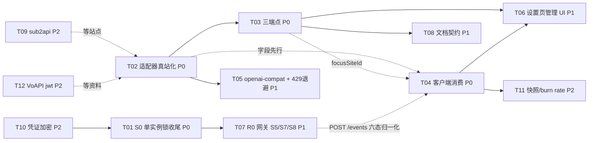

# dsh-pet-agent · V1.1 修订规划

> 作者：高见远（Architect）｜ 日期：2026-10-17 ｜ 基线：`feat/relay-management` HEAD=`2cb1e30`
> 输入：`docs/PLAN-v1.md`（含修订 #1-#23、纪律 E1-E4）、`docs/06-research-optimization.md`（PM 调研，附录 B/C/D）、`docs/07-architecture-host-agnostic.md`（v2.2 架构设计）、`docs/08-site-setup-checklist.md`（PM 用户侧清单）、`docs/10-real-site-verification.md`（真站实测报告）、`dsh-pet/src/host/relays/*`、`dsh-pet/src/host/index.ts`、`dsh-pet/src/standalone/*`
> 纪律：**本文只出规划，不改任何产品代码**。所有结论标注证据等级：**【真站】**=真站实测、**【源码】**=源码/官方文档一手证据、**【二手】**=社区资料推断、**【假设】**=未经任何证据。

---

## 0. TL;DR —— 最紧急的三件事

| # | 事项 | 为什么最紧急 |
|---|---|---|
| 🔴 1 | **T02 newapi 适配器真站化重构** | 当前 `providers/newapi.ts` 只打 `/api/user/self`，而真站实测：API Key 打它必返 `HTTP 200 + {"success":false}`。**现在这个适配器对唯一验证过的站点必败**。不修，后面接什么都不真 |
| 🔴 2 | **T04 客户端消费 `sections.relays`** | 宿主侧已把舰队汇总写进状态叶，但 `src/client/` 零消费：桌宠不显示中转站余额、六档动画没接汇总、没有告警。**后端数据没有消费者 = 用户价值为零** |
| 🔴 3 | **T01 S0 单实例锁收尾提交**（在途） | 无锁时第二实例静默顺延 3081 → 双桌宠 + 双倍轮询。**N 个站 × 双实例 = 双倍外发请求**，one-api 系站点侧默认 `GlobalApiRateLimitNum=480/180s`【源码】，429 限流风险是现实存在而非理论 |

一句话结论：**先让数据变真（T02），再让数据可见（T04），同期把在途的 S0 收掉（T01）；R0 网关是目标①的承载但依赖链最长、与目标②无耦合，排 P1 与中转站链路并行推进。**

---

## 1. 现状基线（写规划前先对账，全部有据可查）

### 1.1 已完成（9 commits，累计新增 63 个单测）

| 层 | 文件 | 状态 |
|---|---|---|
| R1 契约 | `dsh-pet/src/host/relays/{types,money,redact}.ts` + `providers/newapi.ts` | ✅ `e604146`（12+12 单测） |
| R2 持久化 | `relays/store.ts`（站点/凭证分文件、原子写、损坏改名留存） | ✅ `304d87c`（17 单测） |
| R2b 编排 | `relays/index.ts`（降级链、并发 4、多币种不混算、低余额判定） | ✅ `8f58db0`（14 单测） |
| R3 宿主侧 | `host/index.ts` `handleRelayRoute`（8 端点）+ `refreshRelays` + `state.ts` `SectionName` 加 `'relays'` | ✅ `2e7aecb` |
| 质量 | typecheck/lint/build 清零，全量测试 718 过 717 | ✅ `e73286b` |
| 路由纯逻辑 | `relays/routes.ts`（路径解析、脱敏自检、入参校验） | ✅ 随上（15 单测） |
| **S0 单实例锁** | `standalone/instance-lock.ts`（未提交，工程师正在修 2 测试缺陷 + 1 lint） | 🔵 **在途** |

### 1.2 真站实测结论（docs/10，2026-10-17，`https://st.cmjlevi.top`）——本规划的事实地基

| # | 结论 | 证据 |
|---|---|---|
| F1 | `/api/usage/token/`（API Key 可调）才是 **API-Key-only 场景第一优先端点**：直接给 `unlimited_quota` 布尔 + `total_used`/`total_granted`（quota）。原规格排第三是错的 | 【真站】 |
| F2 | `unlimited_quota===true` 或 `hard_limit_usd>=1e8` → 无限额度：不显示为余额、不参与告警；UI 显示「无限额度 · 已用 $X」（本站已用 $34.582358） | 【真站】 |
| F3 | `total_available` 可能为负（本站 −17291179），**绝不能当余额** | 【真站】 |
| F4 | `/dashboard/billing/usage` 的 `total_usage` 单位是**分**；`/api/usage/token/` 的是 **quota**；两者不可混用（已交叉验算吻合） | 【真站】 |
| F5 | HTTP 200 + `{"success":false}` 必须判失败（`/api/user/self` 用 API Key 实测） | 【真站】 |
| F6 | 类型识别不能用 `system_name`/`version`（一个被改成"st-api"、一个为空）；可靠信号是 `/api/status` 的 `HeaderNavModules`/`SidebarModulesAdmin`、`/v1/models` 的 `supported_endpoint_types` | 【真站】 |
| F7 | `Server: cloudflare` 不等于被拦（无 `cf-mitigated` 头）；CF 判定只在真被拦时生效 | 【真站】 |
| F8 | `/api/status` 免鉴权且带 `quota_per_unit`（本站 500000）→ 换算率可自动探测；探测不到必须标 `rateUnconfirmed` 要求用户确认（PLAN 修订 #11），**绝不静默默认** | 【真站】+【源码】 |
| F9 | `/api/pricing` 免鉴权且带 `model_ratio`/`model_price`（比价必须用它）；`/api/models/display` 需鉴权（PM 说的匿名可见不成立）；「pricing 返回 1000+ 模型」在本站不成立（依赖站点规模，不能当通用结论） | 【真站】 |

### 1.3 明确缺口（对照 team-lead 交办 + 代码核实）

| # | 缺口 | 代码位置证实 |
|---|---|---|
| G1 | **客户端完全未触及 relays**：`sections.relays` 无消费方、桌宠不显示中转站余额、无管理页面、六档余额动画未接舰队汇总 | `src/client/` 无任何 relay 代码；`pet.ts:1725` 只处理 `sections.balance` |
| G2 | `/relays/detect`、`/relays/models`、`/relays/focus` 三端点未实现 | `routes.ts:55` `parseRelayRoute` 无对应 action |
| G3 | `sub2api` / `openai-compat` 适配器未写（注册表只有 `newApiProvider`） | `index.ts:22` `RELAY_PROVIDERS = [newApiProvider]` |
| G4 | `API.md` / `openapi.yaml` 无 `/relays` 契约（含 07 文档 §4.6 的「数据直返」子域决策未落档） | 仓库根两份文档 |
| G5 | R0 宿主无关网关未开工（只有 07 设计文档；S0 是其中唯一在途代码） | `src/standalone/` 无 gateway 代码 |
| G6 | 凭证明文落盘（Q1：`relay-credentials.json` 明文，V2 上 keytar/DPAPI） | `store.ts:190` |
| G7 | `money.ts:31` `siteQuotaPerUnit(undefined)→500000` 仍是**静默默认**，修订 #11 的 `rateUnconfirmed` 未实施 | `money.ts:31`、`store.ts:161` 建站即静默默认 |
| G8 | `types.ts:36` 注释仍写 `access-token` 是「推荐」，与修订 #5「API Key 优先」矛盾；`RelayCredentialKind` 无 `jwt`（修订 #12 只预留） | PM 08 清单 §6 已列 |

---

## 2. 待完善功能清单

> 按「让真站数据变真 → 让用户看见 → 让用户管理 → 扩大覆盖 → 目标① → 长线质量」组织。每条标注来源缺口与真站结论编号。

### A. 适配器真站化改造（对应 G7 + F1-F8，P0）

| # | 功能 | 内容 | 依据 |
|---|---|---|---|
| A1 | **三级取数链路重排** | 按凭证类型分流：`api-key` → ① `/api/usage/token/`（unlimited+used+granted）→ ② `/dashboard/billing/subscription` + `/v1/dashboard/billing/usage` → ③ 手工；`access-token`/`session-cookie` → ① `/api/user/self`（账户级）→ ② `/api/usage/token/` → ③ billing → 手工。**凭证类型不自动降级**（修订 #20：AT 预检成功后的业务错误不回退 Cookie） | F1/F4/F5、修订 #5/#20 |
| A2 | **四个解析守卫** | ① `unlimited_quota===true` 或 `hard_limit_usd>=1e8` → `unlimited`；② `total_available<0` 绝不作余额；③ `total_usage`(分) 与 `total_used`(quota) 单位隔离；④ HTTP 200 + `success:false` 判失败。另加 ⑤ 非 JSON + 200（CF 挑战页）→ `blocked`，但**有 `cf-mitigated`/challenge 特征才判**，见 `server: cloudflare` 不判（F7） | F2-F5/F7、修订 #23 |
| A3 | **`rateUnconfirmed` 语义落地** | `money.ts` 拆出「探测」与「兜底」两个入口：探测走 `/api/status.quota_per_unit`；探测不到 → 站点 `rateConfirmed=false`，余额结果带 `rateUnconfirmed:true`。客户端显示「换算率未确认，请核对」；**未确认站点不参与低余额告警**（数据不可靠不评估，OP-6）；建站时不再静默默认 500000 | F8、修订 #11 |
| A4 | **`scope` 与 `unlimited`/`spent` 字段** | `RelayBalanceSuccess` 增加 `scope?: 'account'|'token'`、`unlimited?: boolean`、`spent?: string`。`unlimited` 时 `data.total` 放**已用金额**（与 `spent` 同值），客户端渲染「无限额度 · 已用 $X」，**绝不渲染成「余额」**（语义反了）；不设 `fullBalance` → 六档动画自然不播（无基准不播，沿用上游口径） | F2、真站报告 §3.3 |
| A5 | **detect 识别信号修正** | 新 `relays/detect.ts` 纯函数：`/api/status` 的 `HeaderNavModules`/`SidebarModulesAdmin` 存在 → new-api 强证据；`/v1/models` 元素 `supported_endpoint_types` → 强特征；`system_name` 仅作弱辅助。返回 `{kind, confidence, evidence[], suggestedQuotaPerUnit?, displayInCurrency?}` | F6、修订 #15 |
| A6 | **失败原因扩充** | `RelayBalanceResult.reason` 增加 `'blocked'`（CF/反代/Bot Detection）与 `'rate-limited'`（429），二者文案必须与 `fetch-error` 区分 | 修订 #23 + 429 风险 |

### B. 三端点补齐（对应 G2，P0）

| # | 功能 | 内容 |
|---|---|---|
| B1 | **`POST /relays/detect`**（L2） | 不落库，返回识别结果 + 置信度 + evidence + 建议换算率；给设置页「添加站点」引导用 |
| B2 | **`GET /relays/models`（L1）+ `POST /relays/{id}/models`（L2）** | POST 实时抓取（优先 `/api/pricing` 带倍率、失败回落 `/v1/models`，修订 #14）并写 `relayDir/models.json` 缓存；GET 只读缓存聚合成矩阵（modelId → 有/无/未知）。**不在周期刷新里抓模型**（要带凭证外发，太重） |
| B3 | **`POST /relays/focus`**（L2） | 焦点站点存 `relayDir/focus.json`（单文件，不进站点实体）；`sections.relays` 叶带 `focusSiteId`；桌宠气泡/汇总口径按焦点站。**只影响展示，绝不碰 `sections.balance`、绝不做请求转发**（Q4 Non-Goal） |

### C. 客户端消费（对应 G1，P0/P1）

| # | 功能 | 内容 |
|---|---|---|
| C1 | **`src/shared/relays.ts` 纯函数 `readRelays`** | 状态叶 → 类型化视图，形状非法返回 `null`（轮询安全口径，同 `readBalance` 不抛）；顺带把舰队汇总折成 `BalanceView`（money 形态）喂既有六档动画 |
| C2 | **桌宠展示（`pet.ts` 接 `sections.relays`）** | ① 六档余额动画接 `summary`（`fullBalance` 齐全才播——聚合层已保证）；② 「无限额度 · 已用 $X」文案；③ 低余额告警气泡**去重**（同站同告警恢复前不重复弹，OP-14）+ 只对 `source:'auto'` 且有确认换算率的站；④ `otherCurrencies` 非空 → 一句「另有 N 站为其他币种未计入」；⑤ `failedCount>0` **不弹错误气泡**（避免每周期刷屏），只在管理页呈现（D3 门控） |
| C3 | **设置页中转站管理 UI**（P1） | 站点 CRUD 表单 + detect 引导 + 凭证类型选择（API Key 优先引导）+ 手工余额 + 阈值 + 换算率确认。复用上游 `settings.section` 插槽与 `h` 注入模式 |
| C4 | **隐藏即零功耗**（P1） | 桌宠隐藏时暂停 relays 周期刷新（PM U6/OP-1；防隐藏时持续外发触发 429） |

### D. 新适配器（对应 G3，P1/P2）

| # | 功能 | 内容 | 备注 |
|---|---|---|---|
| D1 | `openai-compat.ts`（P1） | `/dashboard/billing/subscription` + `/v1/dashboard/billing/usage` 双路径（`/v1` 优先回退，真站证实两条都注册）；剩余 = `hard_limit_usd − total_usage/100`；1e8 哨兵 → unlimited；`scope:'token'` | 端点已被真站实测（F4），公式在非无限 Key 上**【待验证】** |
| D2 | `sub2api.ts`（P2） | `GET <base>/usage` + sk key | 契约【二手】，**等用户提供站点再写**，避免造无法验证的代码 |
| D3 | `voapi` kind + `jwt` 凭证（P2） | 修订 #12：识别阶段就分流 | **JWT 获取路径未找到任何公开资料**，卡住即转下一项（纪律 4） |

### E. R0 宿主无关网关续建（对应 G5，P1）

按 07 文档 §5 分册，本轮规划只取 S5/S7/S8（S0 在途、S9 随文档）：

| # | 功能 | 内容 |
|---|---|---|
| E1 | **S5 能力分级** | `gateway/capabilities.ts`：`CapabilitySet` 四接口（`llm`/`credentials`/`account`/`sessionEvents`）+ L0-L3 分级 + 分域可选 token（默认全关，只收紧 L3） |
| E2 | **S7 网关三件套** | `POST /agents/hello`（60s TTL 心跳、优先级+TTL 不搞租约锁）、`GET /capabilities`（L0 在场探测）、`POST /events`（HTTP 摄入主轨，任意 agent 一条 curl 推状态）、`POST /agents/leave`；发现机制 = 3080 端口 + `agent-gateway.json` **目录**（07 v2.2 修正：目录非单文件）+ 25 端口扫描兜底 |
| E3 | **S8 SSE 推送** | `GET /state/stream` opt-in（复用 counter 单调地基，50ms 去抖，连接上限 8 + 429）；**不做 WebSocket**；轮询契约不动 |
| E4 | **TD-1 监控** | `handleRelayRoute` 内联 ~170 行是 V1 接受的技术债：若 `/relays` 分支达 3 个（detect/models/focus 上线即达）→ 抽 `RouteModule` 时一并解决，不在本轮 |

### F. 文档契约（对应 G4，P1）

| # | 功能 | 内容 |
|---|---|---|
| F1 | `API.md` | 按 07 §4.6.1 修订「约定二（动作端点只回 `{ok}`）」为子域例外文案；补 `/relays` 8+3 端点表 + detect/models/focus 的预期返回与失败对照 |
| F2 | `openapi.yaml` | 补 `/relays` 子域与 `/agents`、`/capabilities`、`/events`、`/state/stream` 契约；跑 `scripts/check-openapi.mjs` |
| F3 | `README.md` + `package.json` | 「中转站管理」章节 + 上游致谢与许可 + **凭证明文落盘显著提示** + `forkedFrom` 字段 |
| F4 | `docs/08` 清单 | 补 detect/focus/models 说明、「无限额度」文案、rateUnconfirmed 提示；修正 §6 已列 6 处不一致（types.ts 注释、jwt、kind 矩阵、blocked 归类） |

### G. 工程质量与长线（P1/P2）

| # | 功能 | 内容 |
|---|---|---|
| G1' | **429 退避 + 全局 deadline** | 站点级失败指数退避（内存记忆，重启清零可接受）；单次舰队刷新总 deadline（默认 4s，OP-7）；429 → `rate-limited` 独立原因 |
| G2' | 历史快照 + burn rate（P2） | 日切持久化到 `relayDir/history.json`；气泡加「今日已用」；按窗口估算 burn rate（B5） |
| G3' | 凭证 OS keychain（P2） | Windows DPAPI / keytar（U2）；DSH 宿主模式走 `credentialRef` 二选一 |
| G4' | 新文档提交 | `docs/06b/07/08/10` 四份 untracked 文档先提交（它们已是团队决策记录，不入库等于没发生） |

---

## 3. 优先级排序与裁决

### 3.1 三方对比：客户端消费 vs 补齐适配器 vs R0 网关（team-lead 点名评估）

**裁决：适配器 → 客户端 → R0。** 理由：

| 维度 | T02 适配器真站化 | T04 客户端消费 | T07 R0 网关 |
|---|---|---|---|
| 数据真伪 | ✅ **决定数据真伪**。当前实现对唯一实测站必败（API Key 打 `/api/user/self` 必 200+success:false）。**接一个错误数据源 = 精美的错误展示** | 只是展示层，不产生数据 | 与中转站数据无关 |
| 用户价值 | 隐式（不出错） | ✅ **目标②的直接兑现**：桌宠显示余额/健康/告警是用户原话诉求；且改动集中在纯函数 + 一个分支，是全清单里**单位成本价值最高**的一项 | 目标①的承载，但依赖链最长（S0→S5→S7→S9），对目标②零贡献 |
| 风险 | 中：改的是已飞代码的核心解析路径，但全部纯函数可无网测试 | 中：`sections.relays` 是新叶子，客户端从未消费过，**存在兼容性风险（R1，见 §5）**，必须单独验证 | 大：`CapabilitySet` 接口化触碰宿主无关根基；上游 0.3.4 有 `stream` 形状错误终止进程的事故先例 |
| 可验证性 | 高：喂真站响应 JSON 的纯函数单测 + curl 复测 | 高：mock-server + 无 GUI 可测；沙箱内可完成 90% | 中：POST /events 可 curl；SSE 需浏览器/桌面 |
| 阻塞关系 | 阻塞 T03（detect 复用 `/api/status` 解析）、T05、T06 | 被 T02 阻塞（`unlimited`/`rateUnconfirmed` 字段定了才好写渲染）；不阻塞 T07 | 被 T01 阻塞（S0 是发现文件设计的前提） |

**另一条排序逻辑：先堵漏再装修。** T01（S0）是唯一「正在流血」的项——双实例双倍轮询直接放大 429 风险，且它已在途，收尾成本最低，必须最先落地。

### 3.2 完整优先级表

| 级别 | 任务 | 一句话理由 |
|---|---|---|
| **P0** | T01 S0 收尾 | 在途；双实例 = 双倍外发 = 429 风险放大器 |
| **P0** | T02 适配器真站化 | 数据真伪的地基；不修则一切展示是假的 |
| **P0** | T03 三端点 | 用户原话三诉求（识别/模型/切换）+ 管理页的前置；detect 依赖 T02 的信号解析 |
| **P0** | T04 客户端消费 | 目标②兑现；后端数据零消费者是最大浪费 |
| **P1** | T05 openai-compat + blocked/429 | 端点已真站实测，写了就有质量；退避直接降 429 风险 |
| **P1** | T06 设置页管理 UI | 无 UI 只能 curl 加站，个人工具可忍但不可久忍；工作量最大故 P1 |
| **P1** | T07 R0 续建 | 目标①承载；与目标②解耦，T01 后即可并行 |
| **P1** | T08 文档契约 | 契约不落档 = 下游（agent 接入方）无从下手；check-openapi 是 prepack 门禁 |
| **P2** | T09 sub2api | 无测试站点，先写=造不可验证代码（纪律：卡住就换一件） |
| **P2** | T10 凭证加密 | Q1 已决策 V2；README 提示先行 |
| **P2** | T11 快照/burn rate | 锦上添花；依赖 T04 的客户端链路 |
| **P2** | T12 VoAPI jwt | 资料卡死，等站长文档 |

---

## 4. 实施步骤（按实现顺序，含依赖/判定/复杂度）

> 复杂度为单人当量估计（含测试与自测）。**每个任务完成后必须复跑 `pnpm typecheck && pnpm lint && pnpm test` 再声称完成（E1）**；测试数只增不减（E3）；目录导入写 `./relays/index`（E2）；数据目录一律 `userRoot/relays`（E4）。

### T01 · S0 单实例锁收尾与提交（P0 · 小 · 0.5 天）
- **文件**：`dsh-pet/src/standalone/instance-lock.ts`、`instance-lock.test.ts`、`cli.ts`、`server.ts`、`server.test.ts`
- **依赖**：无（在途，直接修缺陷）
- **内容**：修 2 个测试缺陷 + 1 个 lint 错误；`cli.ts` 接线（拿不到锁 → 明确失败 + 非零退出码 + 错误信息带锁文件路径）；**删除端口顺延逻辑**（`bindFirstFree` → 固定端口 + 锁）；补 stale 锁回收（SIGKILL 场景）的集成测试
- **完成判定**：`pnpm test` 全绿且用例数 ≥ 当前；手工启动两次 → 第二次明确报「已有实例在运行（PID=…）」并非零退出；删锁文件后正常启动；typecheck/lint 过
- **注意**：`instance-lock.ts` 已有 8 个单测；PID 复用误判是已知局限（错误信息里给路径即可，V2 再议），写进 README 排错

### T02 · newapi 适配器真站化重构（P0 · 中 · 2–3 天）
- **文件**：`dsh-pet/src/host/relays/providers/newapi.ts`、`newapi.test.ts`、`../money.ts`、`money.test.ts`、`../types.ts`、`../index.ts`（编排层接线）、`../store.ts`（`rateConfirmed` 字段）
- **依赖**：无（与 T01 并行）
- **内容**（全部 A1–A6）：
  1. 三级取数链路按凭证分流；**凭证类型不自动降级**（修订 #20）
  2. 四守卫 + blocked/rate-limited 归类（CF 判定表：`cf-mitigated` 头 / `server:cloudflare`+403 / challenge-platform / `x-datadome`；**无 cf-mitigated 的 cloudflare 不判**）
  3. `types.ts`：`RelayBalanceSuccess` 加 `scope?`/`unlimited?`/`spent?`/`rateUnconfirmed?`；`RelayBalanceResult.reason` 加 `'blocked'|'rate-limited'`；`RelaySite` 加 `rateConfirmed?: boolean`；`RelayCredentialKind` 注释改「API Key 优先」（修 08 清单 §6-1）
  4. `money.ts`：新增 `detectQuotaPerUnit(body)`（从 `/api/status` 提取，探不到返 undefined）；`siteQuotaPerUnit(undefined)` 的静默默认**改由 store 建站时显式写 500000 且 `rateConfirmed:false`**，`money.ts` 不再提供「无标记兜底」入口
  5. 新纯函数（全部无网可测）：`parseTokenUsage`（F1/F2/F3）、`parseSubscription`+`parseUsage`（F4）、`parseUserSelf` 改造（F5：`success:false` 已有，补 negative quota 守卫）、`parseStatus`（quota_per_unit + display_in_currency + HeaderNavModules 信号，A5 的 detect 也复用它）
  6. 测试直接喂**真站响应原文**（docs/10 已留档）：无限额度、负 total_available、200+success:false、quota 与分混用防护、rateUnconfirmed 透传
- **完成判定**：新单测 ≥ 25 个（喂真站 JSON）；`/api/usage/token/` 链路 curl 复测返回 `unlimited:true, spent:'34.58'`；一个有 `success:false` 的用例证明判失败；typecheck/lint/test 全过
- **风险**：`/api/user/self` 账户级真实形状仍**【待验证】**（需 AccessToken）——解析按 one-api 源码口径写 + 标记，不阻塞本任务

### T03 · 三端点 detect/models/focus（P0 · 中 · 1.5–2 天）
- **文件**：`dsh-pet/src/host/relays/detect.ts`（新，纯函数识别）、`routes.ts`（`parseRelayRoute` 加三 action + detect 入参校验）、`../index.ts`（三分支接线）、`../state.ts`（叶子带 `focusSiteId`——若不改 state.ts 则放在 relays 数据里，由 team-lead 定）、`routes.test.ts`、`detect.test.ts`
- **依赖**：T02（detect 复用 `parseStatus` 信号；models 抓取走 provider）
- **内容**：B1/B2/B3 全量；`relayDir/models.json` 缓存（带 fetchedAt，供 GET 聚合）；`relayDir/focus.json`；`POST /relays/{id}/models` 抓取优先 `/api/pricing`（带 model_ratio/model_price，比价原料）失败回落 `/v1/models`；**模型矩阵未知 ≠ 不存在**（P2 修订）
- **完成判定**：detect 对真站返回 `kind:'new-api', confidence:'certain'` + evidence 含 HeaderNavModules；`/api/usage/token/` 不可用的站（无凭证）detect 仍能工作（`/api/status` 免鉴权）；focus 切换后状态叶 `focusSiteId` 变化；models 缓存文件落盘且 GET 聚合正确；新单测 ≥ 12
- **定级**（07 §3 Q3）：detect=L2 / models GET=L1+POST=L2 / focus=L2——**L1/L2 默认无 token 可过**（鉴权默认全关），但 relay CRUD 与凭证写入在 07 的口径里属 L3 收紧域，本任务的 focus/detect 不写凭证，保持 L2

### T04 · 客户端消费 sections.relays（P0 · 中 · 2 天）
- **文件**：`dsh-pet/src/shared/relays.ts`（新，`readRelays` 纯函数 + 汇总→BalanceView 折算）、`shared/state.ts`（无需改——`walkLeaves` 通配新 section，**这条要写测试证明**）、`client/pet.ts`（接 `sections.relays` 分支）、`shared/relays.test.ts`、`client` 既有测试扩展
- **依赖**：T02（字段定了才好写）；与 T03 可并行（focusSiteId 后补进 readRelays 即可）
- **内容**（C1/C2 全部）：六档动画接汇总；无限额度文案；低余额气泡去重 + 换算率未确认站不告警；多币种一句说明；failedCount 不弹气泡；`readRelays` 形状非法 → null 不抛（轮询安全）
- **完成判定**：**沙箱内**用 `scripts/dev/mock-server.mjs` 喂一份构造的 `/state`（含 relays 叶：3 站 1 无限 1 低额 1 失败 1 外币）→ 浏览器 overlay 显示正确文案与档位动画；`pnpm test` 新增 ≥ 10（含「sections.relays counter 变化被 takeChanged 捕获」的通配证明）；typecheck/lint 过；**真机桌宠截图由用户桌面验证**（沙箱无 GUI）
- **注意**：绝不把 relays 汇总塞进 `sections.balance`（修订 #2 红线）；`pet.ts` 已 1793 行，新代码控制在 120 行内，超出先抽 `client/relay-face.ts`

### T05 · openai-compat 适配器 + blocked/429 退避（P1 · 中 · 2 天）
- **文件**：`dsh-pet/src/host/relays/providers/openai-compat.ts`（新）、其测试、`../index.ts`（429 退避 + 全局 deadline + `rate-limited` 归类）、`../types.ts`（若需）
- **依赖**：T02（守卫与字段模式复用）
- **内容**：D1 + G1'；剩余公式 `hard_limit_usd − total_usage/100` 标注**【待验证：非无限 Key】**；1e8 → unlimited；`scope:'token'`；站点级失败指数退避（1s→2s→4s…封顶 60s，内存态）；单次舰队刷新 deadline 4s
- **完成判定**：新单测 ≥ 10（含真站 subscription/usage 响应原文）；429 响应 → `rate-limited` 且退避生效可测（注入假时钟/假 fetch）；typecheck/lint/test 过
- **备注**：openai-compat 的端点是**真站实测过的**（F4），与 sub2api 的纯二手契约不同，可以先行

### T06 · 设置页中转站管理 UI（P1 · 大 · 3–4 天）
- **文件**：`dsh-pet/src/client/relays-admin.ts`（新，表单 + 列表 + detect 引导）、`client/settings.ts`（挂新 section）、`client/app.ts`（注册 `settings.section` 插槽）、i18n 文案（settings.ts 的 zh/en 字典）、`relays-admin.test.ts`
- **依赖**：T03（detect/focus 端点）+ T04（共享 relays 视图口径）
- **内容**：C3 全部；凭证引导顺序 UI 化（API Key 优先 → AccessToken → Cookie 高级 → manual，08 §5 决策树）；换算率未确认时**强制弹核对提示**；手工余额带「手工」标签 + 时间；隐藏即零功耗（C4）若要动 Helper 计时器，放本任务尾部
- **完成判定**：mock-server 下完整走通「加站 → detect → 刷余额 → 改阈值 → 切焦点」；空态/错误态/未确认态三态截图；`pnpm test` 新增 ≥ 8；**桌面 Helper 桥行为需真机验证**（桥复用同一份 handlePetRoute，理论一致，标注【待验证】）
- **风险**：这是全清单最大单任务；若超 4 天，砍「模型矩阵展示」保「站点 CRUD + detect + focus」

### T07 · R0 网关续建 S5/S7/S8（P1 · 大 · 4–5 天）
- **文件**：`dsh-pet/src/standalone/gateway/capabilities.ts`、`agents.ts`、`auth.ts`、`ingest.ts`（新目录）、`standalone/discovery.ts`（发现机制）、`standalone/server.ts`（接线 + `/state/stream` SSE + `/agents` 路由）、`host/index.ts`（`POST /events` → 写 `sessions.notify`/`workStatus` 的六态归一化）、`gateway/*.test.ts`
- **依赖**：T01（S0 是发现文件的前提）；与 T02-T06 完全并行
- **内容**：E1/E2/E3；能力分级按「能否造成不可逆损害」切（L3 = 凭证写入/配置写入/relay CRUD/shutdown）；`POST /events` 六态归一化复用 counter 地基；SSE 50ms 去抖 + 8 连接上限 + 429；**ACP 日志若写必进 stderr**（07 红线，虽然不实现 ACP 协议，hooks/JSONL 轨道同样遵守）；**桌宠不注册进 ACP Registry**（范畴错误）
- **完成判定**：`curl POST /agents/hello` → TTL 注册；`GET /capabilities` 返回 L0-L3 与 `sseMaxConnections`；一条 `curl POST /events`（notice+severity）驱动桌宠气泡；`curl -N /state/stream` 收到一帧；独立模式 balance 降级从「硬降级」变「可填充」至少有 `sessionEvents` 一个填充样例；新单测 ≥ 15
- **注意**：07 文档 §8.2 有两处待 team-lead 拍板的分歧，开工前确认

### T08 · 文档契约同步（P1 · 小 · 1 天）
- **文件**：`API.md`、`openapi.yaml`（仓库根）、`README.md`、`package.json`（forkedFrom）、`docs/08-site-setup-checklist.md`（补 detect/focus/models + 修 §6 六处）、`scripts/check-openapi.mjs`（跑）
- **依赖**：T03（端点定稿）；README/package.json 部分可提前
- **内容**：F1-F4；`/relays`「数据直返」子域例外**只限本子域，不扩散**（修订 #7）；凭证明文提示放 README 显著位（Q1 的 README 落实）
- **完成判定**：`pnpm check:openapi` 过；API.md 的每个 `/relays` 端点都有「预期返回 + 失败对照」；grep 确认 README 含上游地址与禁商用声明

### T09-T12 · P2 池（依赖外部输入或长线）

| ID | 任务 | 依赖/前置 | 完成判定 |
|---|---|---|---|
| T09 | `sub2api.ts` 适配器 | **等用户提供 sub2api 站点**；模式同 T02 | 真站实测通过 + ≥8 单测；**站点不到不写代码** |
| T10 | 凭证 OS keychain（DPAPI/keytar） | T01（独立模式就绪）；DSH 宿主走 `credentialRef` 通路（`host/index.ts` 已有 credentials.resolve） | 加密后盘上无明文；迁移旧 `relay-credentials.json`；≥6 单测（加解密 round-trip） |
| T11 | 历史快照 + burn rate | T04 | 日切持久化；气泡「今日已用」；跨日重启不丢；≥8 单测 |
| T12 | VoAPI `jwt` kind | **等 JWT 获取路径资料**（当前全无） | 识别阶段分流 + ≥6 单测；资料不到就维持 manual 降级并在 08 清单如实记账 |

### 4.1 依赖关系图



**并行面**：T02 与 T01 完全并行；T07 在 T01 后与 T02-T06 全线并行；T08 半程可入。**关键路径**：T02 → T03 → T06（目标②管理闭环）与 T02 → T04（目标②展示闭环）双链并行，关键路径约 7–9 个工作日到 M2。

---

## 5. 假设与风险

### 5.1 已证实（真站实测 F1-F9 + 源码级）

- `/api/usage/token/` 为 API-Key 场景第一优先端点（F1）；`unlimited_quota` 布尔与 1e8 哨兵双判据（F2）；`total_available` 可负（F3）；分 vs quota 单位（F4）；200+success:false（F5）；识别信号（F6）；CF 判定条件（F7）；quota_per_unit 自动探测可行（F8）；`/api/pricing` 免鉴权带倍率（F9）
- 【源码】`/dashboard/billing/*` 中间件 `TokenAuth()`（API Key 可查）；`/api/status` 无 auth 中间件（仅全局限流 480/180s）；`/v1` 前缀非版本分界（双路径都注册）
- 【代码】`sections.relays` 叶子已写入且形状恒定；`walkLeaves` 通配新 section（`shared/state.ts:88-93`，路径只当不透明键）；Helper 桥与浏览器复用同一份 `handlePetRoute`（`host/index.ts:734-749` 区域）

### 5.2 待验证（需要用户桌面/素材才能闭环）

| # | 项 | 需要什么 |
|---|---|---|
| V1 | `/api/user/self` 账户级余额真实形状（`quota` 是剩余还是总额、`used_quota` 语义） | **一个 AccessToken**（本站只有 API Key） |
| V2 | 有额度（非无限）Key 的 `hard_limit_usd − total_usage/100` 剩余公式 | **一个有额度的 Key**（本站令牌 unlimited，公式无法实测） |
| V3 | Cloudflare 真拦截时的响应形态（挑战页 HTML / `cf-mitigated` / Turnstile） | **一个被挑战过的站点** |
| V4 | `display_in_currency=false` 站点返回 quota 原值的行为 | 关掉该开关的站点（**无法从外部判断**，只能观察到「量级荒谬大数字」现象） |
| V5 | 429 在本项目实际触发条件（N 站 × 刷新周期 vs 站点 480/180s） | 真机跑一段时间观察；**这是 T05 退避参数的校准依据** |
| V6 | `sections.relays` 客户端兼容（新叶子进 1s 轮询不破坏既有渲染） | T04 的 mock + 通配测试；**沙箱内可完成** |
| V7 | 桌面 Helper 桥对 `/relays` 的行为对齐 | 真机桌面验证（理论同源，未实测） |
| V8 | 动图/自定义素材路径（Q5）、桌宠六档动画接汇总的观感 | 用户桌面 |
| V9 | done-hub / Veloera / VoAPI 等分支行为（本站是标准 new-api） | 对应站点 |

### 5.3 假设（无证据，按合理判断推进，不卡住）

1. **沙箱不能起 GUI**：本环境的会话无法启动 Electron/WebView 桌宠。所有客户端任务按「沙箱内 mock-server + 单测完成 90%，真机观感交用户桌面验证」分工。**这是全规划最重要的过程假设**——若用户无法及时桌面验证，M1 的客户端部分只能算「代码完成」不算「产品完成」。
2. 用户将按需提供 4 类测试素材：AccessToken 站点 / 有额度 Key / 被 CF 拦站点 / sub2api 站点（docs/10 §五已正式请求）。
3. instance-lock 修完缺陷后行为符合设计（原子 wx 创建 + stale 回收）；PID 复用误判按已知局限接受。
4. `openai-compat` 的剩余公式在非无限 Key 站点成立（端点已实测，公式未实测——按 V2 处理，不视为阻塞）。
5. 429 退避参数（1s 起步封顶 60s）先按经验值，V5 校准。
6. team-lead 会拍板 07 文档 §8.2 的两处分歧（发现文件目录 vs 单文件等），T07 开工前确认。

### 5.4 风险登记册

| # | 风险 | 等级 | 对冲 |
|---|---|---|---|
| R1 | `sections.relays` 客户端兼容性破坏既有渲染（新叶子进轮询） | 中 | T04 通配测试 + mock-server 全量回归；`readRelays` 形状非法返回 null 不抛（轮询安全口径） |
| R2 | 双实例/舰队轮询触发站点 429 → 连锁失败 | **高** | T01 最先落地；T05 退避 + deadline；并发 4 保持保守；隐藏即零功耗（C4） |
| R3 | 凭证明文落盘（`relay-credentials.json`） | 高（已知，V2 解） | README 显著提示（T08）；脱敏唯一出口已有；T10 DPAPI 进 P2 |
| R4 | detect 误判站点类型（system_name 被改的坑已踩过） | 中 | 只用 HeaderNavModules/supported_endpoint_types 强信号；返回 evidence + confidence；detect 不落库（误判无持久后果） |
| R5 | 换算率静默默认复活（money.ts 兜底入口） | 中 | T02 把「无标记兜底」入口从 money.ts 移除，建站显式 `rateConfirmed:false`；测试锁死「未确认不告警」 |
| R6 | 契约分裂：`/relays` 数据直返例外扩散到既有端点 | 低 | 修订 #7 已划边界；T08 落档时写明「不许扩散」 |
| R7 | 文档漂移：代码前进文档停（本次已有 4 份 untracked） | 中 | G4' 先提交现有文档；T08 收口；每轮 commit 带 doc 更新 |
| R8 | 范围蔓延（比价/burn rate/浏览器桥被提前拉入） | 中 | P2 池明确「等外部输入」；每轮只干清单内的事 |

---

## 6. 里程碑与验收方式

### M1 · 「真站可跑 + 桌宠可见」（P0 四任务完成）

**跑什么**：
```bash
cd dsh-pet && pnpm typecheck && pnpm lint && pnpm test   # 测试数只增不减（当前 718+63 基线，M1 后应 ≥ 718+63+47）
node scripts/dev/mock-server.mjs 8231                     # 客户端 mock 验证
# 真站 curl 复测（同 docs/10 手法，不记录密钥）：
#   /api/usage/token/ → unlimited:true + spent:$34.58
#   /api/user/self（若用户给了 AT）→ 账户级形状记录进 docs/11 附录
```

**看什么**：
1. **数字对账**：桌宠显示的已用金额与站点后台一致（±$0.01，交叉验算同 docs/10 §2.5 手法）；
2. **文案正确性**：无限额度站显示「无限额度 · 已用 $34.58」而**不是**「余额 $34.58」；换算率未确认站显示核对提示且**不触发告警**；
3. **动画**：有 `fullBalance` 基准的站播六档动画，无基准的不播（不猜基准）；
4. **S0**：二次启动明确失败；stale 锁回收；错误信息带锁路径；
5. **三端点**：detect 对真站返回 new-api + evidence；focus 切换叶变化；models 缓存落盘；
6. **告警去重**：低额站连续多轮只弹一次，恢复后重置；
7. **真机**：用户桌面启动独立模式，桌宠显示 ≥1 个真站（V6/V7/V8 闭环）。

**出口条件**：以上 7 条全过 + commit。任一条不过 → 记入 PLAN §9「尚未闭环」，不谎报。

### M2 · 「可管理 + 目标①落地」（P1 完成）

**跑什么**：mock-server 走完整管理流；`curl POST /agents/hello`、`GET /capabilities`、`POST /events`、`curl -N /state/stream`；`pnpm check:openapi`；openai-compat 对真站 billing 端点实测（若用户给了有额度 Key）。

**看什么**：设置页加站全流程（含 detect 引导、未确认换算率强制核对）；API.md/openapi.yaml 每个 `/relays` 与 `/agents` 端点可对照；SSE 一帧到达且 counter 与轮询一致；`POST /events` 驱动气泡；README 上游致谢 + 凭证明文提示在位。

### M3 · 「覆盖更多站点 + 长线质量」（P2 完成）

**跑什么**：sub2api 真站（素材到位后）；DPAPI 加解密 round-trip；跨日重启历史保留。

**看什么**：sub2api 站余额与后台一致；盘上搜不到明文；气泡「今日已用」跨日正确；VoAPI 要么 jwt 打通要么 08 清单如实记账「资料未找到」。

---

## 7. 纪律与合规传承（本规划所有任务默认遵守）

1. **PLAN-v1 §4 迭代纪律**：每轮必有产出；声称完成贴 `git log --oneline -1` + `ls -la`；不编造；卡住就换一件；测试只增不减；纯逻辑无 GUI 可测。
2. **§8 工程纪律 E1-E4**：改完复跑 typecheck（E1）；目录导入写 `./relays/index`（E2）；测试数只增不减、掉了先查为什么（E3）；数据目录挂 `userRoot/relays`（E4）。
3. **上游纪律**：provider 只负责成功路径，失败 `throw`，统一落 `fetch-error`，**绝不伪造 0 余额**；`sections.relays` 与 `sections.balance` 并存，**绝不合流**（修订 #2）。
4. **金额唯一权威**：quota↔金额换算只准在 `relays/money.ts`，provider/路由/前端不许自算；`money.ts` **不提供无标记兜底入口**（修订 #11）。
5. **合规红线**：二创附原作者地址 `https://github.com/PC2005-cloud/dsh-pet`；素材禁商用；不做签到、不绕人机验证、不做请求转发网关（focus 只影响展示）；`/relays` 无任何端点返回凭证明文（07 Q8 硬边界）。
6. **本规划自身**：只出规划不写产品代码；与 07 文档分歧处标注待 team-lead 拍板，不自行裁决。

---

## 8. 给 team-lead 的待拍板事项

| # | 事项 | 我的建议 |
|---|---|---|
| D1 | 07 文档 §8.2 两处分歧（发现文件目录 vs 单文件等） | T07 开工前裁决，不阻塞 M1 |
| D2 | `focusSiteId` 放 `state.ts` 的 relays 数据里还是独立字段 | 放 `sections.relays` 的 data 里（`state.ts` 的 SectionName 已够用，不为一个字段改地基） |
| D3 | 管理 UI 若超期砍范围 | 砍「模型矩阵展示」，保「站点 CRUD + detect + focus」 |
| D4 | untracked 文档（06b/07/08/10）提交时机 | 立即提交（G4'），它们是团队决策记录 |
