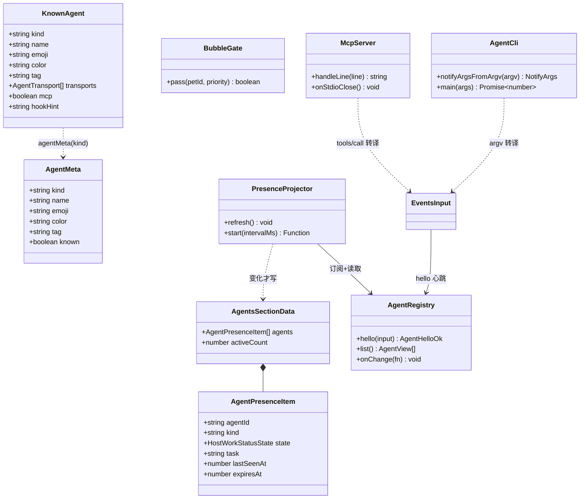
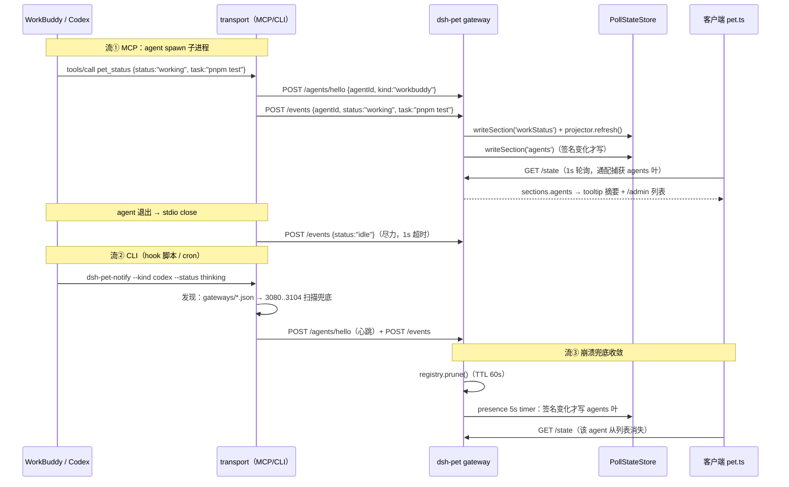
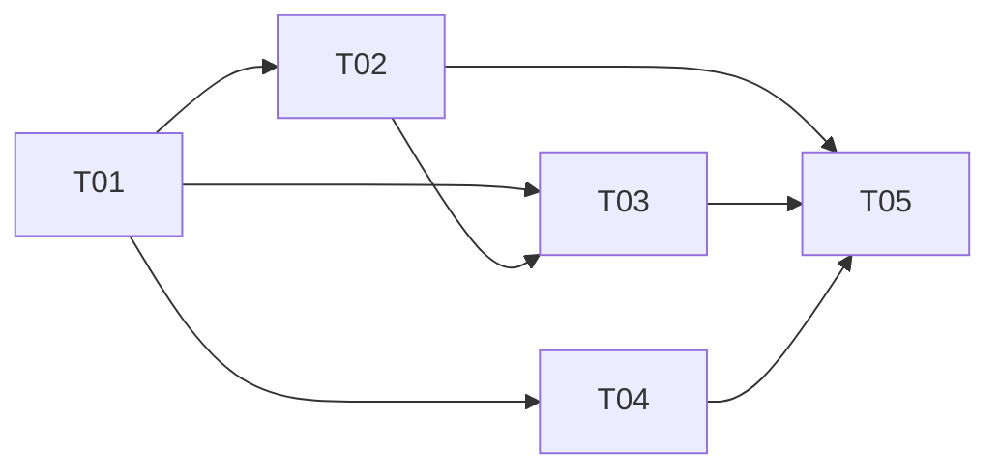

# 桌宠适配 WorkBuddy / Codex 类 agent —— 架构设计（待确认）

| 项 | 值 |
|---|---|
| 提出人 | 用户（2026-10-19）：「它还需要适配于 workbuddy、codex 这类的 agent，思考你觉得合理美观的方式增加这个功能」 |
| 设计 | 高见远（架构师） |
| 汇编/编排 | 齐活林（主理人） |
| 状态 | **设计完稿，等用户确认后才动代码** |
| 基线 | 包 HEAD `e780fbc`（分支 `feat/relay-management`）；`docs/15-handover-2026-10-18.md` §3 代码地图仍有效 |
| 阅读前提 | 本文自包含；配合 `docs/07-architecture-host-agnostic.md`（v2.2）与 `docs/15` 阅读 |

---

## 0. TL;DR（八条结论）

1. 「适配一个 agent」拆**六层**：接入协议 / 身份与展示 / 能力协商 / 权限 / 生命周期 / 退出清理。
2. 三方案对比后**明确推荐 B：声明式「已知 agent 注册表」+ 通用协议**——一份 `/events` 契约，HTTP / CLI / MCP 三种 transport 都序列化成它。A（每 agent 专用 connector）让 core 腐烂；C（只做 MCP）把「任意 agent」收窄成「有 MCP 的 agent」。**C 作为 B 的一个 transport 成立**。
3. 注册表放 `src/shared/agents.ts`（客户端唯一事实源）；**host 不持有注册表**（host 自 contain 不 import `src/shared`），投影只带原始 kind 字符串。
4. 呈现层裁决：**`sections.workStatus` 保留不动**（六档动画单值仲裁），**新增 `sections.agents`**（在场列表投影）。两者同源（AgentRegistry + WorkStatusStore），无第二真相。
5. 气泡仲裁补 host 侧 `bubble-gate.ts`：1500ms 窗口内低优先级不得覆盖高优先级，**error 永不被吞**。不加租约锁（07 Q2 2c 已否决）。
6. 权限：**默认全关不变，Phase 1 不做 per-agent token**；scope 契约只定不实现（Phase 2）。
7. 退出收敛三层：MCP stdio close→idle（~0s）/ hook on-stop→CLI idle（~0s）/ 崩溃被杀→TTL 60s + 5s 投影 timer（≤65s）。
8. **零新第三方依赖**：全部 node 内置；MCP server 手写最小 JSON-RPC 子集（~200 行单文件）。

---

## 1. 复用的既有资产（本轮读码确认，不重复设计）

| 资产 | 位置 | 本设计怎么用 |
|---|---|---|
| 通用摄入契约 `POST /events` | `src/host/gateway/ingest.ts` | **唯一摄入入口**。三种 transport 都构造同一份 `EventsInput`；本轮仅 +task 透传 |
| 在场登记 `POST /agents/hello` + `GET /agents` | `src/host/gateway/agents.ts`（TTL 60s 内存 Map，读时 prune） | `kind` 是自由字符串——注册表降级的地基。本轮 +onChange 钩子（+8 行） |
| 能力自述 `GET /capabilities` | `src/host/gateway/capabilities.ts` | 不动（transports 清单属文档层，不进 /capabilities，避免契约膨胀） |
| SSE `GET /state/stream` | `src/host/gateway/stream.ts` | 不动（50ms 去抖、上限 8） |
| 六档状态 `sections.workStatus` + `http:<agentId>` 合成会话 | `src/host/work-status.ts`（pickDisplayed 仲裁 + 终态 60s 清理） | **不动**。投影器读它取各 agent 档位；需 +`entryOf()`（+4 行） |
| 客户端通配捕获 | `src/shared/state.ts` takeChanged | 新 section 自动被 capture（T04 已证），pet.ts 只加一个 else-if 分支 |
| 分域 token 默认全关 | `src/host/gateway/auth.ts` | 不动；`'ingest'` 域扩成员留 Phase 2 |
| 独立 /admin 纯函数页 | `src/standalone/admin-page.ts`（零数据嵌入、createElement/textContent、CSP） | 加「接入的 agent」区块（约 +60 行） |
| 发现目录 `<DSH_HOME>/dsh-pet/gateways/<pid>.json` | `src/standalone/discovery.ts` | CLI/MCP 的发现逻辑照此口径（读目录 → pid 活性校验 → 3080..3104 扫描兜底） |
| 验收手段 | `scripts/dev/mock-server.mjs`(8231) + `verify:relays*`（renderToStaticMarkup） | `verify-agents-client.ts` 照抄此模式 |

---

## 2. 语义分层：「适配一个 agent」的六层与最小契约

| 层 | 回答的问题 | 最小契约 | 本轮落点 |
|---|---|---|---|
| L1 接入协议 | agent 怎么把事件送进来 | 一份 `EventsInput`：`{agentId, kind, status?, notice?:{severity,text,coalesceKey?,ttlMs?}, task?}`。severity∈{info,warning,error}；status∈六态；agentId≤128 字符；text≤500 码点；task≤40 码点 | **已有（T07）**，仅 +task |
| L2 身份与展示 | 它是谁、怎么显示 | `agentId` 唯一键 + `kind` 自由字符串；注册表给展示元数据；**未注册 kind 必须优雅降级显示**（不许拒映） | **新增** `shared/agents.ts` |
| L3 能力协商 | 桌宠能干什么、档位该谁写 | `GET /capabilities`（已有）+ hello 的 wants/granted（已有）+ `sessionEvents` 源互斥规则（已有） | **已有，不动** |
| L4 权限 | 谁能干什么 | 分域 token 默认全关（已有）；per-agent scope 契约只定不实现 | Phase 2 |
| L5 生命周期 | 在场 / 续期 / 过期 | hello 即心跳（重复调用=续期，leaseId 不变）；TTL 60s；读时 prune | **已有，+onChange** |
| L6 退出清理 | 状态如何最快收敛 | 三层收敛 + 终态 60s 自动清理（已有） | **新增**（MCP/CLI 各 +20 行） |

> 不变式：**协议只有一份（/events），transport 有三样，注册表是数据不是代码分支。**

---

## 3. 方案对比（A / B / C）

| 维度 | A. 每 agent 专用 connector | B. 声明式注册表 + 通用协议 ★ | C. 只做 MCP server 一种入口 |
|---|---|---|---|
| 新接入一个 agent 的成本 | 改 core：加分支、发版、回归 | 注册表加一行 + 一段文档，**core 零改动** | 写一份 MCP 配置片段 |
| 覆盖「任意 agent」 | ❌ 没排到的 agent 完全不显示 | ✅ 未知 kind 也能用（降级显示） | ❌ 只覆盖有 MCP client 的 agent（cron/脚本/自研 agent 全被排除） |
| 与上游生态关系 | ❌ ECOSYSTEM.md 一批裸 HTTP 消费方被排斥 | ✅ 同一 /events，旧调用方零影响 | ❌ 逼所有消费方改造成 MCP |
| 与红线/纪律冲突 | 违反「一份路由表」、TD-1（内联分支膨胀） | 无冲突 | 收缩目标①「适用于所有 agent」 |
| 代码腐化 | N 个 agent = N 份理解代码 | 分支恒为 0 | 一个进程，但绑死一种形态 |
| 高保真度 | 最高 | 够用（severity 三档 + 六态是观察者需要的公共最小集） | 高 |
| 常驻成本 | 无 | 无（CLI/MCP 都是 agent spawn 的短命进程） | MCP server 每 agent 一个子进程 |

**为什么 B 优于 A**：桌宠是**第三方观察者**（07 §3.8），不需要理解每个 agent 的内部语义。每 agent 专用 connector 是「编排器」形态，违反 Non-Goal 且让 core 腐烂。

**为什么 B 优于 C（作唯一入口）**：「一个 curl 就能接入」是既有生态的根基（API.md §六原话）。把 MCP 当唯一入口 = 用新形态换掉已跑通的形态。

**C 作为 B 的一个 transport 成立**：MCP server 的 `tools/call` 内部就是 `POST /events` 的转译，不新造协议；且 MCP 有独有优势——**server 是被 agent spawn 的子进程，stdio 一关就知道 agent 退出了**（收敛 ~0s）。

---

## 4. 具体落地设计

### 4.1 注册表：`src/shared/agents.ts`

```ts
/** agent 传输方式（纯接入提示，不影响协议） */
export type AgentTransport = 'http' | 'cli' | 'mcp';

export interface KnownAgent {
  readonly kind: string;      // hello/events 的 kind 值 = 稳定 id（只增不删，永不改名）
  readonly name: string;      // 显示名
  readonly emoji: string;     // 单字符 emoji（桌宠气泡是纯文本槽，emoji 零素材成本）
  readonly color: string;     // CSS 主色（近似值，不声称官方商标色）
  readonly tag: string;       // 1–4 字符短标签（窄气泡角落用）
  readonly transports: readonly AgentTransport[];
  readonly mcp: boolean;      // 是否给 MCP 配置片段
  readonly hookHint?: string; // hook 安装提示（指向文档，不放脚本内容）
}

export const KNOWN_AGENTS: readonly KnownAgent[] = [
  { kind: 'workbuddy',   name: 'WorkBuddy',   emoji: '🧰', color: '#6366f1', tag: 'WB', transports: ['mcp','cli','http'], mcp: true,  hookHint: 'docs 接入指南 §MCP' },
  { kind: 'codex',       name: 'Codex',       emoji: '🤖', color: '#10a37f', tag: 'CX', transports: ['mcp','cli','http'], mcp: true,  hookHint: 'docs 接入指南 §CLI' },
  { kind: 'claude-code', name: 'Claude Code', emoji: '🐈', color: '#d97757', tag: 'CC', transports: ['cli','http'],       mcp: true,  hookHint: 'hooks: Stop' },
  { kind: 'custom',      name: '自定义脚本',   emoji: '📜', color: '#6b7280', tag: 'DIY',transports: ['http','cli'],       mcp: false },
];

/** 渲染层唯一入口：已知 → 注册表元数据；未知 → 降级（绝不拒映） */
export interface AgentMeta { kind: string; name: string; emoji: string; color: string; tag: string; known: boolean; }
export function agentMeta(kind: string): AgentMeta;
```

**未知 kind 优雅降级契约（写死）**：`name` = kind 原样（截 24 码点）、emoji `👾`、color 中性灰 `#6b7280`、tag `…`、`known=false`。`agentMeta()` 永远返回可渲染对象。host 侧零改动的原因：`agents.ts` 的 hello 本来就是 `readString(input.kind) || prev?.kind || 'unknown'`——kind 本来就是自由字符串。

### 4.2 `sections.agents`：数据结构与投影器

**裁决依据（三个指定评估维度）**：

| 维度 | 只复用 workStatus | 新增 sections.agents（采纳） |
|---|---|---|
| state.ts 地基影响 | 零 | 纯新增一个 section（与 S4 加 relays 同款风险与缓解：`state.test.ts` 键集会红 → 同轮加例；客户端可选读） |
| 客户端通配覆盖 | 已覆盖 | `shared/state.ts` walkLeaves 遍历 `sections` 全键，T04 已证新 section 自动进 takeChanged；pet.ts 加一个分支即可 |
| 多 agent 仲裁 | workStatus 快照只有 `{state,task}` 单值 → **答不出「有哪几个 agent 在场」「这是谁在干活」**；say 单槽后到覆盖 → 「error 被 info 盖掉」痛点仍在 | 列表+摘要回答在场问题；bubbleGate 解决优先级覆盖 |

**分工（两者并存，不动 workStatus）**：`workStatus` = 桌宠该播哪档动画（单值）；`agents` = 谁在场、各自什么状态、谁在干活（列表投影）。

```ts
// src/host/gateway/presence.ts（host 自包含，不 import src/shared）
export interface AgentPresenceItem {
  agentId: string; kind: string;
  state: HostWorkStatusState | null;   // http:<agentId> 合成会话当前档位；无会话 → null
  task: string | null;
  lastSeenAt: number; expiresAt: number;   // epoch ms
}
export interface AgentsSectionData {
  agents: AgentPresenceItem[];    // 按 agentId 排序（与 GET /agents 一致）
  activeCount: number;            // state ∈ thinking/working/result/waiting/error 的个数
}
export interface PresenceDeps {
  registry: AgentRegistry;
  workStateOf: (agentId: string) => { state: HostWorkStatusState | null; task: string | null } | undefined;
  write: (data: AgentsSectionData) => void;   // → state.writeSection('agents', data)
  now?: () => number;
}
export function createPresenceProjector(deps: PresenceDeps): {
  refresh: () => void;
  start: (intervalMs?: number) => () => void;   // 默认 5000ms、unref；返回停止函数
};
```

写入口径（三条，缺一不可）：
1. `registry.onChange`（hello/心跳/prune 时）→ `projector.refresh()`；
2. ingest 写 status/task 后 → `projector.refresh()`；
3. `start(5000)` timer → prune + 重投影（兜住「心跳过期但没人再调 hello」的空窗）。

**「变化才写」是硬纪律**：投影前算签名（agents 的 JSON 序列化 + activeCount），与上次相同 → 不调 write，counter 不空转（同 S4「无启用站点不写这一叶」的判断）。

### 4.3 气泡仲裁：`bubble-gate.ts`

```ts
// severity→priority 复用 ingest.ts 的 SEVERITY_PRIORITY（info:0 / warning:10 / error:20），不另立表
export interface BubbleGate { pass(petId: string, priority: number): boolean; }
export function createBubbleGate(now?: () => number, holdMs?: number): BubbleGate;  // holdMs 默认 1500
```

规则：`priority < 当前记录 && now - 记录.at < holdMs` → 拒（静默合并）；否则放行并记账。**error(20) 是最高优先级，永不被拒**；同优先级放行（防嘴被堵住）。接线方式：`index.ts` 给 ingest 注入的 `pushSay` 包一层 gate——**ingest.ts 本体不改**（T07 测试零影响）。

### 4.4 三种 transport 的具体形态

**(a) CLI `tools/dsh-pet-notify.mjs`**（给没有 MCP 的 agent / hook 脚本 / cron 用）

```bash
node tools/dsh-pet-notify.mjs --kind workbuddy --status working --task "pnpm test"
node tools/dsh-pet-notify.mjs --kind codex --severity error --text "构建失败" --coalesce-key build-fail
node tools/dsh-pet-notify.mjs --status idle          # 退出清理（hook on-stop 用）
node tools/dsh-pet-notify.mjs --list-agents          # 调试：打印在场 agent
node tools/dsh-pet-notify.mjs --base http://127.0.0.1:8231 --status working   # 冒烟/测试注入，跳过发现
```

- **每次调用自带 hello 心跳**（登记+事件一次完成，agent 不需要理解两段协议——这是「接入成本低」的关键）。
- agentId 缺省 `<kind>@<主机名>`（node:os hostname）。
- 参数解析是纯函数 `notifyArgsFromArgv(argv)`（照 `tools/shortcut-spec.mjs` 模式，node:test 可测）；执行层薄。
- 退出码：成功 0；桌宠不在场/网络失败 **1**（hook 脚本可感知，不静默——延续「查不到就明确失败」）。

**(b) MCP server `tools/mcp-server.mjs`**（给 WorkBuddy / Codex / Claude Code 等有 MCP client 的 agent）

```bash
printf '%s\n' \
 '{"jsonrpc":"2.0","id":1,"method":"initialize","params":{"protocolVersion":"2024-11-05"}}' \
 '{"jsonrpc":"2.0","id":2,"method":"tools/list"}' \
 '{"jsonrpc":"2.0","id":3,"method":"tools/call","params":{"name":"pet_status","arguments":{"status":"working"}}}' \
 | node tools/mcp-server.mjs --base http://127.0.0.1:8231
```

- 协议：MCP over stdio = newline-delimited JSON-RPC。**手写最小子集**：`initialize` / `ping` / `tools/list` / `tools/call`；notification（无 id）不回包。
- 暴露 3 个 tool（最小集）：`pet_status(status)` / `pet_notice(severity,text,coalesceKey?)` / `pet_agents()`。
- **退出收敛（MCP 独有）**：stdin `close`/`end` → 尽力 POST `/events {status:'idle'}`（1s 超时）→ exit 0。agent 被杀时内核关管道，同样触发。
- 发现逻辑与 CLI 共用 `tools/pet-gateway-client.mjs`（**不复制第二份**）：读 `gateways/*.json`（pid 活性校验）→ 空/全失效时 `127.0.0.1:3080..3104` 逐个 `GET /health` 认名。
- 配置片段形状（**需真机验证**）：

```jsonc
// mcpServers 形状（WorkBuddy / Claude Code 直接可用；Codex 按实际配置形态适配）
{ "mcpServers": { "dsh-pet": { "command": "node",
    "args": ["D:/dev/dsh-pet-agent/dsh-pet/tools/mcp-server.mjs"] } } }
```

**(c) HTTP 轨**：无新代码；文档给 curl 模板 + `AgentHelloInput`/`EventsInput` 形状（照 API.md §六扩写）。

### 4.5 呈现与美观层

- **六档动画反馈：已有**（/events status → workStatus → animations.events.workStatus 索引 0-5）。本设计不动一行。
- **tooltip 摘要（Phase 1）**：`shared/agents-face.ts` 的 `agentsSummary(view)` 取 active 中优先级最高者 → `"🧰 WorkBuddy · pnpm test"`。pet.ts setAgents 后挂到桌宠 tooltip（工程师按 `shared/tooltip.ts` 现成机制选挂载点；原生 title 属性兜底）。**零新 UI 框架**。
- **右键菜单子菜单「接入的 agent」：Phase 2**。理由：`menu.ts` 是上游契约，改动面大于收益。
- **/admin 区块（Phase 1 做）**：构建期嵌 `KNOWN_AGENTS` 静态 JSON（注册表是公开静态数据，不是用户数据，与「零数据嵌入」纪律本意不冲突；注释写清），运行期 `fetch('/dsh-pet-7340/agents')` + createElement/textContent 渲染。判定：`curl -s localhost:3080/admin | grep 接入的 agent`。
- **DSH 设置页 slot（relays-admin.ts）：Phase 1 不做，Phase 2 默认也不做**（2423 行文件纯增长；/admin + tooltip 已覆盖感知路径）。若用户明确要求再做（约 +150 行 + 单测）。
- **气泡看 agent：不为它新开气泡通道**。notice 气泡已在 say 单槽 + bubbleGate 仲裁；「在场列表」走 tooltip/菜单/admin（气泡是易失通道，列表是状态数据，媒介属性不同）。

### 4.6 权限：per-agent token 与「默认全关」共存

| 问题 | 设计 |
|---|---|
| Phase 1 要不要 per-agent token | **不要**。威胁模型不变（本机进程/同一用户，只监听 127.0.0.1）；**hello 永远开放**——在场登记若被 token 挡，agent 连上线都做不到，与「接入成本低」根本冲突 |
| Phase 2 的 scope 契约（只定不实现） | hello 带 `token` → 校验通过才在 `GET /agents` 标注 `verified:true`；scope：`ingest:status` / `ingest:notice` / `agents:read`；签发物存 `<DSH_HOME>/dsh-pet/agent-tokens.json`（0600，与 L3 全局 token **分文件**） |
| 与 auth.ts 默认全关如何共存 | `AuthDomain` 联合类型加成员 `'ingest'`；`domains` 参数已支持 `Partial<Record<AuthDomain, boolean>>` → 默认 false，**零行为变化**；开启后仅 `POST /events` 要求 Bearer（hello 仍开放） |
| 明确不做 | 自动签发/续期/吊销 UI；per-agent 权限矩阵管理页 |

### 4.7 生命周期与退出收敛

| 场景 | 收敛手段 | 延迟 | 落点 |
|---|---|---|---|
| agent 正常退出（MCP） | stdio close → POST /events idle → 清会话 | ~0s（自动，agent 无感知） | mcp-server.mjs +20 行 |
| agent 正常退出（CLI/hook） | on-stop hook → `dsh-pet-notify --status idle` | ~0s（需 agent 侧配 hook） | 文档 + hook 示例 |
| agent 崩溃/被杀（HTTP/CLI 轨） | TTL 60s 过期 → prune → 投影 5s timer 重写 | ≤65s | registry + presence.start |
| 终态残留（success/error） | 既有 scheduleTerminalCleanup 60s | ≤60s | 已有，不动 |
| 进程重启 | 在场/档位本就是内存易失态 | 0 | 已有 |

---

## 5. Phase 拆分

- **Phase 1（T01–T05：做完就能让 WorkBuddy/Codex 接进来并看见效果）**：注册表 + sections.agents 投影 + bubbleGate + task 字段 + pet.ts 消费/tooltip + MCP server + CLI + /admin 区块 + 文档/验收脚本。验收动作：给 WorkBuddy 配一段 mcpServers（或 hook 调 CLI）→ 桌宠按六档动 + tooltip 出「🧰 WorkBuddy · pnpm test」+ /admin 列出它在场。
- **Phase 2**：右键菜单「接入的 agent」子菜单；`'ingest'` 域 + per-agent token（scope 契约落地，默认关）；`tools/agent-hooks/` 安装脚本；npm bin 分发（package.json files 加 tools/ + bin 字段）；DSH slot agents 区块（**默认仍不做，除非用户点名**）。
- **Phase 3**：JSONL tail 兜底轨（07 P2）；更多注册表行（cursor/gemini-cli，只加数据）；MCP 官方 SDK 评估替换（先过 07 §3.8.5 依赖树/体积实测）；agent 自动登记中转站（07 U1，默认关）。

---

## 6. 接口与流程图





---

## 7. 任务分解（5 个，依赖有序）

**Required Packages：零新增三方依赖**（全部 node 内置：`node:crypto` / `node:fs` / `node:os` / `node:http`(node:test) / fetch）。

| ID | 名称 | Source Files | 依赖 | 优先级 |
|---|---|---|---|---|
| T01 | 契约与注册表地基 | `src/shared/agents.ts`★、`src/shared/agents.test.ts`★、`src/host/state.ts`（+agents section）、`src/host/work-status.ts`（+entryOf）、`src/host/gateway/agents.ts`（+onChange）、`src/host/gateway/agents.test.ts` | 无 | P0 |
| T02 | 在场投影 + 气泡仲裁 + task 透传 | `src/host/gateway/presence.ts`★、`presence.test.ts`★、`bubble-gate.ts`★、`bubble-gate.test.ts`★、`ingest.ts`（+task）、`ingest.test.ts`、`src/host/index.ts`（接线+启停） | T01 | P0 |
| T03 | 客户端消费与呈现 | `src/shared/agents-face.ts`★、`agents-face.test.ts`★、`src/client/pet.ts`（agents 分支+tooltip）、`src/standalone/admin-page.ts`（agents 区块）、`admin-page.test.ts` | T01, T02 | P0 |
| T04 | CLI + MCP 两种 transport | `tools/pet-gateway-client.mjs`★、`tools/mcp-server.mjs`★、`tools/dsh-pet-notify.mjs`★、`src/standalone/mcp-server.test.ts`★、`src/standalone/agent-cli.test.ts`★ | T01（可与 T02 并行） | P0 |
| T05 | 契约文档 + 端到端验收 | `scripts/dev/verify-agents-client.ts`★、`scripts/dev/mock-server.mjs`（+agents）、`API.md`、`openapi.yaml`、`README.md` | T02, T03, T04 | P1 |



**Shared Knowledge（跨任务约定，实现者必读）**：

- host 侧（`src/host/**`）**不 import `src/shared/**`**（DSH 单文件加载约束）；展示元数据只存在于 `shared/agents.ts`、`admin-page.ts`、`pet.ts`；投影器只输出原始 kind。
- severity→priority 唯一口径复用 `gateway/ingest.ts` 的 `SEVERITY_PRIORITY`，不开第二张表。
- 合成会话 id 口径 `http:<agentId>` 不散不变；HTTP 摄入与 DSH 会话事件的互斥规则**扩展到 task**。
- 新 section 纯新增（不改既有键）；客户端一律 `sections.agents?.counter` 可选读；takeChanged 通配已覆盖。
- 目录导入写 `./xxx/index`（E2）；提交前复跑 typecheck/lint/test（E1）；测试只增不减，核对 `# tests` 总数（E3）；不碰 userRoot 数据目录（E4）。
- 加了/改 openapi 路径或 schema 必须同轮过 `pnpm check:openapi`（双向对齐）。
- 绝不伪造：agents 查不到就是空数组；未知 kind 降级显示而非拒绝；CLI 失败 exit 1 不静默。
- 沙箱约束影响验收：不起 GUI/Electron；bash 结束带走子进程树 → 「起真服务再 curl」归需真机，沙箱只用 mock-server 8231 + 字符串/SSR 断言；不建 .lnk（COM 禁）。

---

## 8. 验收标准（沙箱内可验 + 需真机标注）

| # | 验收项 | 手段（沙箱内） | 判定 |
|---|---|---|---|
| A1 | 五道门禁全绿 | `pnpm typecheck && lint && test && check:openapi && bundle` | 无输出 / `# fail 0` / `# tests` 只增不减 |
| A2 | 注册表 | `agents.test.ts` | kind 唯一；agentMeta 已知命中+未知降级（👾/灰/截断）；transports/mcp 合法 |
| A3 | 投影器 | `presence.test.ts`（假时钟） | hello→投影；TTL 过期→剔出；**签名不变不 write**（counter 不空转）；activeCount 正确 |
| A4 | 气泡门控 | `bubble-gate.test.ts` | 1500ms 内低不压高；窗口后放行；同优先级放行；error(20) 永不被吞 |
| A5 | 客户端通配捕获 | `shared/state.test.ts` + `agents-face.test.ts` | flattenCounters/takeChanged 对 sections.agents 生效；readAgents 坏形状→null；agentsSummary 优先级正确 |
| A6 | MCP 纯逻辑 | `mcp-server.test.ts` | initialize/tools-list/tools-call/ping 四方法行级 JSON-RPC 进出一致；tools/call 构造的 /events body 形状正确（mock fetch 注入） |
| A7 | CLI 纯逻辑 | `agent-cli.test.ts` | argv 解析（缺 kind 默认 custom、--base 覆盖）；agentId 缺省 `<kind>@<host>`；退出码口径 |
| A8 | CLI 冒烟 | `node tools/dsh-pet-notify.mjs --help`；`--base http://127.0.0.1:8231 --status working` | exit 0 + 一行 JSON；`--list-agents` 打印构造的在场列表 |
| A9 | MCP 冒烟 | `printf … \| node tools/mcp-server.mjs --base http://127.0.0.1:8231` | 输出合法 JSON-RPC 响应行 |
| A10 | 全链路 SSR 验收 | `pnpm verify:agents`（新脚本） | mock /state → fetchState → takeChanged 捕获 sections.agents → readAgents → agentsSummary → AgentsFace renderToStaticMarkup，打印 `EVIDENCE OK` |
| A11 | /admin 区块 | `admin-page.test.ts`（renderAdminPage 字符串断言，零起服务） | 含「接入的 agent」标题与 fetch('/agents')；**无任何用户数据嵌入**；KNOWN_AGENTS 静态 JSON 在 |
| A12 | 摄入 task 字段 | `ingest.test.ts` | task≤40 码点校验；DSH 在场互斥时 task 同段忽略；/events 契约文档与 openapi 同步 |
| A13 | 退出收敛逻辑 | `mcp-server.test.ts`（stdin close 模拟） | close → 发 status:idle → exit 0 |
| R1 | WorkBuddy 真实 MCP 配置（路径/形状/是否标准 stdio） | **需真机**（或官方文档） | 配完 `tools/list` 能通 |
| R2 | Codex 的 MCP 配置与 hook 机制 | **需真机** | 同上；不成立则走 CLI hook 兜底 |
| R3 | 桌宠 tooltip 悬停观感与摘要文案可读性 | **需真机**（沙箱禁 GUI） | 用户桌面看一眼 |
| R4 | 崩溃后 ≤65s 收敛的体感 | 逻辑沙箱可验，体感**需真机** | 杀 agent 进程看列表消失时间 |
| R5 | 真服务 `/admin` curl | **需真机/手动**（bash 进程树限制） | `curl -s localhost:3080/admin \| grep 接入的 agent` |

---

## 9. 风险与回滚

| # | 风险 | 触发条件 | 影响 | 缓解 | 回滚动作 |
|---|---|---|---|---|---|
| K1 | sections.agents 新键破坏严格键断言 | 加 section | state.test.ts 红 | 纯新增；客户端可选读；同轮加例 | 删 state.ts 两行 + presence.ts 整文件（≤10 分钟） |
| K2 | 投影 5s timer 空转 counter | 无变化也写 | 前端每 5s 白渲染 | 签名变化才写（硬纪律 + 单测 A3） | 删 index.ts 的 start() 一行 |
| K3 | bubbleGate 误吞气泡 | 连续不同 severity | 「error 被吞」反向事故 | error=20 最高永不被吞；只吞 1500ms；A4 覆盖 | 删 index.ts 的 pass 包装一行，恢复后到覆盖 |
| K4 | 手写 MCP JSON-RPC 与三家实现不符 | protocolVersion 协商/分页/notification 差异 | agent 连不上 MCP | 只实现最小子集；R1/R2 真机冒烟；HTTP/CLI 不受影响 | 删 tools/mcp-server.mjs + 注册表 transports 去 mcp（数据一行） |
| K5 | /events 加 task 破坏 T07 测试 | 改 ingest.ts | ingest.test.ts 红 | task 只加不改、上限 40 码点、互斥开关同管；A12 | revert ingest.ts（约 +10 行） |
| K6 | 范围膨胀（每来个 agent 想定制） | 需求蔓延 | core 分支腐烂 | 纪律：新 agent = 注册表一行 + 文档一段；code review 挡 if/else | — |
| K7 | CLI/MCP 发现依赖 gateways 目录 | 目录不存在/空 | 连不上 | 端口扫描兜底 + `--base` 手动指定 | — |
| K8 | admin-page 嵌注册表引发「零 import」纪律争议 | 评审 | 争议 | 注册表=静态公开数据非用户数据；注释声明纪律本意 | 页面脚本改显 kind 原文（弱化可用） |
| K9 | kind 自声明不可信 | 任意进程可声明任意 kind | 仅展示元数据错配（降级），无安全影响 | kind 不参与任何权限判定；Phase 2 token 才与 identity 绑定 | — |

---

## 10. 未定项与假设（需真机/官方资料才能收口）

1. **WorkBuddy 的 MCP client 配置形状未验证**（假设标准 `mcpServers: {command, args}` stdio 形态）。若不支持 stdio 只支持 http transport → MCP server 要加 streamable-http 模式（约 +0.5 天），注册表 transports 字段已为此留形。
2. **Codex 的 MCP 配置形态与 hook/notify 机制未验证**。设计以 MCP 为主、CLI hook 兜底；哪条通需真机确认。
3. **Claude Code hooks 事件名**（Stop 等）以官方文档为准。
4. **npm 分发**：`package.json` `files` 不含 `tools/` → Phase 1 用户从仓库路径引用；bin 分发是 Phase 2。
5. **agents 叶刷新间隔**定 5000ms（可配）：体感是否够「实时」需真机；若要 1s，改 `start(1000)` 一行。
6. **tooltip 挂载点**是 UI 细节，工程师按 `shared/tooltip.ts` 现成机制定；原生 title 属性兜底。
7. **HTTP agent 的 task 在 DSH 模式被互斥规则忽略**（与 status 同开关）——若希望 DSH 模式下也显示，需重开互斥规则（不建议：两个源同时写档位会抖）。
8. **注册表颜色为近似值**，不声称官方商标色；合规上 emoji/色值非上游素材，不受「素材禁商用」约束（README 署名块保持不动）。

---

## 11. 不建议做（防范围膨胀，附理由）

| # | 项 | 理由 |
|---|---|---|
| 1 | per-agent 专用 connector if/else（方案 A） | 注册表是数据不是代码；违反「一份路由表」；观察者不需要 agent 内部语义 |
| 2 | 只做 MCP 一种入口（方案 C 作唯一） | 排除 cron/脚本/无 MCP 宿主；MCP 保留为 transport 之一 |
| 3 | ACP 协议实现 | 07 §3.8 已裁决：桌宠是第三方观察者，拿不到会话所有权 |
| 4 | JSONL tail 作主轨 | 07 P2 兜底；读别人文件格式，格式一变就废 |
| 5 | per-agent token 自动签发/续期/吊销 UI | 过度设计；scope 契约只定不实现 |
| 6 | 未知 kind 的用户自定显示名 UI | 降级已够；持久化+UI 成本 > 收益 |
| 7 | DSH 设置页（relays-admin.ts）agents 区块（Phase 1/2 默认不做） | 2423 行文件纯增长；/admin + tooltip 已覆盖感知路径 |
| 8 | 把 workStatus 单快照改成多 agent 列表 | 上游契约（浏览器/桌面/第三方按 `{state,task}` 解析）；sections.agents 已覆盖 |
| 9 | WebSocket / 长轮询 | 07 Q7 已否决；SSE 已满足 |
| 10 | 桌宠反向驱动 agent（发 prompt/执行命令） | Non-Goal；桌宠只观察 + 被驱动 |
| 11 | /events 默认开启鉴权 | 接入成本与「默认全关」红线；hello 被 token 挡 = 接入链断 |
| 12 | MCP 官方 SDK | 依赖树/体积未验证（07 §3.8.5）；手写最小子集单文件可审计；Phase 3 再评估 |
| 13 | 给 /capabilities 加 transports 清单 | 能力自述是机器契约，transports 是文档引导，混入即膨胀 |
| 14 | agent 自动登记中转站（07 U1） | 弱相关 + 默认关；本设计不碰 relays |

---

## 12. 需要用户拍板的四件事

1. **Phase 1 范围**是否按本文 T01–T05 执行（注册表 + sections.agents + bubbleGate + MCP + CLI + /admin 区块）？
2. **MCP server 用仓库路径引用**（Phase 1，`tools/mcp-server.mjs`）还是等 npm bin 分发（Phase 2）？前者现在就能用，后者更「产品化」但要多改 package.json 两处。
3. **DSH 设置页要不要也加 agents 区块**？（设计默认不做；若你主要在 DSH 里用而不是独立模式，这条要改。）
4. **刷新间隔 5s** 是否接受？（崩溃收敛 ≤65s；要更实时改一个数字，但 SSE 轨已有 50ms 去抖可作补充。）
