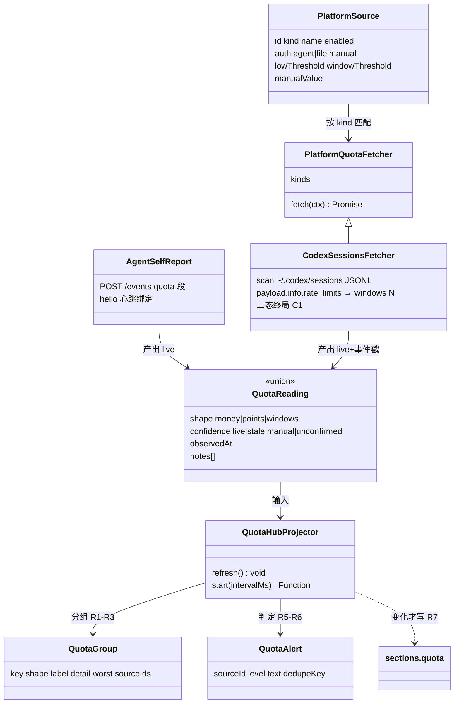
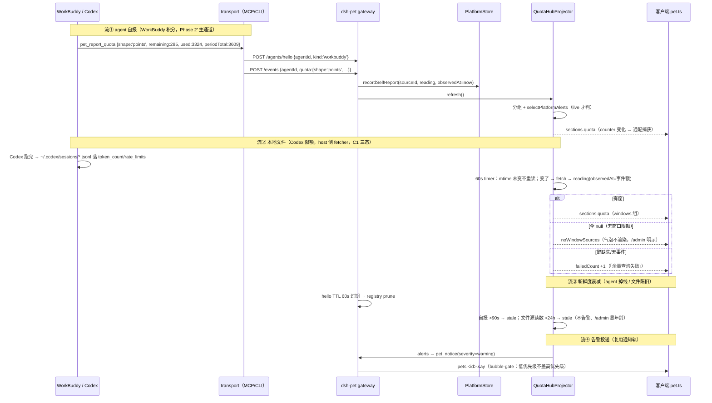
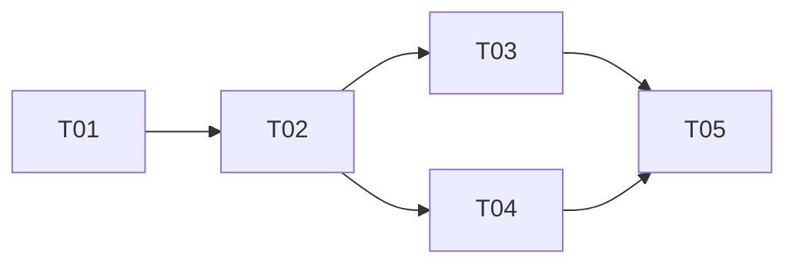

# 桌宠 = AI 额度一站式总仪表盘 —— 修订设计（docs/20，待用户确认）

| 项 | 值 |
|---|---|
| 提出人 | 用户（2026-10-19）：「桌宠还是应该专注于各个中转站的额度管理，对应到 agent 如 WorkBuddy 就是积分，如 Codex 就是限额」 |
| 设计 | 高见远（架构师） |
| 汇编/编排 | 齐活林（主理人） |
| 状态 | **设计完稿（含真机数据校准），等用户确认后才动代码** |
| 基线 | 包 HEAD `37b97d8`（Phase 1 agent 适配层资产全部在场且 QA 通过） |
| 阅读前提 | 自包含；配合 `docs/15-handover-2026-10-18.md`（代码地图）、`docs/19-agent-adapter-design.md`（上一轮通知轨设计，本版修正其命题）、`docs/07-architecture-host-agnostic.md`（架构裁决出处） |
| 修订记录 | 初稿 → 主理人用本机真实 Codex 数据实测发现三态缺口 → 架构师补 §4.5 真机校准（C1–C8 + 13 条 fixture） |

---

## 〇、TL;DR

1. **统一模型裁决：「实体层平行 + 读数层统一 + 聚合层 hub」三层结构。不泛化 `RelaySite`。** relays 实体原样不动；新增 `src/host/platforms/` 平台额度源子系统；两者都投影成统一的「额度读数（QuotaReading）」——这是 `src/host/balance/types.ts` 已奠定的 `shape: 'money' | 'windows'` 双形态路线的自然延伸，只扩两处：**新增 `points` 形态 + `windows` 从三固定槽泛化为 N 窗数组**。
2. **异构聚合铁律：不同 dimension 绝不相加。** 分组键 `shape:dimension`：money 按币种、points 按 kind（跨平台积分不可加）、windows 每源独立。动画由「可折算已用百分比的最大组」驱动；告警每源自阈值，`manual/stale/unconfirmed` 不告警。
3. **取数四级可信链**（均有调研证据）：① 官方 OpenAPI（WorkBuddy `GET /openapi/v2/credit` **已验证存在**：OAuth 2.1 + scope `user.credit.readable`，返回 `{total_capacity_size, total_capacity_used}`；太重 → Phase 3）② **agent 自报（MCP `pet_report_quota`）——WorkBuddy 积分 Phase 2' 主通道** ③ **本地文件（Codex `~/.codex/sessions/**/*.jsonl` 的 `rate_limits`）——本机已验证真实存在** ④ 手工兜底。每级带 `confidence + observedAt`；查不到即结构化失败，绝不伪造 0。
4. **Codex fetcher 已按本机真实数据校准**（§4.5）：`rate_limits` 在 `payload.info.rate_limits`、时间戳在顶层、**「rate_limits 全 null」是合法态（无窗口限额）而非失败**、全文件 CRLF、双 `resets` 形态兼容、按事件 timestamp 选最新读数。**「绝不伪造」红线的第一个考验就在这里：把「无窗口限额」演成「0% 已用」= 伪造一个不存在的宽限期。**
5. **Phase 1 资产去留：零移除、七项保留（其中五项扩展）、在场展示降级为诊断。** `sections.agents` 从「产品功能」降级为「自报新鲜度诊断列」——自报 quota 的可信度完全依赖 hello 心跳/在场状态，它是 quota 视图的隐藏列，删不得。
6. 气泡一行：`余 $12.34 · 🧰 285/3609 · 🤖 5h 78%`（≤3 段，紧急度优先；有告警换告警行）。tooltip/admin 分工；六档动画语义从「余额充足度」扩展为「余量充足度」，hub 数据优先、无数据回落既有 balance/relays 行为。
7. **Phase 2' = T01–T05 全部**（契约 → platforms+摄入+Codex fetcher → 呈现 → transport 扩展 → 验收），沙箱内全链路可验；**必须真机/官方资料的 4 项 + 需用户拍板 3 项**见 §九。
8. 零新第三方依赖（node 内置 only）；host 不 import `src/shared`；money.ts/redact.ts/余额单链接/agents 摄入轨全部不动——relays R-a~R-f 红线零触碰（hub 只**读** relays 查询结果）。

---

## 一、命题修正与设计立场

| 项 | docs/19（通知轨，已被用户否定） | docs/20（额度轨，本版） |
|---|---|---|
| 产品定位 | agent 在干什么 → 播报 | 用户所有 AI 余量 → 一屏总览 + 告警 |
| 「适配 agent」的含义 | 接入事件协议 | 把它的余量接进来显示与告警 |
| 主状态叶 | sections.agents / workStatus | **sections.quota（新）** |
| 与 relays 关系 | 无关 | relays 是 hub 的第一个 quota 家族（`relay`），platforms 是第二家族（`platform`） |
| 保留的资产 | — | transport 三件套 + 气泡门控 + 注册表 + 心跳（自报通道的地基） |

**为什么这个修复合乎产品层次**：用户只有一个桌宠、一条气泡。额度是**存量状态**（随时可看、需要告警），「在干什么」是**流量事件**（看过即抛）。把后者当主轨，桌宠就沦为一个播报器；把前者当主轨，桌宠才是仪表盘。通知轨降级为「额度轨的告警投递通道」——气泡门控、severity、coalesce 全部复用，不浪费。

---

## 二、Q1：统一额度源模型（核心裁决）

### 2.1 三个候选的真实改动面评估

| 方案 | 改动面（实测盘点） | 风险评估 | 结论 |
|---|---|---|---|
| **A. 泛化 `RelaySite`→`QuotaSource`（family: relay/platform）** | types.ts + store.ts + index.ts + routes.ts + relays-admin.ts（2423 行）+ shared/relays.ts + openapi（29 路径）+ 全部 relays 单测 ≈ **千行级重构 + 全量回归** | ① R-b（money.ts 唯一权威）/R-d 护栏全锚在 relays 实体上，泛化=给护栏开后门 ② 新实体是「nullable 字段汤」：url/quotaPerUnit/rateConfirmed 对 platform 源全部无意义 ③ 2423 行 admin 与多币种舰队聚合为一个统一实体后，「同口径分组」反而更难表达 | **否决** |
| **B. 完全平行：platforms 独立自建一套展示，不做 hub** | 小（只加 platforms） | **两个聚合口径**（relays 一个、platforms 一个）→ 气泡要拼两条链路，/admin 两块，用户视角仍不是「一个仪表盘」 | **否决**（不合新命题） |
| **C. 实体平行 + 读数统一 + 聚合 hub ★** | platforms 新目录 ~600 行 + hub ~150 行 + 新叶子 + openapi 增量；**relays 零改** | 统一发生在**结果层不是实体层**——与 R-a「balance 与 relays 并存不合流」同构哲学：源并存，合的是展示；每个子系统保留自己的领域护栏 | **推荐** |

### 2.2 三层结构

```
┌ 实体层（平行，各自持守护栏）──────────────┐
│ relays:      RelaySite + provider 注册表 + money/redact 权威（红线原样）
│ platforms:   PlatformSource + fetcher 注册表（新，~600 行）
│ balance:     上游单服务商（不动，不进 hub，见拍板项 P1）
├ 读数层（统一契约 QuotaReading）───────────┤
│ 三 shape：money（USD/CNY 余额）· points（积分）· windows（N 窗限额）
│ 每读数带 confidence(live/stale/manual/unconfirmed) + observedAt + notes[]
├ 聚合层（quota hub，纯函数 + 投影器）───────┤
│ 分组（shape:dimension）→ 告警判定 → sections.quota 叶子（变化才写）
└──────────────────────────────────────────┘
```

**为什么统一发生在读数层就够**：展示层（`src/host/balance/types.ts` 起）本来「不认识任何服务商，只认 shape」。实体层的不统一对用户不可见；读数层统一后，气泡/动画/admin 全部只面对一种数据。加一种新平台 = fetcher 一个文件 + 注册表一行 + 客户端注册表一行，**core 零改动**（与 agents 注册表同款纪律）。

### 2.3 读数契约扩展现状的精确落点（`src/host/balance/types.ts`，主理人已核实：68/95/130 行）

| 已有 | 本轮扩展 | 理由 |
|---|---|---|
| `shape: 'money'`（MoneyBalance: total/granted/toppedUp/fullBalance/tier） | **原样复用**（relays 舰队已折叠成它） | 上游已立「服务商自报业务事实、展示层不写死」 |
| `shape: 'windows'`（WindowsUsage：rolling/weekly/monthly 三槽 + *CapUsd + *ResetsAt） | **泛化为 N 窗数组**：`windows: Array<{key, minutes, label, usedPercent, resetsAt?}>` | Codex 的 `rate_limits` 是**不命名槽位**（primary/secondary），窗口数随套餐变化；硬套三槽必然丢窗或造假窗 |
| —— | **新增 `shape: 'points'`**：`{remaining, used, periodTotal?, unit}` | WorkBuddy 积分形态。**不做积分↔USD 换算**（无公开兑换率；硬造汇率违反 money.ts 唯一权威 + 「绝不伪造」） |
| —— | `confidence + observedAt + notes[]`（每读数必带） | relays 的 rateUnconfirmed/manual、Codex 的事件时间戳、自报的心跳新鲜度，全部收口成一套可信度语言 |

### 2.4 PlatformSource 实体（新，`src/host/platforms/types.ts`）

```ts
export interface PlatformSource {
  id: string;
  kind: string;                    // 'workbuddy' | 'codex' | …（自由字符串；host 不 import shared 注册表）
  name: string;                    // 用户可改显示名
  enabled: boolean;
  auth: { mode: 'agent'; agentId: string }   // 自报：绑定 hello 的 agentId（新鲜度来源）
      | { mode: 'file';  path?: string }      // 本地文件 fetcher（codex：缺省 ~/.codex/sessions）
      | { mode: 'manual' };                   // 纯手工兜底
  /** 阈值（缺省 = 不告警，绝不替用户猜；与 relays lowThreshold 同哲学） */
  lowThreshold?: number;           // points: 剩余下限 / money: 金额下限
  windowThreshold?: number;        // windows: 单窗已用%告警线
  /** manual 兜底快照（auth.mode='manual' 或自动源失败后的临时值） */
  manualValue?: { reading: QuotaReading; updatedAt: string };
  createdAt: string; updatedAt: string;
}
```

存储：`<DSH_HOME>/dsh-pet/platforms/sources.json`（照抄 `relays/store.ts` 的分文件 + 原子写 + 损坏改名 `.corrupt-*` 模式；**E4：不碰既有 relays 目录，新建平级目录**）。Phase 2' 明确砍掉：健康探针、模型缓存、历史快照/T11 burn rate（K6：防止 platforms 重演 relays 复杂度，列 Phase 3）。

---

## 三、Q2：异构度量聚合规则（hub）

### 3.1 数据契约（host → 叶子；host 自包含，与 shared/quota.ts 同构双声明）

```ts
// src/host/quota/types.ts（host 侧，不 import src/shared）
export type QuotaShape = 'money' | 'points' | 'windows';
export type QuotaConfidence = 'live' | 'stale' | 'manual' | 'unconfirmed';
export type QuotaFailReason = 'unsupported' | 'credential-missing' | 'fetch-error' | 'blocked' | 'rate-limited' | 'stale-source';
export type QuotaReading =
  | { ok: false; sourceId: string; family: 'relay' | 'platform'; kind: string; name: string;
      reason: QuotaFailReason; message?: string; observedAt: string }
  | { ok: true; sourceId: string; family: 'relay' | 'platform'; kind: string; name: string;
      confidence: QuotaConfidence; observedAt: string;
      notes?: string[];                                   // §4.5 增量：credits 未解析 / 跳槽 / 形状异常如实记录
      shape: 'money';   data: { currency: string; total: string; fullBalance?: string; unlimited?: boolean; spent?: string } }
    | { ok: true; ...same envelope...;
      shape: 'points';  data: { remaining: number; used: number; periodTotal?: number; unit: string } }
    | { ok: true; ...same envelope...;
      shape: 'windows'; data: Array<{ key: string; minutes: number; label: string; usedPercent: number; resetsAt?: string }>;
      tokenTotal?: number };                              // Codex total_token_usage 作展示补充，不参与聚合 */

/** hub 输出（sections.quota 的 data） */
export interface QuotaGroup {
  key: string;              // 'money:USD' | 'points:workbuddy' | 'windows:platform:<id>'
  shape: QuotaShape;
  label: string;            // 「美元余额」「WorkBuddy 积分」「Codex 限额」
  detail: string;           // 该组渲染原料：'$12.34' / '285/3609' / '5h 78%'
  worst?: { usedPercent?: number; sourceName: string };  // 组内最紧张者（紧急度排序用）
  sourceIds: string[];
}
export interface QuotaAlert {
  sourceId: string; kind: string; name: string;
  level: 'warning' | 'info';            // info = 「窗口即将重置」类安抚提示
  text: string;                          // 「积分将尽：剩 285 / 3609」
  dedupeKey: string;                     // 复用既有 coalesceKey 通道（不新建去重机制）
}
export interface QuotaHubData {
  groups: QuotaGroup[];        // 按紧急度降序（紧急度 = worst.usedPercent；不可折算排后）
  alerts: QuotaAlert[];        // host 判定（阈值 + 可信门槛），客户端只渲染
  /** §4.5 增量：②态「无窗口限额」的源（合法态，气泡不渲染，/admin 显示） */
  noWindowSources: Array<{ sourceId: string; kind: string; name: string }>;
  failedCount: number;         // ③态（真失败）源计数
  updatedAt: string;
}
```

### 3.2 聚合规则表（全部纯函数，可无网络单测）

| 规则 | 内容 | 出处/理由 |
|---|---|---|
| **R1 同键才合计** | money 同币种相加（沿用 `sumMoney` 字符串精度口径）；points 仅同 kind（`points:<kind>`）相加；windows 永不合计 | 币种/积分价值/窗口口径三维异构，相加即造假（aggregateBalances 多币种不混算的扩展） |
| **R2 组内取 worst** | money 组 worst=剩余/基准折算；points worst=remaining/periodTotal（**periodTotal 缺省 → 不折算、不参与动画**，不猜基准）；windows worst=usedPercent 最大窗（**已过期窗除外，见 C8**） | balancePercent「无基准不播」纪律的跨形态统一 |
| **R3 跨组不相加，只并列** | 气泡每组一段；组间按 worst.usedPercent 降序，≤3 段 | 气泡宽度 0.5×宠物宽物理约束 |
| **R4 动画驱动** | 客户端取 groups 中可折算者的最大 usedPercent → 既有 `balanceEventIndex` 六档动画机；**无可折算组 → 不播**（回落 balance/relays 老路径） | 复用全部上游动画资产 |
| **R5 告警判定在 host** | `selectPlatformAlerts()`（对称 `selectLowSites` 纯函数）：points remaining < lowThreshold；windows 任一窗 ≥ windowThreshold；**manual/stale/unconfirmed 一律不告警**；阈值缺省 = 不判；**无窗口限额源不告警**（无窗可告） | 「数据不可靠不评估」（OP-6）原样延伸 |
| **R6 窗口将重置豁免** | 触阈窗 `resetsAt` 在 1 小时内 → alert.level 降为 `info`（文案「5h 窗 78%，1.2 小时后重置」），只提示不告警 | 平台限特有节奏；快重置还狂报=骚扰 |
| **R7 变化才写** | 投影器签名机制照抄 presence.ts（K2 同款）：无变化不 writeSection | 防前端白渲染 |
| **R8 绝不伪造（三态终局）** | 终局从「失败/成功」两态改**三态**：① 有窗（`windows.length>0`）② **无窗口限额（诚实态：`ok:true, windows:[]`，≠ 失败，≠ 0%）** ③ 失败。客户端气泡：全空且 `failedCount>0` → 「余量查询失败」；全空且只有 `noWindowSources` → **不渲染额度段**（无额度可显示≠出错）；混合时只渲染有数据的组 | R-d/R-e 在真实数据上的第一个考验 |

### 3.3 自报/文件读数的新鲜度规则

- agent 经 `POST /events {quota}` 自报 → host 记 `sourceId → {reading, observedAt: now()}`（进程内缓存，与 agents registry 同哲学：**易失不落盘**——重报即恢复）。
- 刷新周期：自报值覆盖后 `hub.refresh`；另起 60s 低频 timer 做 staleness 扫描。
- staleness 阈值**按家族分两种**（§4.5 C4）：
  - **自报源**：`observedAt` 超过 **90s**（TTL 60s + 30s 宽限）未刷新 → `confidence='stale'`：/admin 显示「离线 · 最后自报 x 分钟前」，不参与告警。**agent 不在场=读数自然过期，天然自洽。**
  - **文件源**：读数年龄（= 事件 timestamp，非文件 mtime）超过 **24h** → `stale`；≤24h → `live`。/admin 显示「读数年龄 x」。

---

## 四、Q3：取数可信链（调研结论 + 真机校准）

### 4.1 调研结论表（WebSearch/WebFetch，2026-10-19；**未验证项如实标注**）

| 平台 | 出口形态 | 结论 | 证据 |
|---|---|---|---|
| **Codex 限额** | 本地 JSONL `~/.codex/sessions/YYYY/MM/DD/*.jsonl`，`token_count` 事件内嵌 `rate_limits`；另有 `total_token_usage.total_tokens` | **✅ 本机已 verified**（6 个真实会话文件，结构见 §4.5）；多个独立第三方工具同读此文件（codex-quota / macotron-plugin-codex-usage / whoburnedmore / Nightshift）。**⚠ 本机账号 rate_limits 全 null（无窗口限额），非 null 子字段形状未验证** | 见 §4.5 + 第三方工具 |
| **Codex MCP** | `~/.codex/config.toml` `[mcp_servers.<name>]` TOML 表；`codex mcp add` | **✅ 已 verified**：Codex CLI 支持 MCP（stdio + Streamable HTTP）。**注意配置形状是 TOML 不是 JSON**，文档片段必须单独给 | developers.openai.com/codex/extend/mcp |
| **WorkBuddy 积分** | 官方 OpenAPI `GET https://www.workbuddy.cn/openapi/v2/credit`，OAuth 2.1 授权码流，scope `user.credit.readable`，响应 `{total_capacity_size, total_capacity_used}`（整数；仅个人用户；不区分资源包类型） | **✅ 已 verified 存在**；⚠ 需用户注册开发者账号 + 建应用 + 走 OAuth——**对个人桌宠用户太重 → Phase 3 评估，默认走 agent 自报** | open.workbuddy.cn/en/docs/openapi |
| **WorkBuddy 本地出口** | 客户端 UI「设置>套餐与积分」可见；官网网页 | **❓ 未验证**：未找到本地文件/CLI 出口。不编造——主通道定为 agent 自报 | workbuddy.cn/docs/workbuddy/Usage |
| **WorkBuddy MCP** | 界面化 MCP 配置（社区文章佐证） | **⚠ 半验证**：官方 FAQ 未直接命中；真机 R2 确认 | cloud.tencent.com 开发者社区文章 |
| **Claude Code 限额** | —— | **❓ 未验证**，不在 Phase 2' 范围（注册表留行即止） | —— |

### 4.2 四级取数链与每级契约

| 级 | 通道 | confidence | Phase | 适用平台 | 设计要点 |
|---|---|---|---|---|---|
| **L1 官方 OpenAPI** | host fetcher 调 API | live | Phase 3 | workbuddy（OAuth 太重，默认不做）；未来其他有公开 API 的平台 | 凭证走三层来源（沿用 gateway/auth.ts 口径：env > 0600 文件 > DSH credentialRef）；**不做自动刷新 token**（超出桌宠职责，用户重授权） |
| **L2a agent 自报** | MCP `pet_report_quota` / CLI `--quota` / HTTP `/events {quota}` | live（≤90s 后 stale） | **Phase 2' 主通道** | **workbuddy**（无本地出口，平台自己最清楚）；一切愿意自报的 agent | 每次自报自带 hello 心跳（CLI/MCP 已有行为）；读数是**易失缓存**不落盘；host 零平台知识 |
| **L2b 本地文件** | host fetcher 周期性扫文件 | live + 文件源 staleness（读数年龄 >24h → stale） | **Phase 2'（Codex 第一个）** | **codex** | **60s 低频扫描 + mtime 未变不重读**（不轮询外部 API）；解析失败 = `fetch-error` 结构化失败，**绝不猜 0**；路径可配；契约见 §4.5 C1–C8 |
| **L3 手工兜底** | /admin 填写 | manual | Phase 2' | 全部 | 不参与告警、不被自动刷新覆盖（relays manualBalance 原样纪律）；带填写时间展示 |

**「平台自己最清楚」原则的落地形态**：自报通道不是「让 agent 帮忙查」，而是把平台既有的读数管道（Codex 落在本地文件、WorkBuddy 在服务端/agent 内存）接进来。**统一的是 QuotaReading 契约，不是取数方式**——这正是 Q1 三层架构的红利。

### 4.3 fetcher 注册表模式（与 RELAY_PROVIDERS 同款，K6 纪律）

```ts
// src/host/platforms/index.ts
export interface PlatformQuotaFetcher {
  kinds: string[];                    // ['codex']
  fetch(ctx: { path?: string }): Promise<QuotaReading-ish>;   // 只负责成功路径，失败 throw
}
export const PLATFORM_FETCHERS: PlatformQuotaFetcher[] = [codexSessionsFetcher];
export function matchPlatformFetcher(kind: string): PlatformQuotaFetcher | undefined;
```

### 4.4 MCP tool / CLI 扩展（agent 自报的入口，改动各 ~40 行）

```
tools/mcp-server.mjs +tool:
  pet_report_quota({ shape:'points', data:{remaining, used, periodTotal?, unit?},
                     | shape:'windows', data:[{key,minutes,label,usedPercent,resetsAt?}],
                     | shape:'money',   data:{currency,total,fullBalance?} })
    → POST /events {agentId, kind, quota:{shape,data}}（自带 hello）
tools/dsh-pet-notify.mjs +flag:
  --quota-shape points --remaining 285 --used 3324 --period-total 3609
  --quota-shape windows --window-json '[{"key":"primary","minutes":300,"usedPercent":78}]'
```

`/events` 的 `quota` 段与 notice/status **并列**（ingest.ts +15 行：结构校验 → platformStore.recordSelfReport() → hub.refresh()）。**不开新端点**（R-c 精神：动作端点直返例外不得扩散；/events 本就是摄入主轨）。

### 4.5 真实数据校准（2026-10-19 主理人实测 + 架构师复验）

**实测环境**：`C:\Users\admin\.codex\sessions\`，6 个会话文件（3 个含 `token_count` 事件）。

#### 4.5.1 实测事实（已复验，直接作为设计不变量）

| # | 事实 | 证据 |
|---|---|---|
| F1 | `rate_limits` 位于 **`payload.info.rate_limits`**（`type:"event_msg"` → `payload.type:"token_count"` → `payload.info.rate_limits`），**不在 payload 顶层** | 真实事件原文 |
| F2 | 时间戳在**顶层 `timestamp`**（ISO8601，如 `2026-10-16T12:14:51.451Z`）；另有顶层 `ordinal`（fetcher 忽略） | 同上 |
| F3 | `rate_limits` 全 null 是**合法状态**：`{"limit_id":"codex","limit_name":null,"primary":null,"secondary":null,"credits":null,"individual_limit":null,"spend_control_reached":null,"plan_type":null,"rate_limit_reached_type":null}` | 6 文件全部如此（该账号无窗口限额/Codex 未上报） |
| F4 | 全文件 CRLF（每行都有 `\r`）：CR 数 = 行数（784/784、773/773、64/64、15/15、10/10、10/10） | grep 复验 |
| F5 | `total_token_usage.total_tokens` 可用（展示补充） | 真实事件（19170 / 27491 等） |
| F6 | 目录布局 `sessions/YYYY/MM/DD/rollout-<时间>-<uuid>.jsonl`，同秒会话有 `_<uuid2>` 续跑文件 | 文件清单 |
| F7 | 主/次窗非 null 子字段形状**本机无法验证**（`used_percent`/`window_minutes`/`resets_*` 出现 0 次）——子字段名来自第三方工具源码佐证 | 见 4.5.3 |

真实事件原文（节选，已按 §4.5 C5 要求 trim 后解析）：
```json
{"timestamp":"2026-10-08T06:17:14.512Z","ordinal":22,"type":"event_msg",
 "payload":{"type":"token_count","info":{
   "total_token_usage":{"input_tokens":27121,"cached_input_tokens":3840,"cache_write_input_tokens":0,"output_tokens":370,"reasoning_output_tokens":236,"total_tokens":27491},
   "last_token_usage":{...},
   "model_context_window":996147,
   "rate_limits":{"limit_id":"codex","limit_name":null,"primary":null,"secondary":null,"credits":null,"individual_limit":null,"spend_control_reached":null,"plan_type":null,"rate_limit_reached_type":null}}}}
```

#### 4.5.2 设计约束（F1–F7 → fetcher 硬契约）

| # | 约束 | 落点 |
|---|---|---|
| C1 | **三态终局契约**（fetcher 输出只有这三种，无第四种）：① `ok:true, windows.length>0` ② **`ok:true, windows:[]`（rate_limits 存在但 primary/secondary 全 null = 无窗口限额，detail 展示「无窗口限额」）** ③ `ok:false, reason`（真失败）。**绝不允许把 ② 落成 ③，更绝不允许产出 0% 假窗** | codex-sessions.ts 返回值 + hub 分组 + 客户端文案三处联动 |
| C2 | **读取路径钉死 `payload.info.rate_limits`**；单测放一个 payload 顶层的 `rate_limits` 诱饵验证隔离（F1 反过来证明：写错路径会读到 undefined 而误判「无窗」——那正是 ②被误落成 ③ 的路径） | fetcher + A3-2 |
| C3 | **只取 primary/secondary 两个槽**，槽内只认 `used_percent`（有限数字）、`window_minutes`（有限正数）、`resets_at`（epoch 秒，优先）/`resets_in_seconds`（相对秒，回退：`resetsAt = 事件 timestamp + seconds`）。其余字段（limit_id/limit_name/credits/individual_limit/spend_control_reached/plan_type/rate_limit_reached_type/未知键）**宽松忽略**；`credits`/`spend_control_reached` 非 null 时写入 `reading.notes[]`，/admin 如实展示——**不静默丢，也不硬猜** | fetcher + QuotaReading.notes |
| C4 | **observedAt = 顶层事件 `timestamp`**（不是文件 mtime）。mtime 只作「未变不重读」的缓存键。staleness 按家族分两种：自报源 >90s → stale；**文件源读数年龄 >24h → stale**；≤24h → live | fetcher + hub staleness 扫描 + §3.3 |
| C5 | 行解析：`split(/\r?\n/)` 后**逐行 `trim()` 再 `JSON.parse`**；空行/空白行/坏行静默跳过（CRLF 是真实常态，不 trim 会让 `JSON.parse` 把整行判坏 → 全部误落 fetch-error，即 F4 的真实坑） | fetcher + A3-4 |
| C6 | 文件选择不依赖单一名排序：按 `(YYYY/MM/DD 目录日期, 文件名)` 降序取候选 N=5，逐个解析，**最终读数 = 候选中「嵌入 timestamp 最大」的那条**（F6：续跑文件与父文件的先后不保证与 mtime/名序一致；timestamp 是唯一可信序） | fetcher + A3-9 |
| C7 | 槽级优雅降级：单个槽形状坏（used_percent 非数字等）→ 跳过该槽 + notes 记录，**不连坐整条读数**；全部槽都坏 → ③fetch-error。`rate_limits` 键**完全缺失**（版本形状漂移，F7 的风险形态）→ ③fetch-error 且 message 写明「rate_limits 键缺失（形状漂移?）」——**注意：键缺失 ≠ 键存在全 null，两者终局不同** | fetcher + A3-11/12/13 |
| C8 | 窗口已过期（`resetsAt < now`）不是坏事是事实：窗口按重置时间归零，客户端 `effectivePercent = 0` 且文案「已重置」；host 告警判定对已过期窗跳过（R5/R6 家族规则）。**这不是伪造**——是以读数自带的 resetsAt 推出来的，/admin 同时显示原始 usedPercent 供核对 | 客户端 quota-face + selectPlatformAlerts + A3-7 |

#### 4.5.3 三条已知未知（防工程师当成已证事实）

1. primary/secondary 非 null 时的子字段名（`used_percent`/`window_minutes`/`resets_at`/`resets_in_seconds`）：第三方工具源码佐证（codex-quota/macotron-plugin/Nightshift），**本机 0 次出现**；R1 真机校准目标就是抓一份非 null 样本贴进 fixture。
2. `resets_at`（epoch 秒，Nightshift 引文）与 `resets_in_seconds`（相对秒，macotron-plugin 引文）两种形态跨版本并存——C3 双形态兼容，哪个是当前版未验证。
3. `plan_type`/`credits` 非 null 时的语义（套餐名？积分余额？）：未验证，Phase 2' 只记 notes 不解析；若 R1 抓到非 null 样本再议是否需要新 shape。

---

## 五、Q4：Phase 1 资产去留表（零移除）

| 资产（commit `5ec8128`/`37b97d8`） | 判断 | 理由 |
|---|---|---|
| `POST /agents/hello` + AgentRegistry（TTL 心跳） | **保留** | 自报 quota 的身份与新鲜度地基：agentId 绑定 sourceId；掉线=读数 stale。删它=自报通道塌 |
| `POST /events`（notice/status/task） | **保留+扩展**（+quota 段） | 摄入主轨；quota 只是又一个事件类型 |
| `GET /agents` `/capabilities` SSE `/state/stream` | 保留 | 诊断与自述；零成本 |
| `src/shared/agents.ts` 注册表 | **保留+扩展**（+`quotaShape?` 提示字段：该 kind 的额度形态，供 /admin 表单与文档引导） | 展示元数据唯一事实源；数据不是代码的纪律延续 |
| `gateway/presence.ts` + `sections.agents` | **降级：产品功能 → 接入诊断列** | ① 自报可信度依赖 hello/在场（quota 视图的隐藏列：/admin 显示「WB · 在线 · 3 分钟前自报」）② pet.ts 的 tooltip 主摘要改读 sections.quota；agents 摘要退居「多少 agent 在线」的次要行 ③ **不移除**：删除省几 KB，丢的是「为什么这个源不报了」的诊断能力；且与 E3「测试只增不减」兼容 |
| `bubble-gate.ts`（severity 门控） | **保留** | 告警投递直接复用：host 产 QuotaAlert → pet_notice(warning/error) → 同一 gate。1500ms 低不压高规则正好防「积分告警被 info 气泡盖掉」 |
| MCP server（pet_status/pet_notice/pet_agents） | **保留+扩展**（+pet_report_quota） | WorkBuddy 自报主通道 |
| CLI `dsh-pet-notify` | **保留+扩展**（+--quota-* flags、自报带心跳） | 无 MCP 的 agent/脚本自报入口 |
| HTTP curl 轨 / tools/pet-gateway-client.mjs（发现逻辑） | 保留 | 自报的裸通道；CLI/MCP 共用发现层 |
| sections.workStatus 六档动画 | **保留** | 语义扩展为「余量充足度」驱动源之一（hub 最差者）；原有 workStatus 触发不变 |
| relays 全套（R-a~R-f 红线范围） | **不动**（hub 只读其查询结果） | 红线 |
| /admin「接入的 agent」区块 | **改造为「平台额度」区块** | 新命题下用户要管的是额度源；原区块诊断信息并入 |
| sections.balance（上游单服务商） | **不进 hub**（默认；见拍板项 P1） | R-a 争议零化 |

---

## 六、Q5：呈现设计

### 6.1 气泡一行「AI 余量」总览

```
常态（≤3 段，紧急度降序）:  余 $12.34 · 🧰 285/3609 · 🤖 5h 78%
告警（有 alert 时替换首段）: ⚠ 🧰 积分将尽：剩 285 / 3609
无窗口限额（仅 tooltip/admin）: Codex 无窗口限额
已重置（C8，仅 tooltip/admin）: 5h 窗已重置
全失败（R8）:              余量查询失败（2 源不可用）
```

生成规则（`src/shared/quota-face.ts` 纯函数，与 balanceBubbleView/relaysBubbleRows 同款）：
1. 每 group 出 `{emoji, label, detail}`（emoji/name 由客户端注册表 agentMeta(kind) 富化——host 只出原始 kind）；
2. 段数 >3 时按 `worst.usedPercent` 降序取前 3，其余折叠为「+N」；**不可折算组（无基准点）排后**；
3. `alerts` 非空 → 首段换最高 level 的 alert 全文；info 级（窗口将重置）不占首段、进 tooltip；
4. windows 段取组内最紧迫窗（`<label> <pct>%`，有重置时间进 tooltip）；
5. **全空且只有 noWindowSources → 不渲染额度段**（无额度可显示≠出错，R8）。

### 6.2 tooltip / /admin 分工

| 位置 | 内容 | 理由 |
|---|---|---|
| 桌宠 tooltip（hover 常驻一行） | 同气泡总览 + 年龄标记（自报源「WB 3 分钟前自报」/文件源「读数年龄 x」）+ info 级提示 | 常驻但零交互；年龄是可信度的一部分 |
| /admin「平台额度」区块 | 源 CRUD（kind/agentId 或文件路径/manual 值/阈值）+ 每源完整读数（全窗口 + resetsAt + confidence + observedAt + notes）+ MCP 配置片段复制区 | 管理入口；运行期 fetch `/platforms`（**用户数据零嵌入**纪律延续：SSR 只嵌静态 fetcher kinds） |
| /admin「中转站」区块 | 原样不动 | relays 红线 |
| 六档动画 | R4 规则；hub 有可折算组时 **hub 优先覆盖** balance/relays 的老驱动（客户端一处 if），hub 无数据回落老路径 | 一个桌面宠一个动画槽 |

### 6.3 告警文案（host 判定 → 客户端渲染）

| 源 | 触发 | level | 文案 |
|---|---|---|---|
| points | remaining < lowThreshold（live） | warning | `🧰 积分将尽：剩 285 / 3609` |
| windows | 单窗 ≥ windowThreshold 且 >1h 才重置 | warning | `🤖 5h 窗已用 92%` |
| windows | 单窗 ≥ windowThreshold 但 <1h 重置 | info | `🤖 5h 窗 78%，1.2 小时后重置` |
| windows | 已过期窗（C8） | — | **不告警**（跳过） |
| money | 同 relays selectLowSites 规则 | warning | `余额 $2.10 低于 $5.00` |
| 无窗口限额源 | —— | — | **不告警**（无窗可告） |
| 任何 | confidence≠live / manual / stale | — | **不告警**（只在 admin 显示状态） |

---

## 七、Mermaid





---

## 八、任务分解（5 个，依赖有序）

**Required Packages（零新增三方依赖）**：node 内置 only（node:crypto / node:fs / node:os / node:test / fetch）。

| ID | 名称 | Source Files | 依赖 | 优先级 |
|---|---|---|---|---|
| T01 | 读数契约与聚合纯函数 | `src/host/quota/types.ts` ★、`src/host/quota/hub.ts` ★（分组+alerts 纯函数）、`src/host/quota/hub.test.ts` ★、`src/shared/quota.ts` ★（readQuota/quotaBubbleLine/紧急度）、`src/shared/quota.test.ts` ★ | 无 | P0 |
| T02 | platforms 子系统 + 摄入扩展 + Codex fetcher | `src/host/platforms/types.ts` ★、`store.ts` ★、`index.ts` ★（fetcher 注册表+CRUD+自报缓存）、`fetchers/codex-sessions.ts` ★、`fetchers/codex-sessions.test.ts` ★、`tools/fixtures/codex-sessions/` ★（A3 全部 fixture）、`store.test.ts` ★、`src/host/gateway/ingest.ts`（+quota 段）、`ingest.test.ts`（quota 用例） | T01 | P0 |
| T03 | hub 投影 + 呈现层 | `src/host/quota/projector.ts` ★、`projector.test.ts` ★、`src/host/index.ts`（投影器/timer 接线）、`src/client/pet.ts`（sections.quota 分支+动画优先+tooltip 摘要改源）、`src/shared/quota-face.ts` ★、`quota-face.test.ts` ★、`src/standalone/admin-page.ts`（平台额度区块）、`admin-page.test.ts` | T02 | P0 |
| T04 | transport 自报扩展 | `tools/mcp-server.mjs`（+pet_report_quota）、`tools/dsh-pet-notify.mjs`（+--quota-*）、`src/standalone/mcp-server.test.ts`、`src/standalone/agent-cli.test.ts` | T02（与 T03 可并行） | P0 |
| T05 | 验收与契约文档 | `scripts/dev/verify-quota.ts` ★、`scripts/dev/mock-server.mjs`（+sections.quota 叶）、`openapi.yaml`（QuotaLeaf + PollState.quota + EventsInput.quota）、`API.md`（额度 hub 契约+取数链）、`README.md`（总览入口+Codex JSONL 读法说明） | T03, T04 | P1 |



**Shared Knowledge（跨任务约定，实现者必读）**：

- host 侧一律自包含（`src/host/quota/*`、`src/host/platforms/*` 不 import `src/shared`；客户端 `src/shared/quota.ts` 同构双声明，DSH 单文件加载约束）。
- relays 的 R-a~R-f 全部原样：money.ts 权威、redact 出口、单链接、动作端点例外不扩散——**platforms 不碰 relays 一行**；hub 只调 relays 既有查询结果。
- 绝不伪造：points 无 periodTotal 不折算百分比；Codex **键缺失≠全 null**（终局不同，C1/C7）；全源失败 groups 空 + failedCount 如实呈现，不渲染 0 余量。
- confidence 三门槛（不告警、不折算、显年龄）是跨形态统一语言；observedAt 必带；staleness 阈值按家族分开（自报 90s / 文件 24h）。
- 自报值是易失内存态，不落盘（与 agents registry 同哲学）；persisted 的只有 PlatformSource 配置与 manual 快照。
- sections.quota 新叶纯新增；客户端 `sections.quota?.counter` 可选读；takeChanged 通配自动覆盖。
- E1–E4 原样：提交复跑门禁；目录导入写 `./xxx/index`；测试只增不减；不碰 userRoot/relays 既有目录（platforms 新建平级目录）。
- openapi 双向对齐：任何新 schema/路径与实现同轮（check:openapi）。
- 沙箱约束延续：不起 GUI；真服务 curl 归需真机；**Codex fetcher 用 fixture 注入（真实目录只读参考，绝不依赖用户数据）**。

---

## 九、验收标准 + 风险 + 拍板项

### 9.1 验收（沙箱内可验）

| # | 项 | 手段 | 判定 |
|---|---|---|---|
| A1 | 五道门禁 | typecheck/lint/test/check:openapi/bundle | 全绿；# tests 只增不减（基线 1133） |
| A2 | 聚合纯函数 | hub.test.ts | 同币种合并；`money:USD`≠`money:CNY` 不相加；**`points:workbuddy`≠`points:codex` 不相加**；windows 取最紧迫窗；无数据 → groups 空；alert 判定：manual/stale/unconfirmed 不告警；<1h 重置降 info；已过期窗不告警 |
| A3 | Codex fetcher | `codex-sessions.test.ts` + `tools/fixtures/codex-sessions/` | 见下表 13 条 |
| A4 | 自报摄入 | ingest.test.ts | points/windows/money 三形状入 store + observedAt；坏形状 → 400；无 hello 记录的自报仍收（agentId 自声明，落地即建在场条目） |
| A5 | 客户端 | quota.test.ts + quota-face.test.ts | takeChanged 捕获 sections.quota；readQuota 坏形状→null；气泡 ≤3 段+超长折叠；告警替换首段；可折算组选最大百分比喂 balanceEventIndex；无组不播；**C8「已重置 → effectivePercent 0」** |
| A6 | MCP/CLI | mcp-server.test.ts / agent-cli.test.ts + 冒烟 | pet_report_quota 构造的 /events body 正确；`printf … \| node tools/mcp-server.mjs --base …` 与 `node tools/dsh-pet-notify.mjs --quota-shape points --remaining … --base …` exit 0 |
| A7 | 全链路 | `pnpm verify:quota`（新脚本，照 verify:relays 模式） | mock /state（3 异构组构造）→ fetchState → readQuota → quotaBubbleLine → renderToStaticMarkup → `EVIDENCE OK` |
| A8 | /admin | admin-page.test.ts | 「平台额度」区块存在 + fetch('/platforms') + 零用户数据嵌入（SSR 只嵌静态 kinds）；「中转站管理」标题断言不破 |
| A9 | openapi | check:openapi | QuotaLeaf/PollState.quota/EventsInput.quota 双向对齐 |

**A3 十三条 fixture**（§4.5 增量，全部落 `tools/fixtures/codex-sessions/`）：

| # | fixture | 断言 |
|---|---|---|
| A3-1 | **all-null（真机事件原文照抄，CRLF）** | `ok:true`、`windows.length===0`、detail 含「无窗口限额」、**不是 ok:false**、notes 空 |
| A3-2 | 路径隔离：真实事件 + 一个 payload 顶层 `rate_limits` 诱饵（带 used_percent 99） | 解析到的是 `payload.info.rate_limits`；顶层诱饵不影响结果（C2） |
| A3-3 | observedAt：事件 timestamp `2026-10-16T12:14:51.451Z` | `reading.observedAt === 该 ISO`；与文件 mtime 无关（fixture 的 mtime 是「现在」也必须是事件戳）（C4） |
| A3-4 | CRLF+坏行：3 行好事件 + 1 行 `{broken` + 1 空行 + 1 行纯空格，全 CRLF | 坏/空/空白行跳过；3 个好事件都被解析；不抛（C5） |
| A3-5 | primary-only：`{primary:{used_percent:42.5,window_minutes:300,resets_in_seconds:7800},secondary:null}` @ 事件 ts T | 1 个窗；`label==='5h'`；`usedPercent===42.5`；`resetsAt === T+7800s`（C3 相对秒回退） |
| A3-6 | resets_at 绝对秒：`{primary:{used_percent:61,window_minutes:10080,resets_at:1780000000}}` | `resetsAt === ISO(1780000000)`；label==='7 天'（C3 绝对秒优先） |
| A3-7 | resetPassed：窗 resetsAt 在过去 | host 告警判定跳过该窗；客户端 effectivePercent===0 且文案「已重置」；/admin 显示原始 42.5（C8） |
| A3-8 | mtime 缓存：连续两次 fetch（文件未动） | 第二次不重读（适配器注入计数器可验）；touch mtime 后第三次重读 |
| A3-9 | 文件选择：3 个日期目录 + 同日父文件与 `_` 续跑文件，各嵌不同 timestamp | 选中「嵌入 timestamp 最大」者；不是文件名最大者、也不是 mtime 最大者（C6/F6） |
| A3-10 | notes：`credits:{balance:500}, spend_control_reached:true` + primary 正常 | `notes` 含两条记录；ok:true；primary 正常成窗；**不猜 balance 显示**（C3） |
| A3-11 | 无 token_count 事件（只有 session_meta 等） | `ok:false, reason:'fetch-error'`，message 如实「未找到 token_count 事件」 |
| A3-12 | token_count 存在但**全部缺 `rate_limits` 键**（旧版形状） | `ok:false, reason:'fetch-error'`，message「rate_limits 键缺失（形状漂移?）」——**≠A3-1 的空窗**（C7） |
| A3-13 | 槽级降级：primary 的 used_percent 是字符串 "abc"、secondary 正常 | secondary 成窗；notes 记 primary 跳过；**不整条失败**（C7） |

### 9.2 需真机 / 需官方资料（不许沙箱冒充血）

| # | 项 | 手段 |
|---|---|---|
| R1 | Codex 非 null 窗口样本（本机账号全 null，无法自证） | 用户在有窗口限额的账号上跑一次 Codex，贴一份 `primary/secondary` 非 null 的 `token_count` 行进 fixture |
| R2 | WorkBuddy MCP 配置方式（半验证） | 用户机器配一次 tools/mcp-server.mjs → pet_report_quota 真调 |
| R3 | 气泡/tooltip 多源异构的排版观感（宽度/截断） | 用户桌面看一眼 |
| R4 | Codex fetcher 在真实目录树的扫描性能与跨月边界 | 真机跑 60s 扫描计时（R1 后） |

### 9.3 风险与回滚

| # | 风险 | 触发 | 缓解 | 回滚 |
|---|---|---|---|---|
| K1 | sections.quota 新键破严格断言 | state.test.ts 键集 | 纯新增+同轮加例+客户端可选读 | 删 SectionName 一行 + 删 quota/projector，agents/relays 全不受影响 |
| K2 | 动画三方竞争（balance/relays/quota 都驱动） | 三叶同时写 | hub 有可折算组时优先覆盖，无则回落（客户端一处 if）；单测覆盖 | 删 pet.ts 的 quota apply 一行即恢复旧行为 |
| K3 | Codex JSONL 形状漂移 | 版本升级 | **路径钉 `payload.info.rate_limits` + 槽级宽松 + 键缺失与全 null 区分 + CRLF trim + 双 resets 兼容**（§4.5 C1–C8）；fetch-error 不猜；R1 真机校准 | 删 fetcher 一个文件 + 注册表一行 |
| K4 | 自报读数不可审计（agent 可报假数） | 恶意/故障 agent | 产品选择写明：读数只影响自家展示、不涉权限与转发；校正路径=manual/官方 API；/admin 显示「自报」标识 | auth.mode 改 'manual'（源不停数据通路） |
| K5 | platforms 重演 relays 复杂度 | 需求蔓延 | Phase 2' 明确砍：健康探针/模型缓存/历史快照；砍到「能读能报能告警」 | 逐步砍 fetcher 与字段 |
| K6 | OAuth 拉起 WorkBuddy OpenAPI 成本爆炸 | Phase 3 诱惑 | 默认 agent 自报；OAuth 不进 Phase 2' | 注册表 transports 字段已有留形 |
| K7 | 命题再次翻新 | 用户复盘 | 全部新增件（sections.quota/platforms/quota-face）是**纯附加**，砍掉不回退任何既有功能；通知轨资产保留为告警投递层 | 见 K1 |
| K8 | 沙箱无 ~/.codex 数据可用 | fetcher 真机依赖 | fetcher 路径参数化 + fixture 单测全覆盖（13 条） | —— |

### 9.4 需用户拍板（默认值已给，不阻塞 Phase 2'）

| # | 问题 | 默认（推荐） | 理由 |
|---|---|---|---|
| P1 | hub 是否纳入**上游 sections.balance 单服务商**（DSH 账号余额）？ | **默认不纳入** | R-a「balance 与 relays 并存不合流」的争议零化；若要纳入=新加一个 reader（0.5 天），先问用户 |
| P2 | agent 自报读数不可审计——接受吗？ | **接受**（个人自用，自家展示） | 与「桌宠信 agent 自报」的产品选择一致；有 manual/官方校正路径 |
| P3 | WorkBuddy OAuth OpenAPI 是否 Phase 3 做？ | **默认不做**（agent 自报够用；OAuth 需用户自建 app） | 接入成本违背「低」的初衷；留评估位 |

### 9.5 不建议做（防范围膨胀）

| # | 项 | 理由 |
|---|---|---|
| 1 | 实体级泛化 RelaySite→QuotaSource | Q1 已论证：改动面千行级+红线下高危+nullable 汤，收益在展示层不在实体层 |
| 2 | 积分↔美元换算 | 无公开兑换率；money.ts 唯一权威；硬造=伪造 |
| 3 | 跨平台积分求和 / 跨源窗口百分比合并 | 三维异构，相加即造假 |
| 4 | windows 硬套 rolling/weekly/monthly 三槽 | Codex 槽位不命名+窗口数随套餐变，硬套必丢窗/造假 |
| 5 | hub 纳入上游 balance（P1 未拍板前） | R-a 争议 |
| 6 | platforms 健康探针/模型矩阵/T11 快照 | Phase 2' 砍；先证明主轨成立 |
| 7 | WorkBuddy OAuth flow 全套 | Phase 3 评估；个人用户太重 |
| 8 | 移除 agents 在场资产（presence/sections.agents/tooltip 摘要） | 降级为诊断列而非移除：自报新鲜度依赖它 |
| 9 | agent 自报强制鉴权 | 默认全关延续；hello 被挡=接入链断 |
| 10 | 每分钟轮询外部 API | Codex 走本地文件 mtime；agent 自报随活动自然流动；OAuth/API 留 Phase 3 |
| 11 | Codex JSONL 全天全历史扫描 | 只取候选 N=5 中「嵌入 timestamp 最大」的一条（C6） |
| 12 | 桌宠反向操作 agent（按余量暂停/切换模型） | Non-Goal 延续：桌宠只观察+告警 |

---

## 十、附录：主理人实测证据（可复跑）

```bash
# 1) 真实 Codex 会话数据存在性与文件布局
ls "$USERPROFILE/.codex/sessions"                    # → sessions/2026/10/08、2026/10/16 …
find "$USERPROFILE/.codex/sessions" -name "*.jsonl" | wc -l   # → 6

# 2) rate_limits 全 null（F3）
grep -o '"primary":{"[^}]*}' $(find "$USERPROFILE/.codex/sessions" -name "*.jsonl") | sort -u   # → 无输出（全 null）

# 3) CRLF（F4）：每个文件 CR 数 = 行数
for f in $(find "$USERPROFILE/.codex/sessions" -name "*.jsonl"); do echo "$(grep -c $'\r' "$f") / $(wc -l < "$f")"; done

# 4) 真实事件信封（F1/F2/F5）
grep -m1 "token_count" "$(find "$USERPROFILE/.codex/sessions" -name '*.jsonl' | head -1)"
```

> 上游 shape 定义位置核实：`src/host/balance/types.ts`（68 行 `windows` 注释、95 行 `money` 注释、130–131 行 `shape: 'windows' | 'money'` 联合）——docs/19 曾写的 `balance/types.ts` 路径不存在，本版已修正。
